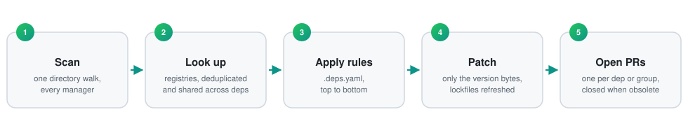

<p align="center">
  
</p>
<h1 align="center">deps</h1>
<p align="center">
  <b>Your dependency bot, in one static binary.</b><br>
  Renovate-style pull requests. No Node runtime, no hosted app, no reformatted files.
</p>
<p align="center">
  <a href="https://git.jakob-moeller.cloud/jakobmoellerdev/deps/actions?workflow=ci.yml"></a>
  <a href="https://git.jakob-moeller.cloud/jakobmoellerdev/deps/releases"></a>
  <a href="LICENSE"></a>
</p>

deps finds the dependencies in a repository, looks up newer versions, and opens branches and pull requests for them on GitHub, Gitea, Forgejo and GitLab — one per dependency by default, or grouped, split and limited however your rules say. It rewrites only the version bytes, so formatting and comments stay as they are.

---

<p align="center">
  <a href="docs/reference/managers.md#gomod" title="Go"></a>&nbsp;&nbsp;
  <a href="docs/reference/managers.md#npm" title="Node.js: npm, pnpm, Yarn, Bun"></a>&nbsp;&nbsp;
  <a href="docs/reference/managers.md#deno" title="Deno"></a>&nbsp;&nbsp;
  <a href="docs/reference/managers.md#pep621" title="Python: pip, uv, Poetry, pdm, Pipenv, conda"></a>&nbsp;&nbsp;
  <a href="docs/reference/managers.md#bundler" title="Ruby: Bundler"></a>&nbsp;&nbsp;
  <a href="docs/reference/managers.md#cargo" title="Rust: Cargo"></a>&nbsp;&nbsp;
  <a href="docs/reference/managers.md#swift" title="Swift: SwiftPM, Mint, XcodeGen"></a>&nbsp;&nbsp;
  <a href="docs/reference/managers.md#cocoapods" title="CocoaPods"></a>&nbsp;&nbsp;
  <a href="docs/reference/managers.md#composer" title="PHP: Composer"></a>&nbsp;&nbsp;
  <a href="docs/reference/managers.md#nuget" title=".NET: NuGet, Cake, Paket"></a>&nbsp;&nbsp;
  <a href="docs/reference/managers.md#maven" title="JVM: Maven"></a>&nbsp;&nbsp;
  <a href="docs/reference/managers.md#gradle" title="JVM: Gradle"></a>&nbsp;&nbsp;
  <a href="docs/reference/managers.md#sbt" title="Scala: sbt, scalafmt"></a>&nbsp;&nbsp;
  <a href="docs/reference/managers.md#leiningen" title="Clojure: Leiningen, Clojure CLI, Babashka"></a>&nbsp;&nbsp;
  <a href="docs/reference/managers.md#pub" title="Dart and Flutter: pub, FVM"></a>&nbsp;&nbsp;
  <a href="docs/reference/managers.md#mix" title="Elixir: Mix"></a>&nbsp;&nbsp;
  <a href="docs/reference/managers.md#gleam" title="Gleam"></a>&nbsp;&nbsp;
  <a href="docs/reference/managers.md#elm" title="Elm"></a>&nbsp;&nbsp;
  <a href="docs/reference/managers.md#julia" title="Julia"></a>&nbsp;&nbsp;
  <a href="docs/reference/managers.md#vcpkg" title="C and C++: vcpkg"></a>&nbsp;&nbsp;
  <a href="docs/reference/managers.md#bazel-module" title="Bazel"></a>&nbsp;&nbsp;
  <a href="docs/reference/managers.md#nix" title="Nix flakes"></a>
</p>
<p align="center">
  <a href="docs/reference/managers.md#github-actions" title="GitHub, Gitea and Forgejo Actions"></a>&nbsp;&nbsp;
  <a href="docs/reference/managers.md#gitlabci" title="GitLab CI"></a>&nbsp;&nbsp;
  <a href="docs/reference/managers.md#circleci" title="Other CI: CircleCI, Azure, Bitbucket, Drone, Woodpecker, Travis, Buildkite, Bitrise, Tekton"></a>&nbsp;&nbsp;
  <a href="docs/reference/managers.md#jenkins" title="Jenkins plugins"></a>&nbsp;&nbsp;
  <a href="docs/reference/managers.md#docker" title="Containers: Dockerfiles, Compose, Quadlet, Dev Containers"></a>&nbsp;&nbsp;
  <a href="docs/reference/managers.md#kubernetes" title="Kubernetes, Kustomize, Crossplane, Glasskube"></a>&nbsp;&nbsp;
  <a href="docs/reference/managers.md#helm" title="Helm charts, helmfiles, Fleet, Helmsman"></a>&nbsp;&nbsp;
  <a href="docs/reference/managers.md#terraform" title="Terraform and Terragrunt"></a>&nbsp;&nbsp;
  <a href="docs/reference/managers.md#terraform" title="OpenTofu"></a>&nbsp;&nbsp;
  <a href="docs/reference/managers.md#ansible" title="Ansible roles, collections and task images"></a>&nbsp;&nbsp;
  <a href="docs/reference/managers.md#pre-commit" title="pre-commit hooks"></a>&nbsp;&nbsp;
  <a href="docs/reference/managers.md#git-submodules" title="Git submodules"></a>&nbsp;&nbsp;
  <a href="docs/reference/managers.md#homebrew" title="Homebrew formulas"></a>&nbsp;&nbsp;
  <a href="docs/reference/managers.md#custom" title="Debian and Ubuntu packages"></a>&nbsp;&nbsp;
  <a href="docs/reference/managers.md#custom" title="RPM packages: dnf, yum"></a>&nbsp;&nbsp;
  <a href="docs/reference/managers.md#custom" title="Alpine packages: apk"></a>&nbsp;&nbsp;
  <a href="docs/reference/managers.md#custom" title="Anything else: # deps: markers, regex managers, JSONata queries">+ anything else</a>
</p>
<p align="center">
  <sub>Every ecosystem with its manifests, lockfiles, file patterns, dep types and skip reasons: <a href="docs/reference/managers.md#ecosystems">managers and datasources</a>.</sub>
</p>

---

## Install

<details open>
<summary>  <b>Linux / macOS</b> (binary, amd64 and arm64)</summary>

```sh
mkdir -p ~/.local/bin && curl -fsSL "https://github.com/jakobmoellerdev/deps/releases/latest/download/deps_$(uname -s | tr A-Z a-z)_$(uname -m | sed 's/x86_64/amd64/;s/aarch64/arm64/').tar.xz" | tar -xJf - -C ~/.local/bin deps
```

</details>

<details>
<summary> <b>macOS / Linux</b> (Homebrew)</summary>

```sh
brew tap jakobmoellerdev/deps https://git.jakob-moeller.cloud/jakobmoellerdev/deps
brew install jakobmoellerdev/deps/deps
```

</details>

<details>
<summary> <b>Nix</b> (flake, macOS / Linux)</summary>

```sh
nix profile install github:jakobmoellerdev/deps
```

</details>

<details>
<summary>  <b>Debian / Ubuntu</b> (apt)</summary>

```sh
sudo install -d -m 0755 /etc/apt/keyrings
sudo curl -fsSL https://git.jakob-moeller.cloud/api/packages/jakobmoellerdev/debian/repository.key -o /etc/apt/keyrings/deps.asc
echo "deb [signed-by=/etc/apt/keyrings/deps.asc] https://git.jakob-moeller.cloud/api/packages/jakobmoellerdev/debian stable main" | sudo tee /etc/apt/sources.list.d/deps.list
sudo apt-get update && sudo apt-get install deps
```

</details>

<details>
<summary>  <b>Fedora / RHEL</b> (dnf)</summary>

```sh
printf '[deps]\nname=deps\nbaseurl=https://git.jakob-moeller.cloud/api/packages/jakobmoellerdev/rpm\nenabled=1\ngpgcheck=0\nrepo_gpgcheck=1\ngpgkey=https://git.jakob-moeller.cloud/api/packages/jakobmoellerdev/rpm/repository.key\n' | sudo tee /etc/yum.repos.d/deps.repo
sudo dnf install deps
```

</details>

<details>
<summary> <b>Arch Linux</b> (pacman)</summary>

```sh
curl -fsSL https://git.jakob-moeller.cloud/api/packages/jakobmoellerdev/arch/repository.key -o /tmp/deps.key
sudo pacman-key --add /tmp/deps.key
sudo pacman-key --lsign-key "$(gpg --show-keys --with-colons /tmp/deps.key | awk -F: '$1 == "fpr" { print $10; exit }')"
printf '\n[jakobmoellerdev]\nSigLevel = Required\nServer = https://git.jakob-moeller.cloud/api/packages/jakobmoellerdev/arch/$repo/$arch\n' | sudo tee -a /etc/pacman.conf
sudo pacman -Syu deps
```

</details>

<details>
<summary> <b>Alpine</b> (apk, as root)</summary>

```sh
wget -qO /etc/apk/keys/jakobmoellerdev@406384923acbad2a78f7a8f09acbfa3ae0bd4acf33360d688568adaa4cd205a3.rsa.pub https://git.jakob-moeller.cloud/api/packages/jakobmoellerdev/alpine/key
echo https://git.jakob-moeller.cloud/api/packages/jakobmoellerdev/alpine/stable/main >> /etc/apk/repositories
apk add deps
```

</details>

<details>
<summary> <b>Windows</b> (PowerShell)</summary>

```powershell
$arch = if ($env:PROCESSOR_ARCHITECTURE -eq 'ARM64') { 'arm64' } else { 'amd64' }
iwr "https://github.com/jakobmoellerdev/deps/releases/latest/download/deps_windows_$arch.zip" -OutFile deps.zip
Expand-Archive deps.zip -DestinationPath deps   # deps\deps.exe, LICENSE, completions\deps.ps1
```

</details>

<details>
<summary> <b>From source</b> (Go)</summary>

```sh
go install git.jakob-moeller.cloud/jakobmoellerdev/deps/cmd/deps@latest
```

</details>

Packages install `/usr/bin/deps` with shell completions. Checksums and Sigstore verification: [install](docs/install.md).

## Quick start

```sh
deps plan   # preview every update as a diff, in any repository, no config needed
```

In CI, add `.github/workflows/deps.yml`. It uses a GitHub App token, because `GITHUB_TOKEN` can't push changes to workflow files and its PRs don't run CI:

```yaml
name: deps
on:
  schedule:
    - cron: "0 5 * * *"
  push:
    branches: [main] # your default branch: re-run right after a deps PR is merged
  workflow_dispatch:
concurrency:
  group: deps
  cancel-in-progress: false # queue runs, never cancel one: two runs race on the same branches
permissions:
  contents: read
jobs:
  deps:
    runs-on: ubuntu-latest
    steps:
      - uses: actions/create-github-app-token@v3.3.0
        id: app
        with:
          client-id: ${{ vars.DEPS_APP_CLIENT_ID }}
          private-key: ${{ secrets.DEPS_APP_PRIVATE_KEY }}
      - uses: actions/checkout@v7.0.1
        with:
          token: ${{ steps.app.outputs.token }}
      - uses: jakobmoellerdev/deps@v0.16.0
        with:
          token: ${{ steps.app.outputs.token }}
```

The App needs *Contents*, *Pull requests* and *Workflows* set to write (and *Issues* for the dashboard). How to create it, a PAT instead, or the job token alone: [GitHub](docs/ci.md#github).

<details>
<summary><b>Gitea</b></summary>

Add `.gitea/workflows/deps.yml`:

```yaml
name: deps
on:
  schedule:
    - cron: "0 5 * * *"
  push:
    branches: [main] # your default branch: re-run right after a deps PR is merged
  workflow_dispatch:
concurrency:
  group: deps
  cancel-in-progress: false # queue runs, never cancel one: two runs race on the same branches
permissions:
  contents: write
  pull-requests: write
  issues: write # only for dashboard.enabled
jobs:
  deps:
    runs-on: ubuntu-latest
    steps:
      - uses: actions/checkout@v7.0.1
      - uses: https://git.jakob-moeller.cloud/jakobmoellerdev/deps@v0.16.0
```

`uses:` needs the full URL, because a short `owner/repo@ref` is looked up on the instance's default actions host (github.com). CI doesn't run on PRs opened with the job token; to get CI (and automerge), pass a personal access token to both steps ([Gitea](docs/ci.md#gitea)).

</details>

<details>
<summary><b>Forgejo</b></summary>

Use the Gitea workflow as `.forgejo/workflows/deps.yml`, with two changes: drop the `permissions:` block (Forgejo's automatic token can already write), and set `runs-on:` to one of your runner's labels, e.g. `docker`. The runner image needs `bash`, `curl`, `git` and `sha256sum` ([Forgejo](docs/ci.md#forgejo)).

</details>

<details>
<summary><b>GitLab</b></summary>

Add a `deps` job to `.gitlab-ci.yml` that downloads the release binary and runs `deps run` on a pipeline schedule, with a project access token (scopes `api`, `write_repository`) in the CI/CD variable `DEPS_TOKEN`. deps opens merge requests, uses `merge_when_pipeline_succeeds` for automerge and pipelines as checks. The job and token setup: [GitLab CI](docs/ci.md#gitlab-ci).

</details>

Without a `.deps.yaml`, every direct dependency is updated. A small config (replace `vX.Y.Z` in the schema modeline with your deps version):

```yaml
# yaml-language-server: $schema=https://git.jakob-moeller.cloud/jakobmoellerdev/deps/releases/download/vX.Y.Z/deps.schema.json
version: 1
dashboard:
  enabled: true
rules:
  - managers: [github-actions] # minor and patch bumps in one PR
    updateTypes: [minor, patch]
    group: actions
```

The first line turns on completion and checks in editors that use yaml-language-server. `deps init` writes such a starter file, `deps config check` validates it offline (also as a pre-commit hook), `deps config show --sources` prints the effective values and where they come from, and `deps config describe [key]` documents every key in the terminal ([configuration](docs/reference/configuration.md)).

## How it works

<p align="center">
  
</p>

## Why deps

> [!NOTE]
> **We love Renovate.** deps exists because of it: it reads Renovate's markers, takes over its branches, and borrows many of its ideas. But with AI-assisted development, dependencies change many times a day, and the bot has to keep up: deps starts in milliseconds, finishes in seconds, and re-runs on every push to the default branch.

- **Diffs you can trust.** Only version bytes change: no reformatting, no reordered keys, comments kept.
- **A small, strict config.** Rules top to bottom, unknown keys are errors with a line number, JSON Schema completion in the editor.
- **Quiet pull requests.** Unchanged PRs are never pushed again, obsolete ones close after an error-free run. Limits, automerge, drafts, schedules and a dashboard are built in ([CI](docs/ci.md)).
- **Security and staleness.** OSV advisories with CVSS, EPSS and CISA flags, bypassing schedules; abandoned, deprecated, yanked and archived deps are flagged.
- **Scales to an organisation.** Shared config through `extends`, several base branches, and one job for many repositories: `deps plan --repositories my-org/*`.

## Migrating from Renovate

Disable Renovate and run `deps migrate`: it translates your Renovate config, presets included, into a commented `.deps.yaml` (`deps init --from-renovate renovate.json` does the same for a new config) that keeps Renovate's `renovate/` branch prefix. `deps run --dry-run` shows which PRs deps would open; once a real run completes without errors, deps closes Renovate's old PRs under that prefix. `deps plan --renovate` runs from the Renovate config as it is, without translating anything.

Option mapping and what can't be translated: [migrating from Renovate](docs/migrating-from-renovate.md) and [Renovate options](docs/reference/renovate-options.md); an [agent skill](skills/migrate-from-renovate/SKILL.md) does the migration for you.

## Compared with Renovate and Dependabot

| | deps | Renovate | Dependabot |
|---|---|---|---|
| Runtime | one static Go binary, no runtime | Node.js app or container image | hosted by GitHub |
| Operating modes | CLI on your laptop, CI job, one job for many repositories | CLI, self-hosted app, Mend-hosted | GitHub-hosted only |
| Footprint | 41–133 MB peak RSS, 0.2–4.8 s CPU per repository ([measured](docs/benchmarks.md)) | Node.js process and its heap; runs usually take minutes | runs on GitHub's infrastructure |
| GitHub | ✅ | ✅ | ✅ |
| Gitea / Forgejo | ✅ | ✅ | ❌ |
| GitLab | ✅ | ✅ | ❌ |
| Config | one strict `.deps.yaml`, unknown keys are errors | JSON with presets | `dependabot.yml` |
| `# renovate:` markers | ✅ | ✅ | ❌ |
| Runs from a Renovate config | ✅ `--renovate`, `deps migrate` | ✅ | ❌ |

Renovate covers more platforms and managers; deps trades that breadth for a single binary, a smaller config and predictable diffs. Feature-by-feature status: [Renovate parity](docs/renovate-parity.md).

## Performance

**Usual runtime: a few seconds and under 150 MB**, on 4 CPUs (`taskset -c 0-3`, `GOMAXPROCS=4`) like a standard CI runner — small enough for the cheapest runner you have. Across the twelve [benchmark repositories](docs/benchmarks.md), `deps plan` (scan, every registry lookup, patched diff) takes 0.2–4.8 s of CPU and 41–133 MB peak RSS; wall time is 1.1–12.5 s, and most of what exceeds the CPU time is registry latency, mostly container registries paging through tag lists.

| Repository | Ecosystems | Tracked files | Updates found | Wall time | CPU time | Peak memory |
|---|---|--:|--:|--:|--:|--:|
| vercel/next.js | pnpm, Rust, Actions | 34,938 | 1,605 | 9.8 s | 4.5 s | 114 MB |
| kubernetes/kubernetes | Go, containers | 31,757 | 150 | 1.7 s | 0.5 s | 73 MB |
| backstage/backstage | Yarn workspaces | 12,657 | 1,245 | 6.5 s | 2.3 s | 104 MB |
| spring-projects/spring-boot | Gradle, Maven | 11,983 | 35 | 1.1 s | 0.2 s | 41 MB |

One directory walk, lookups deduplicated and shared across dependencies, commits without a checkout or worktree. All twelve repositories and the measurement procedure: [benchmarks](docs/benchmarks.md).

## Docs

- [Running deps in CI](docs/ci.md): tokens and permissions, GitHub, Gitea, Forgejo and GitLab CI, schedules, automerge, dashboard, base branches, signed commits, self-hosted runners, troubleshooting.
- [Install and verify](docs/install.md): packages, the static binary, `go install`, verifying a download, running deps locally.
- [Migrating from Renovate](docs/migrating-from-renovate.md): the five migration steps, what cannot be translated, behavior differences; a complete translated config in the [open-component-model example](docs/examples-ocm.md).
- Reference, generated from the code: [configuration](docs/reference/configuration.md), [CLI](docs/reference/cli.md), [managers and datasources](docs/reference/managers.md), [action](docs/reference/action.md), [Renovate options](docs/reference/renovate-options.md).
- Background: [design](docs/design.md), [Renovate parity](docs/renovate-parity.md), [benchmarks](docs/benchmarks.md), [changelog](CHANGELOG.md) ([how releases are made](docs/ci.md#releases-maintainers)).

## Development

```sh
task ci           # task check (golangci-lint incl. govet, gofmt, go mod tidy, generated docs check), then race tests with coverage gate
task docs         # regenerate docs/reference/* and deps.schema.json
task changelog    # regenerate CHANGELOG.md with git-cliff (cliff.toml)
```

## License

Apache License 2.0, see [LICENSE](LICENSE).
