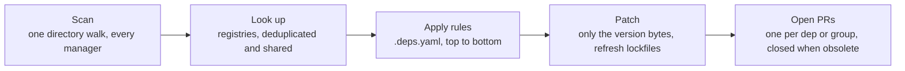

<p align="center">
  
</p>
<h1 align="center">deps</h1>
<p align="center">
  <b>Renovate-style dependency PRs from one static Go binary.</b><br>
  No Node runtime, no hosted app, no reformatted files. One strict config, one pull request per update.
</p>
<p align="center">
  <a href="https://git.jakob-moeller.cloud/jakobmoellerdev/deps/actions?workflow=ci.yml"></a>
  <a href="https://git.jakob-moeller.cloud/jakobmoellerdev/deps/releases"></a>
  <a href="LICENSE"></a>
</p>
<p align="center">
  &nbsp;&nbsp;
  &nbsp;&nbsp;
  &nbsp;&nbsp;
  
</p>

<p align="center">
  <a href="#getting-started">Getting started</a> ·
  <a href="#supported-ecosystems">Supported ecosystems</a> ·
  <a href="#how-it-works">How it works</a> ·
  <a href="#why-deps">Why deps</a> ·
  <a href="#compared-with-renovate-and-dependabot">Comparison</a> ·
  <a href="#performance">Performance</a> ·
  <a href="#next-steps">Docs</a> ·
  <a href="#development">Development</a>
</p>

deps finds the dependencies in a repository, looks up newer versions, and opens one branch and pull request per dependency or group. It rewrites only the version bytes, so formatting and comments stay as they are.

<details open>
<summary>  <b>Linux / macOS</b> (binary, amd64 and arm64)</summary>

```sh
mkdir -p ~/.local/bin && curl -fsSL -o ~/.local/bin/deps "https://github.com/jakobmoellerdev/deps/releases/latest/download/deps_$(uname -s | tr A-Z a-z)_$(uname -m | sed 's/x86_64/amd64/;s/aarch64/arm64/')" && chmod +x ~/.local/bin/deps
```

</details>

<details>
<summary>  <b>Debian / Ubuntu</b> (apt)</summary>

```sh
sudo install -d -m 0755 /etc/apt/keyrings
sudo curl -fsSL https://git.jakob-moeller.cloud/api/packages/jakobmoellerdev/debian/repository.key -o /etc/apt/keyrings/deps.asc
echo "deb [signed-by=/etc/apt/keyrings/deps.asc] https://git.jakob-moeller.cloud/api/packages/jakobmoellerdev/debian stable main" | sudo tee /etc/apt/sources.list.d/deps.list
sudo apt-get update && sudo apt-get install deps
```

</details>

<details>
<summary>  <b>Fedora / RHEL</b> (dnf)</summary>

```sh
printf '[deps]\nname=deps\nbaseurl=https://git.jakob-moeller.cloud/api/packages/jakobmoellerdev/rpm\nenabled=1\ngpgcheck=0\nrepo_gpgcheck=1\ngpgkey=https://git.jakob-moeller.cloud/api/packages/jakobmoellerdev/rpm/repository.key\n' | sudo tee /etc/yum.repos.d/deps.repo
sudo dnf install deps
```

</details>

<details>
<summary> <b>Arch Linux</b> (pacman)</summary>

```sh
curl -fsSL https://git.jakob-moeller.cloud/api/packages/jakobmoellerdev/arch/repository.key -o /tmp/deps.key
sudo pacman-key --add /tmp/deps.key
sudo pacman-key --lsign-key "$(gpg --show-keys --with-colons /tmp/deps.key | awk -F: '$1 == "fpr" { print $10; exit }')"
printf '\n[jakobmoellerdev]\nSigLevel = Required\nServer = https://git.jakob-moeller.cloud/api/packages/jakobmoellerdev/arch/$repo/$arch\n' | sudo tee -a /etc/pacman.conf
sudo pacman -Syu deps
```

</details>

<details>
<summary> <b>Alpine</b> (apk, as root)</summary>

```sh
wget -qO /etc/apk/keys/jakobmoellerdev@406384923acbad2a78f7a8f09acbfa3ae0bd4acf33360d688568adaa4cd205a3.rsa.pub https://git.jakob-moeller.cloud/api/packages/jakobmoellerdev/alpine/key
echo https://git.jakob-moeller.cloud/api/packages/jakobmoellerdev/alpine/stable/main >> /etc/apk/repositories
apk add deps
```

</details>

<details>
<summary>🪟 <b>Windows</b> (PowerShell)</summary>

```powershell
$arch = if ($env:PROCESSOR_ARCHITECTURE -eq 'ARM64') { 'arm64' } else { 'amd64' }
iwr "https://github.com/jakobmoellerdev/deps/releases/latest/download/deps_windows_$arch.exe" -OutFile deps.exe
```

</details>

<details>
<summary> <b>From source</b> (Go)</summary>

```sh
go install git.jakob-moeller.cloud/jakobmoellerdev/deps/cmd/deps@latest
```

</details>

Then, in any repository:

```sh
deps plan   # preview every update as a diff, no config needed
```

Packages install `/usr/bin/deps` with shell completions. Checksums and Sigstore verification: [install](docs/install.md).

**Coming from Renovate?** Disable Renovate and run `deps migrate`: it translates your Renovate config, presets included, into a commented `.deps.yaml` that keeps Renovate's `renovate/` branch prefix (`deps plan --renovate` runs from the Renovate config as it is). `deps run --dry-run` shows which PRs deps would open; once a real run completes without errors, deps closes Renovate's old PRs under that prefix. Option mapping and what can't be translated: [migrating from Renovate](docs/migrating-from-renovate.md); an [agent skill](skills/migrate-from-renovate/SKILL.md) does the migration for you.

## Getting started

### GitHub

Add `.github/workflows/deps.yml`. It uses a GitHub App token, because `GITHUB_TOKEN` can't push changes to workflow files and its PRs don't run CI:

```yaml
name: deps
on:
  schedule:
    - cron: "0 5 * * *"
  push:
    branches: [main] # your default branch: re-run right after a deps PR is merged
  workflow_dispatch:
concurrency:
  group: deps
  cancel-in-progress: false
permissions:
  contents: read
jobs:
  deps:
    runs-on: ubuntu-latest
    steps:
      - uses: actions/create-github-app-token@v3.3.0
        id: app
        with:
          client-id: ${{ vars.DEPS_APP_CLIENT_ID }}
          private-key: ${{ secrets.DEPS_APP_PRIVATE_KEY }}
      - uses: actions/checkout@v7.0.1
        with:
          token: ${{ steps.app.outputs.token }}
      - uses: jakobmoellerdev/deps@v0.5.0
        with:
          token: ${{ steps.app.outputs.token }}
```

The App needs *Contents*, *Pull requests* and *Workflows* set to write (and *Issues* for the dashboard). How to create it, a PAT instead, or the job token alone: [GitHub](docs/ci.md#github).

<details>
<summary><b>Gitea</b></summary>

Add `.gitea/workflows/deps.yml`:

```yaml
name: deps
on:
  schedule:
    - cron: "0 5 * * *"
  push:
    branches: [main] # your default branch: re-run right after a deps PR is merged
  workflow_dispatch:
concurrency:
  group: deps
  cancel-in-progress: false
permissions:
  contents: write
  pull-requests: write
  issues: write # only for dependencyDashboard
jobs:
  deps:
    runs-on: ubuntu-latest
    steps:
      - uses: actions/checkout@v7.0.1
      - uses: https://git.jakob-moeller.cloud/jakobmoellerdev/deps@v0.5.0
```

`uses:` needs the full URL, because a short `owner/repo@ref` is looked up on the instance's default actions host (github.com). CI doesn't run on PRs opened with the job token; to get CI (and automerge), pass a personal access token to both steps ([Gitea](docs/ci.md#gitea)).

</details>

<details>
<summary><b>Forgejo</b></summary>

Use the Gitea workflow as `.forgejo/workflows/deps.yml`, with two changes: drop the `permissions:` block (Forgejo's automatic token can already write), and set `runs-on:` to one of your runner's labels, e.g. `docker`. The runner image needs `bash`, `curl`, `git` and `sha256sum` ([Forgejo](docs/ci.md#forgejo)).

</details>

<details>
<summary><b>GitLab</b></summary>

Add a `deps` job to `.gitlab-ci.yml` that downloads the release binary and runs `deps run` on a pipeline schedule, with a project access token (scopes `api`, `write_repository`) in the CI/CD variable `DEPS_TOKEN`. deps opens merge requests, uses `merge_when_pipeline_succeeds` for automerge and pipelines as checks. The job and token setup: [GitLab CI](docs/ci.md#gitlab-ci).

</details>

### Configuration (optional)

Without a `.deps.yaml`, every direct dependency is updated. A small config (replace `vX.Y.Z` in the schema modeline with your deps version; see [editor support](docs/reference/configuration.md)):

```yaml
# yaml-language-server: $schema=https://git.jakob-moeller.cloud/jakobmoellerdev/deps/releases/download/vX.Y.Z/deps.schema.json
version: 1
dependencyDashboard: true
rules:
  - managers: [github-actions] # minor and patch bumps in one PR
    updateTypes: [minor, patch]
    group: actions
```

The first line turns on completion and checks in editors that use yaml-language-server. `deps init` writes such a starter file (`--from-renovate renovate.json` adds the `deps migrate` translation of a Renovate config), `deps config check` validates it offline (also as a pre-commit hook), `deps config show --sources` prints the effective values and where they come from, and `deps config describe [key]` documents every key in the terminal.

## Supported ecosystems

| | Ecosystem | Manifests | Lockfiles kept in sync |
|:-:|---|---|---|
|  | **CI actions**<br>GitHub, Gitea, Forgejo | `uses:` tags, SHA pins (with or without `# vX` comments), `setup-*` versions, GitHub-hosted `runs-on:` runners (`ubuntu-24.04`, `macos-15`, `windows-2025`) | |
|  | **Go** | `go.mod` requires and `toolchain` | `go.sum` (`go mod tidy`) |
|  | **Containers** | Dockerfiles, Compose, workflow containers, Kubernetes manifests, Helm values, Podman Quadlet units | |
| 📦 | **Dev Containers** | `devcontainer.json` images, features and feature versions | |
|  | **Kubernetes** | Kustomize images, charts and remote refs, Crossplane packages; manifest `apiVersion`s (with warnings for removed/deprecated APIs) | |
|  | **Helm** | `Chart.yaml`, Helm v2 `requirements.yaml`, helmfiles, chart custom resources (classic repos and OCI), Rancher Fleet `fleet.yaml`, Helmsman desired state files, `vendir.yml` | `Chart.lock`, `requirements.lock` |
|  | **Glasskube** | `Package`/`ClusterPackage` versions from the `PackageRepository` in the repository | |
|  | **Node.js**<br>npm, pnpm, Yarn, Bun | `package.json` (deps, `packageManager`, `engines`, `volta`), `.nvmrc`, `.node-version` | `package-lock.json`, `pnpm-lock.yaml`, `yarn.lock`, `bun.lock` |
|  | **Python**<br>pip, pip-tools, uv, Poetry, pdm, Pipenv, conda, Home Assistant | `requirements*.txt` and pip-compile inputs, `pyproject.toml` (PEP 621/735), `setup.cfg`, `setup.py`, PEP 723 inline script metadata, `Pipfile`, conda `environment.yml` (with its `pip:` list), Python version (`.python-version`, `runtime.txt`, asdf/mise, devcontainer feature), Home Assistant integration `manifest.json` `requirements` | `uv.lock`, `poetry.lock`, `pdm.lock`, `Pipfile.lock`, pip-compile outputs |
|  | **Ruby**<br>Bundler | `Gemfile`/`gems.rb`, `*.gemspec`, Ruby version (`ruby` directive, `.ruby-version`, asdf/mise) | `Gemfile.lock`/`gems.locked` (incl. `RUBY VERSION`) |
|  | **Rust** | `Cargo.toml`, with well-known crate monorepos grouped; toolchain in `rust-toolchain.toml` | `Cargo.lock` |
|  | **Swift** | `Package.swift` (`from:`, `exact:`, ranges) | `Package.resolved` |
|  | **Homebrew** | formula `url`/`sha256` in `Formula/*.rb` (GitHub archives and releases, npm tarballs; new sha256 computed) | |
|  | **PHP**<br>Composer | `composer.json` | `composer.lock` |
|  | **.NET**<br>NuGet, Cake, Paket | `*.csproj`/`*.fsproj`/`*.vbproj`, `Directory.Packages.props` and other MSBuild files (`$(Property)` versions, `nuget.config` sources), MSBuild SDKs, .NET SDK in `global.json`, `dotnet-tools.json`, Cake `#addin`/`#tool`/`#load` directives and `InstallTool(s)`, `paket.dependencies` | `paket.lock` |
|  | **Dart / Flutter**<br>pub, FVM | `pubspec.yaml` (hosted and git packages, Dart and Flutter SDK constraints, workspaces), `.fvmrc`/`.fvm/fvm_config.json` | `pubspec.lock` (`dart pub upgrade`) |
|  | **Julia** | `[compat]` entries in `Project.toml` | `Manifest.toml` |
|   | **Elixir / Gleam**<br>Mix, Gleam (Hex) | `mix.exs` (Hex requirements, git tags, umbrella apps), `gleam.toml` | `mix.lock`, `manifest.toml` |
|  | **Elm** | `elm.json` packages and compiler version | |
|  | **C/C++**<br>vcpkg | `vcpkg.json` and `vcpkg-configuration.json` baselines and port versions | |
|  | **Bazel** | `MODULE.bazel` (`bazel_dep`s from the BCR or `.bazelrc` registries, git overrides, rules_oci/rules_img images, rules_jvm_external artifacts, crate_universe crates), `.bazelversion` | `MODULE.bazel.lock` |
|  | **Nix**<br>flakes | `flake.nix` inputs (branches, nixpkgs release branches and channels, version-tag refs, pinned revs) | `flake.lock` (`nix flake update`) |
|   | **Terraform / OpenTofu** | providers, modules (registry, git, OCI), `required_version`, Terragrunt sources and engines, tflint plugins | `.terraform.lock.hcl` (also next to `terragrunt.hcl`, by lock file maintenance) |
|   | **JVM**<br>Maven, Gradle, OSGi, Smithy, Kotlin scripts, Ant | `pom.xml`, Gradle builds and version catalogs, Maven and Gradle wrappers, OSGi feature models (`src/main/features/*.json`), `smithy-build.json`, `@file:DependsOn` of `*.main.kts`, Ant `build.xml` with Maven (Resolver) Ant Tasks | `gradle.lockfile` |
|  | **Scala**<br>sbt, scalafmt | `*.sbt` and `project/*.scala` libraries (`%%` cross versions, `val` versions across files), `addSbtPlugin`, `scalaVersion`, `sbt.version`, `.scalafmt.conf` | |
|  | **Clojure**<br>Leiningen, Clojure CLI, Babashka | `project.clj` (`:dependencies`, plugins, profiles, `~var` versions), `deps.edn`/`bb.edn` Maven and git libs (`:git/tag` + `:git/sha`) | |
|  | **GitLab CI** | images, project includes, CI/CD components | |
|  | **Other CI pipelines**<br>Bitbucket, Woodpecker, Crow, Drone, CircleCI, Azure, Cloud Build, Vela, Travis, Buildkite, Bitrise, Tekton | Bitbucket Pipelines images and pipes, Woodpecker, Crow, Drone, Cloud Build and Vela images, CircleCI images and orbs, Azure Pipelines containers, repositories and tasks, Travis CI `node_js` versions, Buildkite plugins and images, Bitrise steps, Tekton bundles, step images and Pipelines-as-Code remote tasks | |
|  | **Ansible** | Galaxy roles and collections in `requirements.yml` and `galaxy.yml` (Galaxy, Galaxy NG/Automation Hub servers, git sources), container images in task files | |
|  | **pre-commit** | hook `rev`s on any git host, including frozen and bare SHAs; `additional_dependencies` of node, python and golang hooks | |
|  | **Git submodules** | `.gitmodules` (tracked branch or version tag; opt-in, as in Renovate) | |
| 🧰 | **Tool versions** | asdf `.tool-versions`, mise `[tools]` | |
|  | **RPM packages**<br>dnf, yum | package versions pinned in any file (markers or regex managers), looked up in the yum/dnf repositories you name | |
|  | **Alpine packages**<br>apk | `apk add <pkg>=<version>` pins through `# renovate: datasource=apk` markers or regex managers, against Alpine or Wolfi repository indexes | |
|  | **Debian / Ubuntu packages** | pinned apt package versions (`curl=8.14.1-2`) via `# renovate: datasource=deb` markers or regex managers, looked up in APT repository indexes | |
| ✏️ | **Anything else** | `# deps:` and `# renovate:` markers, regex managers (any datasource, plus Artifactory folder listings), JSONata queries over JSON/YAML/TOML; versions from GitHub, GitLab, Gitea and Forgejo releases and tags | |

File patterns, dep types and skip reasons for every manager: [managers and datasources](docs/reference/managers.md).

## How it works



## Why deps

> [!NOTE]
> **We love Renovate.** deps exists because of it: it reads Renovate's markers, takes over its branches, and borrows many of its ideas. But with AI-assisted development, code and dependencies change many times a day, and the update bot has to keep up. deps is built for that: a binary that starts in milliseconds, a run that finishes in seconds, and a re-run on every push to the default branch, so dependency PRs react to your changes instead of waiting for the next scheduled run.

- **Drop-in for Renovate users.** Reads `# renovate:` markers, takes over `renovate/` branches, and maps most options one to one: `deps migrate` writes your Renovate config as a `.deps.yaml`, and `--renovate` runs from it directly ([migration guide](docs/migrating-from-renovate.md)).
- **Diffs you can trust.** Only version bytes change: no reformatting, no reordered keys, comments kept.
- **A small, strict config.** Rules are read top to bottom, later rules override single fields. Unknown keys are errors with a line number, and a JSON Schema gives editor completion.
- **Quiet pull requests.** One PR per dependency or group, split into major/minor/patch. Unchanged PRs are never pushed again; obsolete PRs are closed only after an error-free run. PR limits, automerge and a dashboard issue are built in.
- **PRs when you want them.** Schedules as cron triggers or Renovate-style time windows (`before 6am on monday`) in your `timezone`; draft PRs; PRs opened only once the branch's checks finished or passed, or once approved on the dashboard (`prCreation`, `prNotPendingHours`); updates held back until approved on the dashboard (`dashboardApproval`).
- **Warnings about stale dependencies.** The dashboard and the PRs flag abandoned dependencies (no release within `abandonmentThreshold`) and deprecated, yanked or archived ones.
- **Security updates** from OSV advisories for Go, npm, Rust, PyPI, Maven, RubyGems, Packagist, NuGet, Pub, Hex, GitHub Actions and Terraform providers and CLIs, bypassing schedules and the minimum release age.
- **Release notes in every PR:** notes, release ages and a compare link.
- **Fast and light.** One directory walk, deduplicated lookups, commits without a checkout or worktree. See the numbers below.
- **Runs anywhere.** Same binary on your laptop, in GitHub, Gitea or Forgejo Actions and in GitLab CI; the forge is detected automatically.
- **Scales to an organisation.** Several base branches per repository (`baseBranches`), shared config through `extends`, and one job for many repositories (`run --repositories my-org/*`).

### Compared with Renovate and Dependabot

| | deps | Renovate | Dependabot |
|---|---|---|---|
| Runtime | one static Go binary | Node.js app or container image | hosted by GitHub |
| GitHub | ✅ | ✅ | ✅ |
| Gitea / Forgejo | ✅ | ✅ | ❌ |
| GitLab | ✅ | ✅ | ❌ |
| Bitbucket | 🟡 partial¹ | ✅ | ❌ |
| Config | one strict `.deps.yaml`, unknown keys are errors | JSON with presets | `dependabot.yml` |
| `# renovate:` markers | ✅ | ✅ | ❌ |
| Runs from a Renovate config | ✅ `--renovate`, `deps migrate` | ✅ | ❌ |
| Single static binary, no runtime | ✅ | ❌ | ❌ |

¹ deps opens PRs on GitHub, Gitea, Forgejo and GitLab only. In those repos it still updates what points at Bitbucket: Bitbucket Pipelines images and pipes, and Terraform/Terragrunt modules and Kustomize remotes hosted there.

Renovate covers more platforms and managers; deps trades that breadth for a single binary, a smaller config and predictable diffs. Feature-by-feature status: [Renovate parity](docs/renovate-parity.md).

### Performance

`deps plan` (scan, all registry lookups, patched diff) on large open-source repos, limited to 4 CPUs (`taskset -c 0-3`, `GOMAXPROCS=4`) like a standard CI runner, median of 3 runs:

| Repository | Ecosystems | Tracked files | Updates found | Wall time | CPU time | Peak memory |
|---|---|--:|--:|--:|--:|--:|
| openclaw/openclaw 🦞 | pnpm, Swift, Ruby, Actions | 64,994 | 628 | 2.5 s | 2.1 s | 187 MB |
| vercel/next.js | pnpm, Rust, Actions | 35,403 | 1,620 | 2.5 s | 3.1 s | 226 MB |
| kubernetes/kubernetes | Go, containers | 31,737 | 125 | 1.6 s | 0.7 s | 61 MB |
| grafana/grafana | Go, Yarn, containers, Actions | 24,717 | 1,186 | 12.1 s | 3.0 s | 165 MB |
| apache/airflow | Python, uv, containers | 15,404 | 771 | 50 s¹ | 3.1 s | 219 MB |
| backstage/backstage | Yarn workspaces | 12,456 | 1,215 | 2.4 s | 2.0 s | 212 MB |
| spring-projects/spring-boot | Gradle, Maven | 11,982 | 36 | 0.8 s | 0.4 s | 42 MB |
| astral-sh/ruff | Cargo, Python, npm | 11,304 | 259 | 2.2 s | 1.1 s | 72 MB |
| can1357/oh-my-pi | Bun, Rust, Python | 10,303 | 181 | 1.4 s | 0.7 s | 60 MB |
| istio/istio | Go, containers, Helm | 6,776 | 121 | 7.8 s | 1.3 s | 58 MB |
| argoproj/argo-cd | Go, Yarn, containers | 6,228 | 187 | 11.1 s | 1.1 s | 81 MB |
| open-component-model | Go, containers, Helm | 3,051 | 92 | 1.5 s | 0.7 s | 57 MB |
| kubernetes-sigs/cluster-api | Go, containers | 2,404 | 33 | 0.8 s | 0.4 s | 60 MB |

CPU time is deps itself; the rest of the wall time is registry latency, mostly container registries paging through tag lists. ¹ airflow waits on `public.ecr.aws/lambda/python`'s tag list (16 pages of about 3 s each) and on `docker.elastic.co`, whose tag list either answers after minutes (the run then takes about 6 min) or times out, as in these runs, which report its 2 images as errors.

`deps run` adds the lockfile tools (`go mod tidy`, npm/pnpm/yarn, uv, cargo …) for the PRs it updates; PRs whose content didn't change are not pushed again.

## Next steps

- **Running in CI** ([docs/ci.md](docs/ci.md)):
  - [tokens and permissions](docs/ci.md#tokens-and-permissions)
  - [GitLab CI](docs/ci.md#gitlab-ci)
  - [schedules](docs/ci.md#schedules) and [running on push](docs/ci.md#run-on-push-to-the-default-branch)
  - [automerge](docs/ci.md#automerge), [draft PRs and PRs after CI](docs/ci.md#draft-prs-and-prs-after-ci) and the [dependency dashboard](docs/ci.md#dependency-dashboard)
  - [several base branches](docs/ci.md#several-base-branches), [shared config and many repositories](docs/ci.md#shared-config-and-many-repositories)
  - [signed commits](docs/ci.md#signed-commits)
  - [self-hosted runners and actions hosts](docs/ci.md#self-hosted-runners-and-actions-hosts)
  - [preview on pull requests](docs/ci.md#preview-on-pull-requests)
  - [troubleshooting](docs/ci.md#troubleshooting)
- **Reference** (generated from the code):
  - [configuration](docs/reference/configuration.md): every `.deps.yaml` key
  - [CLI](docs/reference/cli.md): commands, flags, environment, output and exit codes
  - [managers and datasources](docs/reference/managers.md): what is found, skip reasons and lookups
  - [action](docs/reference/action.md): inputs and outputs of the composite action
- **[Install and verify](docs/install.md)**: Debian, RPM, Arch Linux and Alpine packages, the static binary, `go install`, verifying a download, and running deps locally.
- **[Migrating from Renovate](docs/migrating-from-renovate.md)**: `deps migrate` and `--renovate` (run from an existing Renovate config), option mapping, what cannot be translated, and differences. An [agent skill](skills/migrate-from-renovate/SKILL.md) does the migration for you.
- **Background:** [design](docs/design.md), [Renovate parity](docs/renovate-parity.md), [changelog](CHANGELOG.md) ([how releases are made](docs/ci.md#releases-maintainers)).

## Development

```sh
task ci           # task check (golangci-lint incl. govet, gofmt, go mod tidy, generated docs check), then race tests with coverage gate
task docs         # regenerate docs/reference/* and deps.schema.json
task changelog    # regenerate CHANGELOG.md with git-cliff (cliff.toml)
```

## License

Apache License 2.0, see [LICENSE](LICENSE).
