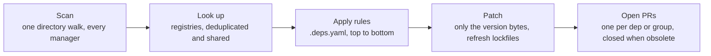

<p align="center">
  
</p>
<h1 align="center">deps</h1>
<p align="center">
  <b>Renovate-style dependency PRs from one static Go binary.</b><br>
  No Node runtime, no hosted app, no reformatted files. One strict config, one pull request per update.
</p>
<p align="center">
  <a href="https://git.jakob-moeller.cloud/jakobmoellerdev/deps/actions?workflow=ci.yml"></a>
  <a href="https://git.jakob-moeller.cloud/jakobmoellerdev/deps/releases"></a>
  <a href="LICENSE"></a>
</p>

deps finds the dependencies in a repository, looks up newer versions, and opens one branch and pull request per dependency or group, on GitHub, Gitea, Forgejo and GitLab. It rewrites only the version bytes, so formatting and comments stay as they are.

## Install

```sh
# Linux / macOS, amd64 and arm64
mkdir -p ~/.local/bin && curl -fsSL "https://github.com/jakobmoellerdev/deps/releases/latest/download/deps_$(uname -s | tr A-Z a-z)_$(uname -m | sed 's/x86_64/amd64/;s/aarch64/arm64/').tar.xz" | tar -xJf - -C ~/.local/bin deps

brew tap jakobmoellerdev/deps https://git.jakob-moeller.cloud/jakobmoellerdev/deps && brew install jakobmoellerdev/deps/deps

go install git.jakob-moeller.cloud/jakobmoellerdev/deps/cmd/deps@latest
```

Debian, Ubuntu, Fedora, RHEL, Arch Linux, Alpine, Nix and Windows packages, shell completions, checksums and Sigstore verification: [install](docs/install.md).

## Quick start

```sh
deps plan   # preview every update as a diff, in any repository, no config needed
```

In CI, add `.github/workflows/deps.yml`. It uses a GitHub App token, because `GITHUB_TOKEN` can't push changes to workflow files and its PRs don't run CI:

```yaml
name: deps
on:
  schedule:
    - cron: "0 5 * * *"
  push:
    branches: [main] # your default branch: re-run right after a deps PR is merged
  workflow_dispatch:
concurrency:
  group: deps
  cancel-in-progress: false
permissions:
  contents: read
jobs:
  deps:
    runs-on: ubuntu-latest
    steps:
      - uses: actions/create-github-app-token@v3.3.0
        id: app
        with:
          client-id: ${{ vars.DEPS_APP_CLIENT_ID }}
          private-key: ${{ secrets.DEPS_APP_PRIVATE_KEY }}
      - uses: actions/checkout@v7.0.1
        with:
          token: ${{ steps.app.outputs.token }}
      - uses: jakobmoellerdev/deps@v0.13.0
        with:
          token: ${{ steps.app.outputs.token }}
```

The App needs *Contents*, *Pull requests* and *Workflows* set to write (and *Issues* for the dashboard). How to create it, a PAT instead, or the job token alone: [GitHub](docs/ci.md#github).

<details>
<summary><b>Gitea</b></summary>

Add `.gitea/workflows/deps.yml`:

```yaml
name: deps
on:
  schedule:
    - cron: "0 5 * * *"
  push:
    branches: [main] # your default branch: re-run right after a deps PR is merged
  workflow_dispatch:
concurrency:
  group: deps
  cancel-in-progress: false
permissions:
  contents: write
  pull-requests: write
  issues: write # only for dashboard.enabled
jobs:
  deps:
    runs-on: ubuntu-latest
    steps:
      - uses: actions/checkout@v7.0.1
      - uses: https://git.jakob-moeller.cloud/jakobmoellerdev/deps@v0.13.0
```

`uses:` needs the full URL, because a short `owner/repo@ref` is looked up on the instance's default actions host (github.com). CI doesn't run on PRs opened with the job token; to get CI (and automerge), pass a personal access token to both steps ([Gitea](docs/ci.md#gitea)).

</details>

<details>
<summary><b>Forgejo</b></summary>

Use the Gitea workflow as `.forgejo/workflows/deps.yml`, with two changes: drop the `permissions:` block (Forgejo's automatic token can already write), and set `runs-on:` to one of your runner's labels, e.g. `docker`. The runner image needs `bash`, `curl`, `git` and `sha256sum` ([Forgejo](docs/ci.md#forgejo)).

</details>

<details>
<summary><b>GitLab</b></summary>

Add a `deps` job to `.gitlab-ci.yml` that downloads the release binary and runs `deps run` on a pipeline schedule, with a project access token (scopes `api`, `write_repository`) in the CI/CD variable `DEPS_TOKEN`. deps opens merge requests, uses `merge_when_pipeline_succeeds` for automerge and pipelines as checks. The job and token setup: [GitLab CI](docs/ci.md#gitlab-ci).

</details>

Without a `.deps.yaml`, every direct dependency is updated. A small config (replace `vX.Y.Z` in the schema modeline with your deps version):

```yaml
# yaml-language-server: $schema=https://git.jakob-moeller.cloud/jakobmoellerdev/deps/releases/download/vX.Y.Z/deps.schema.json
version: 1
dashboard:
  enabled: true
rules:
  - managers: [github-actions] # minor and patch bumps in one PR
    updateTypes: [minor, patch]
    group: actions
```

The first line turns on completion and checks in editors that use yaml-language-server. `deps init` writes such a starter file, `deps config check` validates it offline (also as a pre-commit hook), `deps config show --sources` prints the effective values and where they come from, and `deps config describe [key]` documents every key in the terminal ([configuration](docs/reference/configuration.md)).

## How it works



## What it updates

- **Languages:** Go, Node.js (npm, pnpm, Yarn, Bun), Deno, Python (pip, pip-tools, uv, Poetry, pdm, Pipenv, conda), Ruby, Rust, Swift, CocoaPods, PHP, .NET, Dart/Flutter, Julia, Elixir/Gleam, Elm, C/C++ (vcpkg), JVM (Maven, Gradle, OSGi, Smithy, Ant), Scala, Clojure, Bazel, Nix, Jsonnet — manifests and their lockfiles, plus the language runtime versions.
- **CI:** GitHub, Gitea and Forgejo Actions (tags, SHA pins, `setup-*`, hosted runner images), GitLab CI, Jenkins plugins, and Bitbucket, Woodpecker, Crow, Drone, CircleCI, Azure, Cloud Build, Vela, Travis, Buildkite, Bitrise and Tekton pipelines.
- **Containers and Kubernetes:** Dockerfiles, Compose, Quadlet units, Dev Containers, Kubernetes manifests and `apiVersion`s, Kustomize, Crossplane, Helm charts and helmfiles, Glasskube packages, Terraform/OpenTofu and Terragrunt, Ansible.
- **OS packages:** apt, apk and rpm version pins, looked up in the repository indexes you name; Homebrew formulas and their `sha256`.
- **Tooling and anything else:** pre-commit hooks, git submodules, asdf and mise tool versions, Copier templates, `extends` refs of `.deps.yaml`, and `# deps:`/`# renovate:` markers, regex managers and JSONata queries for everything with no manager of its own.

Every ecosystem with its manifests, lockfiles, file patterns, dep types and skip reasons: [managers and datasources](docs/reference/managers.md#ecosystems).

## Why deps

> [!NOTE]
> **We love Renovate.** deps exists because of it: it reads Renovate's markers, takes over its branches, and borrows many of its ideas. But with AI-assisted development, code and dependencies change many times a day, and the update bot has to keep up. deps is built for that: a binary that starts in milliseconds, a run that finishes in seconds, and a re-run on every push to the default branch, so dependency PRs react to your changes instead of waiting for the next scheduled run.

- **Diffs you can trust.** Only version bytes change: no reformatting, no reordered keys, comments kept.
- **A small, strict config.** Rules are read top to bottom, later rules override single fields. Unknown keys are errors with a line number, and a JSON Schema gives editor completion.
- **Quiet pull requests.** One PR per dependency or group, split into major/minor/patch, with release notes and a compare link. Unchanged PRs are never pushed again; obsolete PRs are closed only after an error-free run. PR limits, automerge, draft PRs, schedules (cron or Renovate-style windows), dashboard approval and a dashboard issue are built in ([CI](docs/ci.md)).
- **Security and staleness.** Security updates from OSV advisories, with CVSS score, EPSS probability and CISA known-exploited flag, bypassing schedules and the minimum release age; abandoned, deprecated, yanked and archived dependencies are flagged in the PR and the dashboard.
- **Fast and light.** One directory walk, deduplicated lookups, commits without a checkout or worktree. See [performance](#performance).
- **Scales to an organisation.** Several base branches per repository, shared config through `extends`, and one job for many repositories (`run --repositories my-org/*`, also GitLab groups); `plan` and `explain` take the same flag and clone the repositories themselves, so `deps plan --repositories my-org/*` reports a whole organisation read-only.

## Migrating from Renovate

Disable Renovate and run `deps migrate`: it translates your Renovate config, presets included, into a commented `.deps.yaml` (`deps init --from-renovate renovate.json` does the same for a new config) that keeps Renovate's `renovate/` branch prefix. `deps run --dry-run` shows which PRs deps would open; once a real run completes without errors, deps closes Renovate's old PRs under that prefix. `deps plan --renovate` runs from the Renovate config as it is, without translating anything.

Option mapping and what can't be translated: [migrating from Renovate](docs/migrating-from-renovate.md) and [Renovate options](docs/reference/renovate-options.md); an [agent skill](skills/migrate-from-renovate/SKILL.md) does the migration for you.

## Compared with Renovate and Dependabot

| | deps | Renovate | Dependabot |
|---|---|---|---|
| Runtime | one static Go binary | Node.js app or container image | hosted by GitHub |
| GitHub | ✅ | ✅ | ✅ |
| Gitea / Forgejo | ✅ | ✅ | ❌ |
| GitLab | ✅ | ✅ | ❌ |
| Bitbucket | 🟡 partial¹ | ✅ | ❌ |
| Config | one strict `.deps.yaml`, unknown keys are errors | JSON with presets | `dependabot.yml` |
| `# renovate:` markers | ✅ | ✅ | ❌ |
| Runs from a Renovate config | ✅ `--renovate`, `deps migrate` | ✅ | ❌ |
| Single static binary, no runtime | ✅ | ❌ | ❌ |

¹ deps opens PRs on GitHub, Gitea, Forgejo and GitLab only. In those repos it still updates what points at Bitbucket: Bitbucket Pipelines images and pipes, and Terraform/Terragrunt modules and Kustomize remotes hosted there.

Renovate covers more platforms and managers; deps trades that breadth for a single binary, a smaller config and predictable diffs. Feature-by-feature status: [Renovate parity](docs/renovate-parity.md).

## Performance

`deps plan` (scan, all registry lookups, patched diff), limited to 4 CPUs (`taskset -c 0-3`, `GOMAXPROCS=4`) like a standard CI runner, median of 3 runs:

| Repository | Ecosystems | Tracked files | Updates found | Wall time | CPU time | Peak memory |
|---|---|--:|--:|--:|--:|--:|
| openclaw/openclaw 🦞 | pnpm, Swift, Ruby, Actions | 66,962 | 671 | 4.5 s | 1.9 s | 133 MB |
| vercel/next.js | pnpm, Rust, Actions | 34,938 | 1,605 | 9.8 s | 4.5 s | 114 MB |
| kubernetes/kubernetes | Go, containers | 31,757 | 150 | 1.7 s | 0.5 s | 73 MB |
| backstage/backstage | Yarn workspaces | 12,657 | 1,245 | 6.5 s | 2.3 s | 104 MB |

CPU time is deps itself; the rest of the wall time is registry latency, mostly container registries paging through tag lists. All twelve repositories and the measurement procedure: [benchmarks](docs/benchmarks.md).

## Docs

- [Running deps in CI](docs/ci.md): tokens and permissions, GitHub, Gitea, Forgejo and GitLab CI, schedules, automerge, dashboard, base branches, signed commits, self-hosted runners, troubleshooting.
- [Install and verify](docs/install.md): packages, the static binary, `go install`, verifying a download, running deps locally.
- [Migrating from Renovate](docs/migrating-from-renovate.md): `deps migrate`, `--renovate`, option mapping, differences.
- Reference, generated from the code: [configuration](docs/reference/configuration.md), [CLI](docs/reference/cli.md), [managers and datasources](docs/reference/managers.md), [action](docs/reference/action.md), [Renovate options](docs/reference/renovate-options.md).
- Background: [design](docs/design.md), [Renovate parity](docs/renovate-parity.md), [benchmarks](docs/benchmarks.md), [changelog](CHANGELOG.md) ([how releases are made](docs/ci.md#releases-maintainers)).

## Development

```sh
task ci           # task check (golangci-lint incl. govet, gofmt, go mod tidy, generated docs check), then race tests with coverage gate
task docs         # regenerate docs/reference/* and deps.schema.json
task changelog    # regenerate CHANGELOG.md with git-cliff (cliff.toml)
```

## License

Apache License 2.0, see [LICENSE](LICENSE).
