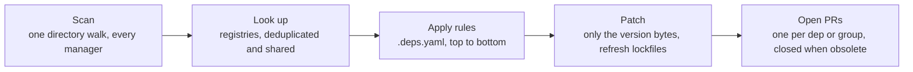

<p align="center">
  
</p>
<h1 align="center">deps</h1>
<p align="center">
  <b>Renovate-style dependency PRs from one static Go binary.</b><br>
  No Node runtime, no hosted app, no reformatted files. One strict config, one pull request per update.
</p>
<p align="center">
  <a href="https://git.jakob-moeller.cloud/jakobmoellerdev/deps/actions?workflow=ci.yml"></a>
  <a href="https://git.jakob-moeller.cloud/jakobmoellerdev/deps/releases"></a>
  <a href="LICENSE"></a>
</p>
<p align="center">
  &nbsp;&nbsp;
  &nbsp;&nbsp;
  
</p>

<p align="center">
  <a href="#getting-started">Getting started</a> ·
  <a href="#supported-ecosystems">Supported ecosystems</a> ·
  <a href="#how-it-works">How it works</a> ·
  <a href="#why-deps">Why deps</a> ·
  <a href="#compared-with-renovate-and-dependabot">Comparison</a> ·
  <a href="#performance">Performance</a> ·
  <a href="#next-steps">Docs</a> ·
  <a href="#development">Development</a>
</p>

deps finds the dependencies in a repository, looks up newer versions, and opens one branch and pull request per dependency or group. It rewrites only the version bytes, so formatting and comments stay as they are.

```sh
curl -fsSL -o ~/.local/bin/deps "https://github.com/jakobmoellerdev/deps/releases/latest/download/deps_linux_$(uname -m | sed 's/x86_64/amd64/;s/aarch64/arm64/')" && chmod +x ~/.local/bin/deps
deps plan                                  # preview every update as a diff, no config needed
```

Also packaged for   [Debian/Ubuntu (`apt`)](docs/install.md#packages),  [Arch Linux (`pacman`)](docs/install.md#packages) and  [Alpine (`apk`)](docs/install.md#packages); checksums and Sigstore verification: [install](docs/install.md).

**Coming from Renovate?** Disable Renovate, add `branchPrefix: renovate/` to `.deps.yaml`, then `deps run --dry-run` to see which PRs deps would open. Once a real run completes without errors, deps closes Renovate's old PRs under that prefix. Option mapping: [migrating from Renovate](docs/migrating-from-renovate.md).

## Getting started

### GitHub

Add `.github/workflows/deps.yml`. It uses a GitHub App token, because `GITHUB_TOKEN` can't push changes to workflow files and its PRs don't run CI:

```yaml
name: deps
on:
  schedule:
    - cron: "0 5 * * *"
  push:
    branches: [main] # your default branch: re-run right after a deps PR is merged
  workflow_dispatch:
concurrency:
  group: deps
  cancel-in-progress: false
permissions:
  contents: read
jobs:
  deps:
    runs-on: ubuntu-latest
    steps:
      - uses: actions/create-github-app-token@v3.3.0
        id: app
        with:
          client-id: ${{ vars.DEPS_APP_CLIENT_ID }}
          private-key: ${{ secrets.DEPS_APP_PRIVATE_KEY }}
      - uses: actions/checkout@v7.0.1
        with:
          token: ${{ steps.app.outputs.token }}
      - uses: jakobmoellerdev/deps@v0.3.0
        with:
          token: ${{ steps.app.outputs.token }}
```

The App needs *Contents*, *Pull requests* and *Workflows* set to write (and *Issues* for the dashboard). How to create it, a PAT instead, or the job token alone: [GitHub](docs/ci.md#github).

<details>
<summary><b>Gitea</b></summary>

Add `.gitea/workflows/deps.yml`:

```yaml
name: deps
on:
  schedule:
    - cron: "0 5 * * *"
  push:
    branches: [main] # your default branch: re-run right after a deps PR is merged
  workflow_dispatch:
concurrency:
  group: deps
  cancel-in-progress: false
permissions:
  contents: write
  pull-requests: write
  issues: write # only for dependencyDashboard
jobs:
  deps:
    runs-on: ubuntu-latest
    steps:
      - uses: actions/checkout@v7.0.1
      - uses: https://git.jakob-moeller.cloud/jakobmoellerdev/deps@v0.3.0
```

`uses:` needs the full URL, because a short `owner/repo@ref` is looked up on the instance's default actions host (github.com). CI doesn't run on PRs opened with the job token; to get CI (and automerge), pass a personal access token to both steps ([Gitea](docs/ci.md#gitea)).

</details>

<details>
<summary><b>Forgejo</b></summary>

Use the Gitea workflow as `.forgejo/workflows/deps.yml`, with two changes: drop the `permissions:` block (Forgejo's automatic token can already write), and set `runs-on:` to one of your runner's labels, e.g. `docker`. The runner image needs `bash`, `curl`, `git` and `sha256sum` ([Forgejo](docs/ci.md#forgejo)).

</details>

### Configuration (optional)

Without a `.deps.yaml`, every direct dependency is updated. A small config:

```yaml
# yaml-language-server: $schema=https://git.jakob-moeller.cloud/api/v1/repos/jakobmoellerdev/deps/raw/deps.schema.json?ref=main
version: 1
dependencyDashboard: true
rules:
  - manager: github-actions # minor and patch bumps in one PR
    updateTypes: [minor, patch]
    group: actions
```

The first line turns on completion and checks in editors that use yaml-language-server.

## Supported ecosystems

| | Ecosystem | Manifests | Lockfiles kept in sync |
|:-:|---|---|---|
|  | **CI actions**<br>GitHub, Gitea, Forgejo | `uses:` tags, SHA pins (with or without `# vX` comments), `setup-*` versions | |
|  | **Go** | `go.mod` requires and `toolchain` | `go.sum` (`go mod tidy`) |
|  | **Containers** | Dockerfiles, Compose, workflow containers, Kubernetes manifests, Helm values | |
|  | **Kubernetes** | Kustomize images, charts and remote refs | |
|  | **Helm** | `Chart.yaml`, helmfiles, chart custom resources (classic repos and OCI) | `Chart.lock` |
|  | **Node.js**<br>npm, pnpm, Yarn, Bun | `package.json` (deps, `packageManager`, `engines`, `volta`), `.nvmrc`, `.node-version` | `package-lock.json`, `pnpm-lock.yaml`, `yarn.lock`, `bun.lock` |
|  | **Python**<br>pip, pip-tools, uv, Poetry, pdm, Pipenv | `requirements*.txt` and pip-compile inputs, `pyproject.toml` (PEP 621/735), `Pipfile` | `uv.lock`, `poetry.lock`, `pdm.lock`, `Pipfile.lock`, pip-compile outputs |
|  | **Ruby**<br>Bundler | `Gemfile`/`gems.rb`, `*.gemspec`, Ruby version (`ruby` directive, `.ruby-version`, asdf/mise) | `Gemfile.lock`/`gems.locked` (incl. `RUBY VERSION`) |
|  | **Rust** | `Cargo.toml`, with well-known crate monorepos grouped | `Cargo.lock` |
|  | **Swift** | `Package.swift` (`from:`, `exact:`, ranges) | `Package.resolved` |
|   | **Terraform / OpenTofu** | providers, modules, `required_version`, Terragrunt sources, tflint plugins | `.terraform.lock.hcl` |
|   | **JVM**<br>Maven, Gradle | `pom.xml`, Gradle builds and version catalogs, Maven and Gradle wrappers | `gradle.lockfile` |
|  | **GitLab CI** | images, project includes, CI/CD components | |
|  | **pre-commit** | hook `rev`s, including frozen SHAs | |
|  | **Git submodules** | `.gitmodules` (tracked branch or version tag; opt-in, as in Renovate) | |
| 🧰 | **Tool versions** | asdf `.tool-versions`, mise `[tools]` | |
| ✏️ | **Anything else** | `# deps:` and `# renovate:` markers, regex managers | |

File patterns, dep types and skip reasons for every manager: [managers and datasources](docs/reference/managers.md).

## How it works



## Why deps

> [!NOTE]
> **We love Renovate.** deps exists because of it: it reads Renovate's markers, takes over its branches, and borrows many of its ideas. But with AI-assisted development, code and dependencies change many times a day, and the update bot has to keep up. deps is built for that: a binary that starts in milliseconds, a run that finishes in seconds, and a re-run on every push to the default branch, so dependency PRs react to your changes instead of waiting for the next scheduled run.

- **Drop-in for Renovate users.** Reads `# renovate:` markers, takes over `renovate/` branches, and maps most options one to one ([migration guide](docs/migrating-from-renovate.md)).
- **Diffs you can trust.** Only version bytes change: no reformatting, no reordered keys, comments kept.
- **A small, strict config.** Rules are read top to bottom, later rules override single fields. Unknown keys are errors with a line number, and a JSON Schema gives editor completion.
- **Quiet pull requests.** One PR per dependency or group, split into major/minor/patch. Unchanged PRs are never pushed again; obsolete PRs are closed only after an error-free run. Schedules, PR limits, automerge and a dashboard issue are built in.
- **Security updates** from OSV advisories for Go, npm, Rust, PyPI, Maven, RubyGems and GitHub Actions, bypassing schedules and the minimum release age.
- **Release notes in every PR:** notes, release ages and a compare link.
- **Fast and light.** One directory walk, deduplicated lookups, commits without a checkout or worktree. See the numbers below.
- **Runs anywhere.** Same binary on your laptop and in GitHub, Gitea or Forgejo Actions; the forge is detected automatically.

### Compared with Renovate and Dependabot

| | deps | Renovate | Dependabot |
|---|---|---|---|
| Runtime | one static Go binary | Node.js app or container image | hosted by GitHub |
| GitHub | ✅ | ✅ | ✅ |
| Gitea / Forgejo | ✅ | ✅ | ❌ |
| GitLab, Bitbucket | ❌ | ✅ | ❌ |
| Config | one strict `.deps.yaml`, unknown keys are errors | JSON with presets | `dependabot.yml` |
| `# renovate:` markers | ✅ | ✅ | ❌ |
| Single static binary, no runtime | ✅ | ❌ | ❌ |

Renovate covers more platforms and managers; deps trades that breadth for a single binary, a smaller config and predictable diffs. Feature-by-feature status: [Renovate parity](docs/renovate-parity.md).

### Performance

`deps plan` (scan, all registry lookups, patched diff) on large open-source repos, limited to 4 CPUs (`taskset -c 0-3`, `GOMAXPROCS=4`) like a standard CI runner, median of 3 runs:

| Repository | Ecosystems | Tracked files | Updates found | Wall time | CPU time | Peak memory |
|---|---|--:|--:|--:|--:|--:|
| openclaw/openclaw 🦞 | pnpm, Swift, Actions | 64,277 | 457 | 1.9 s | 1.7 s | 154 MB |
| vercel/next.js | pnpm, Rust, Actions | 35,218 | 1,510 | 4.5 s | 2.0 s | 147 MB |
| kubernetes/kubernetes | Go, containers | 31,702 | 93 | 1.4 s | 0.3 s | 46 MB |
| grafana/grafana | Go, Yarn, containers, Actions | 24,642 | 1,214 | 5.3 s | 2.6 s | 148 MB |
| apache/airflow | Python, uv, containers | 15,356 | 590 | 48.3 s¹ | 3.1 s | 145 MB |
| backstage/backstage | Yarn workspaces | 12,452 | 2,611 | 2.1 s | 1.8 s | 177 MB |
| spring-projects/spring-boot | Gradle, Maven | 11,978 | 39 | 2.5 s | 0.4 s | 31 MB |
| astral-sh/ruff | Cargo, Python, npm | 11,297 | 230 | 1.5 s | 0.9 s | 63 MB |
| can1357/oh-my-pi | Bun, Rust, Python | 10,283 | 151 | 1.1 s | 0.5 s | 50 MB |
| istio/istio | Go, containers, Helm | 6,769 | 115 | 5.6 s | 1.1 s | 52 MB |
| argoproj/argo-cd | Go, Yarn, containers | 6,220 | 166 | 11.3 s | 1.8 s | 90 MB |
| open-component-model | Go, containers, Helm | 3,045 | 76 | 1.4 s | 0.4 s | 42 MB |
| kubernetes-sigs/cluster-api | Go, containers | 2,404 | 31 | 0.8 s | 0.4 s | 52 MB |

CPU time is deps itself; the rest of the wall time is registry latency, mostly container registries paging through tag lists. ¹ airflow waits on `public.ecr.aws/lambda/python`'s tag list (16 pages of about 3 s each) and a `docker.elastic.co` listing that times out after 30 s.

`deps run` adds the lockfile tools (`go mod tidy`, npm/pnpm/yarn, uv, cargo …) for the PRs it updates; PRs whose content didn't change are not pushed again.

## Next steps

- **Running in CI** ([docs/ci.md](docs/ci.md)):
  - [tokens and permissions](docs/ci.md#tokens-and-permissions)
  - [schedules](docs/ci.md#schedules) and [running on push](docs/ci.md#run-on-push-to-the-default-branch)
  - [automerge](docs/ci.md#automerge) and the [dependency dashboard](docs/ci.md#dependency-dashboard)
  - [signed commits](docs/ci.md#signed-commits)
  - [self-hosted runners and actions hosts](docs/ci.md#self-hosted-runners-and-actions-hosts)
  - [preview on pull requests](docs/ci.md#preview-on-pull-requests)
  - [troubleshooting](docs/ci.md#troubleshooting)
- **Reference** (generated from the code):
  - [configuration](docs/reference/configuration.md): every `.deps.yaml` key
  - [CLI](docs/reference/cli.md): commands, flags, environment, output and exit codes
  - [managers and datasources](docs/reference/managers.md): what is found, skip reasons and lookups
  - [action](docs/reference/action.md): inputs and outputs of the composite action
- **[Install and verify](docs/install.md)**: Debian, RPM, Arch Linux and Alpine packages, the static binary, `go install`, verifying a download, and running deps locally.
- **[Migrating from Renovate](docs/migrating-from-renovate.md)**: option mapping and differences.
- **Background:** [design](docs/design.md), [Renovate parity](docs/renovate-parity.md), [changelog](CHANGELOG.md) ([how releases are made](docs/ci.md#releases-maintainers)).

## Development

```sh
task ci           # task check (golangci-lint incl. govet, gofmt, go mod tidy, generated docs check), then race tests with coverage gate
task docs         # regenerate docs/reference/* and deps.schema.json
task changelog    # regenerate CHANGELOG.md with git-cliff (cliff.toml)
```

## License

Apache License 2.0, see [LICENSE](LICENSE).
