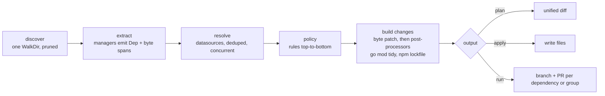

# deps design

`deps` is a dependency updater written in Go and intended to replace Renovate. This document holds the complete design. It covers GitHub/Gitea/Forgejo Actions `uses:` references, Go modules (requirements and `go`/`toolchain` directives), container images, npm `package.json` dependencies, custom annotation/regex dependencies, OSV security updates, and a PR bot for GitHub, Gitea and Forgejo with groups and schedules.

## 1. Goals

- **One static Go binary.** GitHub, Gitea and Forgejo are first-class platforms and are detected automatically.
- **A small, strict config (`.deps.yaml`).** Unknown keys are errors. Rules are evaluated top-to-bottom; each later matching rule overrides only the fields it sets.
- **Files are never reformatted.** Managers extract byte spans and deps replaces only those bytes. The only exceptions are generated files: `go mod tidy` output (go.mod, go.sum) and the `package-lock.json` npm writes.
- **Same behavior locally and in CI.** `deps plan`, `deps apply` and `deps run` behave identically on a laptop and as an Action.
- **Fast and memory-bounded.** Memory grows with the number of dependencies, not the size of the repo (see section 3).

## 2. Pipeline



### Managers

Every discovered file goes to every manager whose `Match` is true. Each dep carries `Manager`, `DepType`, `Datasource` and `Versioning`.

| Manager | Files | DepTypes | Datasource / versioning |
|---|---|---|---|
| `github-actions` | `.github`/`.gitea`/`.forgejo` `workflows`/`actions` and `workflow-templates` YAML, `action.y(a)ml` | `action` | `git-tags` / `tag` |
| `gomod` | `go.mod` | `direct`, `indirect`, `go`, `toolchain` | `go` / `go`; directives `go-toolchain` / `tag` |
| `docker` | `Dockerfile`, `Containerfile` (also `Dockerfile.x`, `x.Dockerfile`), `(docker-)compose*.y(a)ml`, workflows, `action.y(a)ml`, other `*.y(a)ml` (Kubernetes, Helm values) | `dockerfile`, `compose`, `workflow`, `action`, `kubernetes`, `helm` | `docker` / `docker` |
| `npm` | `package.json` | `dependencies`, `devDependencies`, `optionalDependencies`, `peerDependencies`, `packageManager` | `npm` / `semver` |
| `custom` | `custom[].files` globs | `annotation`, `regex` | per entry or per match |

**github-actions.** `uses:` values outside `with:`/`env:`. Skips: `local action` (`./`, `$/`), `docker reference (docker manager)`, `unrecognized uses`, `non-version ref`, `pinned without version comment`, `cannot locate value`.

**gomod.** Every `require` plus the `go` and `toolchain` directives (the `toolchain` span covers only the version after `go`). Skips: `replaced`, `pseudo-version`, `vendored module (not supported)`, `prerelease toolchain`. By default `indirect` requirements and the `go` directive are ignored; a rule with `ignore: false` opts in. `toolchain` is updated by default. `go mod tidy` runs after any gomod change.

**docker.**
- Dockerfile: every `FROM` (case-insensitive, `--flag`s skipped, line continuations and the `# escape=` directive honored). `scratch` and earlier stage names (`AS <name>`) are not dependencies.
- Compose: `services.*.image`.
- Workflows: `jobs.*.container` (string or `.image`), `jobs.*.services.*.image`, `uses: docker://…` steps. Actions: `runs.image: docker://…` (when `runs.using: docker`) and `uses: docker://…` in `runs.steps`.
- References are parsed with distribution/reference; `Name` is the familiar name (`postgres`), the datasource uses the canonical one. Skips: `variable reference` (`$`), `cannot locate value`, `invalid reference`, `no tag`, `digest without tag`, `non-version tag` (e.g. `latest`).
- Digests: `image:tag@sha256:…` is refreshed in place (tag and digest). With `pin: digest`, `@sha256:<index digest>` is appended after the tag. Digests come from a HEAD of the tag's manifest, so multi-platform images get the index digest. Credentials come from the Docker config and credential helpers.

**Dockerfile stage references and ARGs.** Besides `FROM`, the docker manager extracts `COPY --from=<image>` and `RUN --mount=…,from=<image>`; stage names, numeric stage indexes and `scratch` are not images. A reference that is exactly `$X`/`${X}` resolves to `ARG X=<image>` declared before the first `FROM` or in the current stage; the dep sits at the ARG default (once per ARG), so the update rewrites the ARG line. Defaults that are themselves variable or quoted with escapes are skipped as `variable reference`.

**Kubernetes and Helm YAML.** Every other `*.ya?ml` file is a candidate but is only parsed when its bytes contain `image:` or `repository:`; documents are decoded one by one and a parse error (typically Helm templates) yields no deps and no error.
- `kubernetes`: scalar `image` in `containers`/`initContainers`/`ephemeralContainers` items anywhere.
- `helm`: `*image` mappings with `repository` + `tag` (optional `registry` prefix; digest from `tag: x@sha256:…` or a sibling `digest:`); the tag scalar is rewritten in place.
- Values containing `{{` are skipped as `template value`.

**npm.** `package.json` is streamed with `encoding/json` tokens; `InputOffset` after each string value gives its byte span, which must equal the quoted value in the file (otherwise, e.g. with `\u` escapes, `cannot locate value`). Sections: `dependencies`, `devDependencies`, `optionalDependencies`, `peerDependencies` (the section name is the `DepType`) and `packageManager` (`npm@x`, `pnpm@x`, `yarn@x`; `Name` is the tool). `overrides`, `resolutions`, `engines` and `bundleDependencies` are not extracted; `node_modules` is pruned by discovery.
- **Range grammar:** an optional operator `^`, `~`, `>=` or `=`, then a full `MAJOR.MINOR.PATCH[-prerelease]`. `Version` is the bare version and `RefSpan` covers only the version bytes, so the operator is kept: the range is *bumped* (`^1.2.3` → `^1.4.0`), not widened or replaced.
- **Skips:** `npm alias` (`npm:`), `local dependency` (`file:`, `link:`, `workspace:`, `./`, `../`, `/`, `~/`), `git dependency` (`github:`, `gitlab:`, `bitbucket:`, `gist:`, `git+`, `git://`, `git@`, `owner/repo[#ref]`), `url dependency` (`http(s)://` tarballs), `tag` (dist-tags such as `latest`, `next`), `unsupported range` (`||`, spaces, `x`/`*` wildcards, partial versions, `<`, hyphen ranges, `v1.2.3`, empty), `cannot locate value`; for `packageManager` also `packageManager with hash` (`+sha512…` suffix) and `unsupported packageManager`.
- **peerDependencies** are ignored by default, like indirect Go requirements; a rule with `depTypes: [peerDependencies]` and `ignore: false` opts in.
- **Lockfile:** after a package.json change, `apply`/`run` regenerate the workspace's `package-lock.json`, `pnpm-lock.yaml` or `yarn.lock` (see *Post-processors* below). Dependencies naming a member of the manifest's own workspace are never updated (any range form).

**custom, annotation mode** (no `match`). A comment `deps: <datasource> <name> [versioning=<scheme>]` after `#`, `//`, `--`, `;` or `<!--` annotates the next line; its first version token (`v?N.N[.N…][-suffix]`, not glued to other word characters) is the version. Otherwise `no version on next line`.

**Renovate markers.** Annotation mode also accepts `renovate: datasource=<ds> depName=<name> [packageName=<p>] [versioning=<v>] [registryUrl=<url>]` (fields in any order; `packageName` wins over `depName`; `registryUrl` and unknown keys are ignored); it annotates the next line like `deps:`. Skips: `renovate marker without datasource`, `renovate marker without depName`. For the docker datasource the next line's first tagged image reference is used instead: the tag after the last `:` is the version and an adjacent `@sha256:` digest is captured, so tag and digest are rewritten together. Renovate datasource names are aliased: `golang-version` → `go-toolchain`, `github-tags` → `git-tags` (`owner/repo` on github.com), `github-release-attachments` → `github-releases`. Unknown ones (e.g. `node-version`, `custom.*`) are skipped as `unknown datasource "<ds>"`.

```dockerfile
# deps: github-releases golangci/golangci-lint
ARG GOLANGCI_VERSION=v2.5.0
# deps: go golang.org/x/tools versioning=go
RUN go install golang.org/x/tools/cmd/goimports@v0.38.0
```

**custom, regex mode.** `match` is an RE2 run over the whole file; every match is one dep. Named groups: `version` (required; alias `currentValue`), `name` (aliases `depName`, `packageName`; `packageName` wins over `depName`), `datasource`, `versioning`, `digest` (alias `currentDigest`); groups override or supply the entry's `name`/`datasource`. Empty groups skip the match (`empty version`, `empty name`, `empty datasource`). A `digest` group is replaced together with the version.

```yaml
custom:
  - files: ["**/*.mk"]
    match: '(?P<name>[a-z0-9-]+/[a-z0-9-]+)@(?P<version>v\d+\.\d+\.\d+)'
    datasource: github-releases
```

**Release checksums.** A regex entry can pin a checksum next to the version (`ARG GH_VERSION=…` / `ARG GH_SHA256=…`): a `(?P<checksum>…)` group in `match` plus a `checksum:` block, required together. Exactly one source:
- `asset` (github-releases only): the release asset's API `digest` from the already-fetched release list (no extra request);
- `url`: a checksum document downloaded once per URL (streamed, 1 MiB cap); with `file`, the entry is looked up in a sha256sum-style list (`<hex>  <name>` / `<hex> *<name>`), else the first hex token is taken.

The only template variable is `{{version}}` (the new version as written into the file), validated at load. sha256 (64 hex) and sha512 (128 hex) are accepted; the new checksum must have the current length and keeps its letter case. The checksum is fetched only after an update is chosen; a failure is that dependency's error (no update), so version and checksum always change together.

```yaml
custom:
  - files: [Dockerfile]
    match: 'ARG GH_VERSION=(?P<version>\S+)\nARG GH_SHA256=(?P<checksum>[0-9a-f]{64})'
    datasource: github-releases
    name: cli/cli
    checksum:
      url: 'https://github.com/cli/cli/releases/download/v{{version}}/gh_{{version}}_checksums.txt'
      file: 'gh_{{version}}_linux_amd64.tar.gz'
```

### Datasources

| Datasource | Name form | Source |
|---|---|---|
| `git-tags` | repository URL (`https://host/path` or `host/path`) | git smart-HTTP `ls-refs`, tags with peeled commits |
| `go` | module path | GOPROXY `@v/list`, or `go list -m -versions` for GONOPROXY/direct |
| `go-toolchain` | `go` / `toolchain` | `https://go.dev/dl/?mode=json&include=all` |
| `docker` | image reference | registry `tags/list` and manifest HEAD (go-containerregistry) |
| `github-releases` | `owner/repo` (github.com) or `https://host/owner/repo` (GHES, API `/api/v3`) | `GET /repos/{repo}/releases`, non-draft non-prerelease tag names, up to 5 pages of 100 |

| `npm` | package name (`@scope/name` requested as `@scope%2fname`) | `GET <registry>/<name>` with `Accept: application/vnd.npm.install-v1+json` (abbreviated metadata), streamed: only the `versions` keys and each version's `deprecated`; deprecated versions are dropped |

Custom entries may use `git-tags`, `github-releases`, `go`, `go-toolchain`, `docker` and `npm`, plus the Renovate aliases `golang-version`, `github-tags` and `github-release-attachments`.

**npm registry and auth.** Per package.json directory, the nearest `.npmrc` walking up to the scanned root is read (once per directory per run): `@scope:registry=` for scoped names, then `registry=`. Without one, `NPM_CONFIG_REGISTRY` (or `npm_config_registry`), else `https://registry.npmjs.org/`. A `//host/path/:_authToken=` entry whose key is the longest prefix of the registry URL (without scheme) sends `Authorization: Bearer <token>`. `${VAR}` and `${VAR?}` in keys and values expand from the environment (empty when unset); values may be quoted. Lookups are deduped per (registry, name). A 404 is `package <name> not found`. npm has no digests.

### Post-processors

`engine.Build` patches every file, then asks the post-processor registered for the file's manager for the file's **scope**: the directory owning its derived files (`plan` passes none). Manifests of one manager sharing a scope are post-processed together, once per scope, under a global bound of 4 concurrent runs. The engine reads the scope dir's existing siblings; a result under a manifest's path (relative to the scope) replaces that manifest; every sibling whose content differs becomes a change (mode kept, `0644` for new files). A manifest without a scope is only patched. A failing scope drops all its manifests and siblings (`<file>[, <file>…]: <err>`).

- **gomod** (`gotool.Tidier`, scope = module dir, siblings `go.sum`): `go mod tidy -modfile=<tmp>/go.mod` on copies.
- **npm** (`nodetool.Locker`, siblings `package-lock.json`, `pnpm-lock.yaml`, `yarn.lock` + read-only `.npmrc`, `pnpm-workspace.yaml`, `.yarnrc.yml`).
  - Scope (lock root): nearest dir at/above the package.json (within `--dir`) holding one of the lockfiles, accepted if it is the manifest's own dir or its package.json `workspaces` (array or `{packages}`) / `pnpm-workspace.yaml` `packages` doublestar globs match the manifest dir (`!glob` excludes); otherwise no lockfile (none is created).
  - Temp copy: root + all member package.json (patched where changed) at relative paths, the lockfile, config files, and local files referenced by `.yarnrc.yml` `yarnPath`/`plugins` (member discovery walks each glob's literal base, skipping node_modules/.git).
  - Commands: npm `install --package-lock-only --ignore-scripts --no-audit --no-fund`; pnpm `install --lockfile-only --ignore-scripts --no-frozen-lockfile`; yarn berry (`.yarnrc.yml` or `__metadata` in the lock) `install --mode=update-lockfile` with `YARN_ENABLE_SCRIPTS=0 YARN_ENABLE_IMMUTABLE_INSTALLS=0`; yarn classic `install --ignore-scripts --ignore-engines --non-interactive --no-progress`. Env `npm_config_update_notifier=false`, `COREPACK_ENABLE_DOWNLOAD_PROMPT=0`.
  - Tool resolution: binary on PATH; else `npx --yes <tool>@<version>` when root `packageManager` names it (berry: `npx --yes --package=@yarnpkg/cli-dist@<version> -- yarn`); else `npx --yes <tool>`; else `<tool> not found (needed to update <lock>)`.
  - Several lockfiles in one root: the `packageManager` tool's lockfile wins, else package-lock, pnpm, yarn. Only the lockfile is read back and returned when changed; failure `<tool> install in <dir>: <last 20 output lines>`. npm-shrinkwrap.json is not handled.

## 3. Performance and memory design

The following is implemented:

- **Discovery.** A single `filepath.WalkDir`. It prunes `.git`, `node_modules`, `vendor`, `testdata` and directories matching `ignorePaths` via `fs.SkipDir`. When `ignorePaths` is absent the default is `**/{node_modules,bower_components,vendor,examples,__tests__,test,tests,__fixtures__}/**` (Renovate's `:ignoreModulesAndTests`). Paths are matched before any file is opened, and only matched files are read.
- **Extraction.** Runs on `runtime.GOMAXPROCS(0)` workers. Each worker keeps only `[]Dep` (spans and strings); parse trees and file bytes are dropped immediately. Files are re-read when changes are built, so memory is O(deps), not O(repo).
- **HTTP.** One shared `http.Client` (HTTP/2, keep-alive) handles every network call.
- **Retries and rate limits.** The shared transport retries idempotent requests: GET/HEAD/OPTIONS, and read-only POSTs marked with `httpx.Idempotent` (git ls-refs, OSV querybatch). It retries connection errors and 429/500/502/503/504, at most 3 times, with full-jitter exponential backoff (500ms base, 10s cap), honouring `Retry-After`. Platform writes are never retried. A 429, or a 403 with `X-RateLimit-Remaining: 0` or `Retry-After`, is a rate limit: if it resets within 60s deps waits (info log); otherwise the request fails fast with `rate limited by <host> until <time>` (`httpx.ErrRateLimited`) instead of stalling the run. go-containerregistry's own retry is disabled so attempts are not multiplied. Each attempt is logged at debug, with `X-RateLimit-Remaining` when present.
- **Lookup dedupe.** Lookups are deduped within a run per key (one `sync.Once` per cache entry). A global semaphore caps concurrent requests at 16.
- **Actions tags.** Fetched with a native git smart-HTTP protocol v2 `ls-refs` call using `ref-prefix refs/tags/` and `peel`. No `git` process is spawned per action, only tag refs travel over the wire, and the pkt-line response is parsed as a stream.
- **Go versions.** Fetched from the GOPROXY `@v/list` endpoint over HTTP. `go list` is used only for GOPRIVATE/direct modules. Go toolchain releases come from one `go.dev/dl/?mode=json&include=all` fetch per run.
- **Registries.** Docker tags come from `tags/list` (all pages; Docker Hub with page size 10000), digests from a manifest HEAD. One shared go-containerregistry puller per run, so ping and token exchange happen once per repository.
- **npm metadata.** Abbreviated documents are stream-decoded; only one version object is buffered at a time.
- **Security.** OSV is queried in batches of up to 1000 packages; each advisory document is fetched once.
- **Child processes.** Spawned only where unavoidable: post-processors (`go mod tidy`, npm/pnpm/yarn lockfile installs; at most 4 concurrently in total) and `git` for commit and push.
- **Commits.** Built with git plumbing on a temporary index. `run` does no checkout, creates no worktree, and never mutates the working tree.
- **No persistent cache.** Runs are infrequent (scheduled), so in-run dedupe already removes the repeated lookups.

## 4. Core types

```go
// internal/dep
type UpdateType string // "major" | "minor" | "patch" | "digest" | "pin"
const (Major UpdateType = "major"; Minor = "minor"; Patch = "patch"; Digest = "digest"; Pin = "pin")

type Span struct{ Start, End int } // byte offsets, End exclusive

type Dep struct {
    Manager     string // "github-actions" | "gomod" | "docker" | "npm" | "custom"
    Datasource  string // "git-tags" | "go" | "go-toolchain" | "docker" | "github-releases" | "npm"
    Versioning  string // "tag" | "go" | "docker" | "semver"
    DepType     string // gomod: direct|indirect|go|toolchain; actions: action; docker: dockerfile|compose|workflow|action|kubernetes|helm; npm: dependencies|devDependencies|optionalDependencies|peerDependencies|packageManager; custom: annotation|regex
    File        string // slash path relative to --dir
    Line        int    // 1-based
    Name        string // actions: owner/repo[/sub]; gomod: module path
    Source      string // actions: https://<host>/<owner>/<repo>; gomod: ""
    Version     string // current version (ref tag, comment version, or module version)
    Digest      string // actions: full SHA when pinned, else ""
    RefSpan     Span   // actions: ref after '@'; gomod: version token
    VersionSpan Span   // actions: version token in trailing comment (pinned only)
    DigestSpan  Span   // docker/custom: digest token stored apart from RefSpan
    InsertAt    int    // manager-defined insert offset (actions: after the uses value incl. closing quote)
    Skip        string // non-empty = not updatable, with the reason

    Checksum       string          // custom: current sha256/sha512 hex pinned next to the version
    ChecksumSpan   Span            // custom: checksum token
    ChecksumSource *ChecksumSource // custom: where the checksum of a new version comes from; nil = none
}

// Asset and URL/File are templates over {{version}}; exactly one of Asset and URL is set.
type ChecksumSource struct {
    Asset string // github-releases: release asset whose API digest is used
    URL   string // checksums document to download
    File  string // entry name in a sha256sum-style URL document; "" = first hex token
}

type Advisory struct{ ID, Summary, URL string }

type Update struct {
    Dep         Dep
    Type        UpdateType
    NewVersion  string
    NewDigest   string        // "" unless the result is digest-pinned
    Group       string        // policy group, "" = own PR
    Schedule    *schedule.Set // nil = always
    Advisories  []Advisory    // non-empty = security update
    NewChecksum string        // "" unless Dep.ChecksumSource is set and the version changes
    CommitType  string        // policy commit type (fix, chore, ...)
    CommitScope string        // policy commit scope; "" = none
}
```

```go
// internal/manager
type Env struct {
    DefaultHost string                // actions default host
    Vendored    func(dir string) bool // slash dir relative to root; engine supplies a stat check when nil
}
type Manager interface {
    Name() string
    Match(path string) bool
    Extract(file string, src []byte, env Env) ([]dep.Dep, error)
    Edits(u dep.Update) ([]patch.Edit, error) // byte edits for one update; the engine merges them per file
}
// actions.New(), gomod.New(), docker.New(), npm.New() return the built-in managers; custom.New(cfg.Custom) one per custom[] entry.
```

```go
// internal/datasource (leaf package; aliased as engine.Release, engine.Datasource, engine.Vuln, engine.SecuritySource, engine.ChecksumSource)
type Release struct{ Version, Digest string }
type Datasource interface {
    Releases(ctx context.Context, d dep.Dep, dir string) ([]Release, error)
    Digest(ctx context.Context, d dep.Dep, version string) (string, error) // when Release.Digest == ""
}
type Vuln struct{ Advisory dep.Advisory; Fixed []string }
type SecuritySource interface {
    Advisories(ctx context.Context, deps []dep.Dep) ([][]Vuln, error)
}
type ChecksumSource interface {
    Checksum(ctx context.Context, d dep.Dep, version string) (string, error) // lowercase hex
}
type Timer interface { // optional: release times for ages and the older-than-current check
    ReleaseTime(ctx context.Context, d dep.Dep, version string) (time.Time, error)
}
type SourceRepo interface { // optional: source repository for release notes
    SourceRepo(ctx context.Context, d dep.Dep, version string) (string, error)
}
// gittags.Lister ("git-tags"), goproxy.Source ("go"), gotoolchain ("go-toolchain"),
// dockerds ("docker"), githubreleases ("github-releases") and npmds ("npm") implement Datasource; osv implements SecuritySource;
// checksum.Source implements ChecksumSource.
```

```go
// internal/versioning
type Scheme interface {
    Valid(v string) bool
    Compare(a, b string) int
    Kind(cur, next string) dep.UpdateType
    Semver(v string) *semver.Version
    Best(cur string, cands []string, accept func(v string, kind dep.UpdateType) (bool, string), reject func(v, reason string)) (string, bool)
    Compatible(cur, next string) bool
}
func Get(name string) (Scheme, bool) // "tag", "go", "docker", "semver"
```

```go
// internal/engine
type PostProcessor interface {
    Scope(root, manifest string) (dir string, ok bool) // slash dir relative to root owning the derived files; !ok = patch only
    Siblings() []string                                // file names in the scope dir read or regenerated
    // manifests: patched content by path relative to dir; files: existing siblings by name.
    // A result under a manifest's path replaces it, one under a sibling's name the sibling.
    Process(ctx context.Context, dir string, manifests, files map[string][]byte) (map[string][]byte, error)
}
type Options struct {
    Managers    []manager.Manager
    Datasources map[string]Datasource // by Dep.Datasource
    Security    SecuritySource        // nil = off
    Checksums   ChecksumSource        // nil = deps with a checksum source cannot be updated
    Filter      func(dep.Dep) bool    // nil = all
    Trace       func(Trace)           // nil = off
}
type Trace struct {
    Dep        dep.Dep
    Rules      []int
    Policy     config.Policy
    Candidates int
    Rejected   map[string][]string // reason -> versions
    Update     *dep.Update
    Err        error
}
type Result     struct{ Updates []dep.Update; Skipped []dep.Dep; Errors []error }
type FileChange struct{ Path string; Mode fs.FileMode; Old, New []byte }
type Group      struct{ Manager, Name, Branch, Title string; Updates []dep.Update }

func Managers(cfg *config.Config) ([]manager.Manager, error)
func Resolve(ctx context.Context, root string, cfg *config.Config, env manager.Env, o Options) (*Result, error)
func Build(ctx context.Context, root string, managers []manager.Manager, updates []dep.Update, post map[string]PostProcessor) ([]FileChange, []error) // post by manager name; nil = none
func GroupUpdates(updates []dep.Update, branchPrefix string) []Group // "" = config.DefaultBranchPrefix
```

**Resolve order per dep:** datasource releases → `Scheme.Best` under the policy → digest pin/refresh (`tag`/`docker` versioning on the digest-capable managers github-actions and docker) → security. With advisories, the minimum fix F is the highest, over all vulns, of each vuln's lowest compatible fixed version. If there is no normal update or it is below F, the smallest compatible release ≥ F is chosen regardless of `allow`/`updates` (`ignore` still wins). The advisories the chosen version fixes are attached; such security updates get no group and no schedule. Every file goes to every manager that matches it.
- A current value the dep's versioning scheme cannot parse (e.g. a `latest` docker tag) is skipped as `non-version value "<v>"` before any lookup, not reported as an error.
- A major candidate whose release time (via `datasource.Timer`) predates the current version's is rejected as `older than current` and the next best candidate is tried (at most 3). This drops legacy pre-module tags such as `k8s.io/client-go v1.5.2` (2016) when the current version is `v0.37.1`. Unknown times never reject.
- The chosen update carries the policy's `CommitType`/`CommitScope` (`config.Policy` also has `Monorepo`, the built-in group that applied).

```go
// internal/platform
type Kind string // "github" | "gitea" | "forgejo"
type Info struct{ Kind Kind; ServerURL, APIURL, Host, Repo string } // Repo = "owner/name"
type PR struct{ Number int; Title, Body, Head, State, URL string; Merged bool; Mergeable *bool }
type Client interface {
    DefaultBranch(ctx context.Context) (string, error)
    ListPRs(ctx context.Context, state string, maxPages int) ([]PR, error) // "open" | "closed"
    GetPR(ctx context.Context, number int) (PR, error)
    CreatePR(ctx context.Context, head, base, title, body string) (PR, error)
    UpdatePR(ctx context.Context, number int, title, body string) error
    ClosePR(ctx context.Context, number int) error
}
type Overrides struct{ Kind, APIURL, Repo string } // from flags; "" = auto
func FromEnv(getenv func(string) string) (Info, bool)
func Detect(ctx context.Context, getenv func(string) string, remoteURL string, o Overrides, c *http.Client) (Info, error)
func NewClient(info Info, token string, c *http.Client) Client
func DefaultActionsHost(info Info, getenv func(string) string) (host, source string)
```

```go
// internal/bot
type Git interface {
    RevParse(ctx context.Context, rev string) (string, error)
    RemoteURL(ctx context.Context) (string, error)
    LsRemote(ctx context.Context, pattern string) (map[string]string, error)
    Commit(ctx context.Context, parent string, changes []engine.FileChange, msg, name, email string) (string, error)
    Push(ctx context.Context, commit, branch, expected string) error
    DeleteBranch(ctx context.Context, branch string) error
    BranchAuthorEmail(ctx context.Context, branch string) (string, error)
}
type Options struct {
    Base, AuthorName, AuthorEmail string
    BranchPrefix                  string // ending in '/'; "" = config.DefaultBranchPrefix
    DryRun                        bool
    MaxNewPRs                     int    // 0 = unlimited
    Managers                      []manager.Manager
    Now                           time.Time // schedule evaluation; zero = time.Now()
    Notes                         Notes     // nil = no ages/notes
}
type Notes interface { // implemented by releasenotes.Notes
    Section(ctx context.Context, ups []dep.Update) string
    Age(ctx context.Context, u dep.Update) string
}
type Action  struct{ Branch, Title, Status, URL string; Number int }
func Run(ctx context.Context, o Options, root string, res *engine.Result, post map[string]engine.PostProcessor, pc platform.Client, g Git) ([]Action, []error)
```

### Versioning

- **Actions tags.** A tag must match `^(v?)(\d+)(?:\.(\d+))?(?:\.(\d+))?$`; suffixed and prerelease tags are never considered. Candidates must have the same prefix and the same number of parts as the current tag. This precision is what makes `@v4` move to `@v5` and `# v7.0.1` move to `# v7.0.2`.
- **Go modules.** Uses `golang.org/x/mod/semver`. Excluded candidates:
  - pseudo-versions;
  - prereleases, unless the current version is a prerelease;
  - `+incompatible` versions, unless the current version has it;
  - other majors, except the step from v0 to v1.
- **Docker tags (`docker`).** `^(v?)(\d+(?:\.\d+)*)(.*)$` → prefix, numeric parts, suffix. Candidates must have the same prefix, the same number of parts and an identical suffix; `latest` and other non-numeric tags are invalid.
- **Semver (`semver`).** Masterminds loose semver. Prereleases only if the current version is one; any precision. The result keeps the current version's `v` prefix style. Default for `custom[]`; used by npm, whose versions have no `v` and whose prerelease candidates (`2.0.0-rc.1`) are only considered from a prerelease.
- **`go`/`toolchain` directives** use `tag` versioning against the `go-toolchain` releases: every stable `X.Y.Z` plus a derived `X.Y` per minor, so `go 1.26` moves to `go 1.27` and `go 1.26.1` to `go 1.27.1`. Prerelease toolchains (`go1.27rc1`) are skipped.
- Every scheme reports each dropped candidate with a reason (`invalid`, `prerelease`, `precision`, `prefix`, `suffix`, `major`, `not newer`, `policy: <why>`) for `Trace`; policy reasons are `update type <k> not allowed` and `outside allow <constraint>`.

## 5. Platforms

### Detection order

1. **Environment** (no network):
   1. `FORGEJO_ACTIONS=true` → forgejo. Reads `FORGEJO_SERVER_URL`, `FORGEJO_API_URL` and `FORGEJO_REPOSITORY`, each falling back to the `GITHUB_*` name.
   2. `GITEA_ACTIONS=true` → gitea, from the `GITHUB_*` variables.
   3. `GITHUB_ACTIONS=true` → github, from the `GITHUB_*` variables (covers GHES).
2. **The `origin` remote URL.** Accepted forms: `https://host/owner/repo(.git)`, `git@host:owner/repo(.git)` and `ssh://git@host[:port]/owner/repo(.git)`.
   - Host `github.com` → github, API `https://api.github.com`.
   - Any other host is probed unauthenticated, with a 10s timeout each, in this order:
     1. `/api/forgejo/v1/version` returns 200 → forgejo.
     2. `/api/v1/version` returns 200 with JSON `version` → gitea. Both use API `https://host/api/v1`.
     3. `/api/v3/meta` returns 200 → GHES, API `https://host/api/v3`.
     4. Nothing matches → error `cannot detect platform for <host>; pass --platform and --api-url`.

     Instances that require sign-in for the whole API answer probes 1 and 2 with 401/403 and a JSON `message` body; that also counts as a match. Missing paths return 404, so other servers are not misdetected.
3. **Flags.** `--platform`, `--api-url` and `--repo` override the detected values. If only the kind is overridden, the API URL is derived with the per-kind rule above.

**Default host for `owner/repo@ref`**, first match wins:
1. `actions.defaultHost` in the config (source `config`).
2. `DEPS_DEFAULT_ACTIONS_URL` (source `env`).
3. Platform default (source `platform default`): forgejo → `data.forgejo.org`; github, gitea or unknown → `github.com`.

The composite action passes `${{ gitea.gitea_default_actions_url }}` into `DEPS_DEFAULT_ACTIONS_URL`. Gitea puts `gitea_default_actions_url` into the task context, but the Gitea 28 runner does not expose it to expressions (neither via `github.` nor `gitea.`; observed empty on git.jakob-moeller.cloud), so in practice the platform default applies. Instances with a non-default `DEFAULT_ACTIONS_URL` set `actions.defaultHost` in `.deps.yaml`.

### Endpoints

**GitHub.** Headers: `Authorization: Bearer <t>`, `Accept: application/vnd.github+json`, `X-GitHub-Api-Version: 2022-11-28`.

| Method | Endpoint |
|---|---|
| DefaultBranch | `GET {api}/repos/{repo}` → `.default_branch` |
| ListPRs | `GET {api}/repos/{repo}/pulls?state=<s>&sort=updated&direction=desc&per_page=100&page=N` |
| GetPR | `GET .../pulls/{n}` (nullable `mergeable`) |
| CreatePR | `POST .../pulls {title,head,base,body}` |
| UpdatePR | `PATCH .../pulls/{n} {title,body}` |
| ClosePR | `PATCH .../pulls/{n} {state:"closed"}` |

On GitHub, `Merged` is `merged_at != null`.

**Gitea / Forgejo.** Header: `Authorization: token <t>`.

| Method | Endpoint |
|---|---|
| DefaultBranch | `GET {api}/repos/{repo}` |
| ListPRs | `GET {api}/repos/{repo}/pulls?state=<s>&sort=recentupdate&limit=50&page=N` |
| GetPR / CreatePR / UpdatePR / ClosePR | same paths and bodies as GitHub |

On Gitea and Forgejo, `Merged` is the `merged` field and `Mergeable` is the `mergeable` field.

Both clients share these rules:
- `Head` = `head.ref`; `URL` = `html_url`.
- Paging stops at a short page or at `maxPages`.
- Errors have the form `<METHOD> <path>: <status>: <first 200 bytes of body>`.

**Git (all platforms).**
- Tags are fetched from `<source>/info/refs?service=git-upload-pack`, then `POST <source>/git-upload-pack` (`ls-refs`). Servers that only speak protocol v0 are handled by parsing the advertisement and using the `^{}` peeled lines.
- Auth uses HTTP Basic with user `x-access-token`.

### Token sources

1. **Platform API:** `--token`, then the first non-empty of `DEPS_TOKEN`, `GITHUB_TOKEN`, `GITEA_TOKEN`, `FORGEJO_TOKEN`, then the password from `git credential fill` for the platform host.
   - If no token is found, `run` fails with `no token for <host>`.
   - With `--dry-run`, the API is used anonymously instead.
2. **Tag lookups:** the platform token is used for the platform host. `DEPS_GITHUB_COM_TOKEN` is used for github.com when the platform is not github.com.
   - On a 401 without static credentials, deps runs `git credential fill` once per host (`GIT_TERMINAL_PROMPT=0`, 10s timeout), caches the result (success or failure), and retries once.

### PR lifecycle (`deps run`)

1. **Base branch:** `--base`, or the repo's default branch.
2. **Freshness check:** local `HEAD` must equal the remote tip of `origin/<base>`. Otherwise deps fails with `checkout HEAD <h7> is not the tip of origin/<base> (<r7>); check out the latest <base>`.
3. **State:**
   - remote `refs/heads/<branchPrefix>*` (`branchPrefix`, default `deps/`);
   - open PRs (up to 20 pages) and closed PRs (up to 4 pages);
   - both PR lists are filtered to head branches under `branchPrefix`; the bot never touches other branches or PRs.
4. **Grouping:**
   - Updates whose policy sets `group` form one group per group name: branch `<prefix>group/<slug(group)>`, title `<type>(<scope>): update <group> (<n> dependencies)`, `update <group> to <v>` when all members move to one version, or the single-dependency title below when only one dependency is in it.
   - Every other update forms one group per (manager, name): branch `<prefix><manager>/<slug(name)>`.
   - **Built-in monorepo groups:** a curated list of about 60 single-repository monorepos (kubernetes staging modules, opentelemetry-go, aws-sdk-go-v2, babel, typescript-eslint, angular, ...) is applied as implicit rules before the user rules, setting only `group: <name> monorepo`. Any user rule overrides it; `monorepos: false` disables the list; `deps explain` shows them as `builtin`.
   - Security updates (with advisories) are never put into a policy group. Title: `fix(<scope>): update <name> to <ver> [security]`, or `fix(<scope>): update <name> [security]` when versions differ.
   - **Semantic prefix** (Renovate's `:semanticPrefixFixDepsChoreOthers`): production deps (gomod `direct`, npm `dependencies`) use `fix(deps):`, everything else `chore(deps):`, security updates always `fix`. Rules override with `commitType` and `commitScope` (`""` drops the scope: `chore: ...`). A group uses `fix` if any member is `fix`, else the first member's type, and always the first member's scope.
   - Other titles, first match wins (`<p>` = the semantic prefix):
     - every update is a pin with the same digest: `<p> pin <name> to <sha7>`;
     - every update is a digest refresh with the same digest: `<p> update <name> digest to <sha7>`;
     - every update shares one new version: `<p> update <name> to <ver>`;
     - otherwise: `<p> update <name>`.
   - `slug` lowercases, maps bytes outside `[a-z0-9._-]` to `-`, collapses runs of `-` and trims `-`.
   - Changes are built for at most 4 in-schedule groups concurrently, then the groups are handled one after another.
5. **Fingerprint:** the first 16 hex characters of sha256 over the sorted `path\x00newcontent` pairs.
   - The PR body is a `| File | From | To | Type |` table (with an *Age* column when release notes are enabled), a `### Security` section listing the advisories (if any), the release notes section, then `<!-- deps:fingerprint=<fp> -->`.
   - The commit message is the title, a blank line, then one line per update: `- <file>:<line> <from> -> <to>`.
6. **Per-group decision**, first match wins:
   1. No open PR exists, and a closed PR has the same branch, was not merged and has the same title → `skipped: closed PR for this version`.
   2. A non-security update of the group is outside its schedule (evaluated at run time in `timezone`) → `skipped: outside schedule`. Nothing is built or pushed.
   3. The open PR's fingerprint matches and it is not unmergeable → `up-to-date`. On GitHub, a nil `mergeable` triggers a `GetPR` call; nil still counts as mergeable.
   4. No open PR exists and `--max-new-prs` is non-zero and the created count has reached it → `skipped: new PR limit reached` (`0` = unlimited).
   5. The branch exists and the author email of its last commit is not the bot's → `skipped: branch modified by someone else`.
   6. `--dry-run` → `would-create` or `would-update`, with no git or API writes.
   7. Otherwise: commit on a temporary index, then `push --force-with-lease` against the expected sha (empty means the branch must not exist yet). Then update the PR (`updated`) or create one (`created`).

   A build, git or API error in one group is recorded, and the next group is processed.
7. **Cleanup:** runs only when the whole run (engine and bot) produced zero errors and is not a dry run. Every open PR under `branchPrefix` whose branch matches no current group is closed and its branch deleted (`closed`). Groups that are outside their schedule still count as current, so their PRs are never closed as obsolete. This guard ensures that a failed upstream lookup never closes a valid PR.

### Release age and notes

- **When.** Only for PRs that are created or updated; never for up-to-date, skipped or dry-run groups.
- **Age.** From the optional `datasource.Timer`: `@v/<v>.info` (or `go list -m -json` for private modules), the npm packument's `time` (stream-decoded keeping only `time` and `repository`), GitHub releases `published_at`, git tags on github.com or Gitea/Forgejo via their releases API, and the image config's `created`. Go toolchains have no date.
- **Notes.** One page of the source repository's GitHub or Gitea/Forgejo releases per run. The repository is the action's, the module's forge repository (plus a small vanity table: golang.org/x, k8s.io, sigs.k8s.io, google.golang.org/{grpc,protobuf}, go.yaml.in/yaml), npm's `repository`, or the OCI `org.opencontainers.image.source` label. Versions in (current, new] are listed newest first, each body capped at 2 KiB and the section at 40 KiB, plus a compare link when both tags exist.
- **Sanitising.** Quoted bodies are neutralised: no `@mention` pings, upstream `#123` links, `redirect.github.com`.
- **Cost.** Lookups are lazy, deduped and bounded by the shared semaphore; failures only drop the notes. The fingerprint covers file contents only, so changing notes never churns PRs.

### Security updates (OSV)

- **Source.** `api.osv.dev`: one `/v1/querybatch` round per 1000 distinct packages, then one `/v1/vulns/{id}` fetch per distinct advisory (deduped per run). Runs once per run, concurrently with the release lookups. Disabled with `security: false`.
- **Ecosystems.**
  - `Go`: gomod deps of type `direct` or `indirect`, queried with module path and version; OSV matches server-side. Fixed versions get the module `v` prefix.
  - `npm`: npm deps, queried with package name and bare version; OSV matches server-side. Fixed versions are bare semver. GHSA IDs are preferred over aliases.
  - `GitHub Actions`: github-actions deps hosted on github.com, package `owner/repo` (subpath dropped). OSV does not evaluate ranges for this ecosystem, so the package is queried without a version and the ranges are evaluated locally. A floating tag with fewer than three parts (`v4`, `v4.1`) is affected only when every release of its line is. Fixed versions are rendered in the dep's style (prefix, part count).
- **Dedupe.** Withdrawn advisories are skipped. Aliases (`GO-2024-2687` / `GHSA-4v7x-pqxf-cx7m`) are reported once, preferring the ecosystem's native ID.
- **Decision.** The minimum fix F is the max over vulns of each vuln's lowest fix compatible with the current version (vulns without one are ignored). If there is no normal update, or it is below F, the smallest compatible release ≥ F is chosen, bypassing `allow`, `updates` and `schedule`; `ignore` still wins. No such release: the normal update (or none) stays, without error.
- **Failure.** A failed lookup adds `security advisories: <err>` to the errors and resolution continues without advisories (so obsolete PRs are not closed that run).

## 6. Running in CI

### Composite action (`action.yml`)

The action builds the binary from the action's own checkout, so no release artifacts are needed.

```yaml
name: deps
description: Update dependencies and open one pull request per dependency
inputs:
  token: {description: "Token with contents:write and pull-requests:write", default: "${{ github.token }}"}
  args: {description: "Arguments for deps", default: "run"}
runs:
  using: composite
  steps:
    - shell: bash
      working-directory: ${{ github.action_path }}
      run: go build -trimpath -o "$RUNNER_TEMP/deps" ./cmd/deps
    - shell: bash
      env:
        DEPS_TOKEN: ${{ inputs.token }}
        DEPS_DEFAULT_ACTIONS_URL: ${{ gitea.gitea_default_actions_url }}
      run: '"$RUNNER_TEMP/deps" ${{ inputs.args }}'
```

### Gitea / Forgejo workflow

```yaml
# .gitea/workflows/deps.yml (or .forgejo/workflows/deps.yml)
on:
  schedule: [{cron: "0 5 * * *"}]
  workflow_dispatch:
permissions: {contents: write, pull-requests: write}
jobs:
  deps:
    runs-on: ubuntu-latest
    steps:
      - uses: actions/checkout@v6
      - uses: jakobmoellerdev/deps@main   # or ./ inside this repo
```

If the job token cannot push or open PRs, or cannot read private action repos, store a PAT as a secret. Pass it to both `actions/checkout` (`token:`) and the action (`token:`).

Repositories with `package-lock.json` files need `npm` on the runner (e.g. `actions/setup-node` before the action); without it those files fail with `npm not found in PATH` and are not updated.

### GitHub workflow

GitHub workflows cannot `uses:` an action hosted on Gitea, so the binary is run with `go run`:

```yaml
on:
  schedule: [{cron: "0 5 * * *"}]
  workflow_dispatch:
permissions: {contents: write, pull-requests: write}
jobs:
  deps:
    runs-on: ubuntu-latest
    steps:
      - uses: actions/checkout@v6
        with:
          token: ${{ secrets.DEPS_TOKEN }}
      - uses: actions/setup-go@v6
        with: {go-version: stable}
      - run: go run git.jakob-moeller.cloud/jakobmoellerdev/deps/cmd/deps@main run
        env:
          DEPS_TOKEN: ${{ secrets.DEPS_TOKEN }}
```

**Caveat:** PRs created with `GITHUB_TOKEN` do not trigger workflows (`pull_request`, `push`), so CI never runs on them. Use a PAT or a GitHub App token. Pass it via the `token` input (or `DEPS_TOKEN`), and also to `actions/checkout` `token:` so the pushed branches trigger CI.

### Output and logging

Results and diagnostics are separate streams of stderr content:

- **Results** are always printed: `update`, `error` and `pr` lines and the final count line; `skip` lines with `-v`. `plan` writes the diff to stdout. `explain` writes its report to stdout.
- **Diagnostics** go through `log/slog` to stderr, filtered by `--log-level` (`debug|info|warn|error`, env `DEPS_LOG_LEVEL`, default `warn`) and formatted by `--log-format` (`text|json`, env `DEPS_LOG_FORMAT`, default `text`). An invalid value exits 2.
  - `info`: detected platform and how (`ci environment`, `remote host`, `api probe`, `--platform`), the actions default host and its source, per-phase counts and durations (discover, extract, resolve), and the bot's view of the repo (base, head, deps branches, open/closed PRs).
  - `debug`: every HTTP request (method, credential-free URL, status, protocol, time to headers), every `git`, `go` and `npm` process (args, duration, error), credential-helper outcome per host (never the secret), GOPROXY resolution per module, per-file extraction, per-dependency verdict, patch and post-processor steps, `.npmrc` loads, npm metadata fetches (registry, versions, deprecated), and the bot's per-PR decision inputs (fingerprints, mergeability, branch author).
  - `warn`: obsolete PRs left open because the run had errors.

When debug is disabled, the HTTP transport skips timing entirely after one `Enabled` check; other debug calls are cheap level-filtered no-ops.

## 7. CLI reference

| Command | Behavior |
|---|---|
| `deps plan` | Unified diff on stdout, report on stderr. Post-processors do not run: go.sum and package-lock.json changes are not computed (`note    go.sum changes are computed by apply/run`, `note    package-lock.json changes are computed by apply/run`). |
| `deps apply` | Writes the changes, including `go mod tidy` output and regenerated package-lock.json files. |
| `deps run` | Branch and PR per group (section 5). Flags: `--platform`, `--api-url`, `--repo`, `--token`, `--base`, `--author-name`, `--author-email`, `--max-new-prs`, `--dry-run`. |
| `deps explain <name-glob>...` | Resolves only deps whose name matches any `path.Match` glob. Prints per occurrence `<name>  <file>:<line>  (<manager>, <depType>, <datasource>, <versioning>)`, then `current`, `rules` (`#<i> <fields>` or `none`), `policy`, `candidates`, `rejected` (versions by reason, up to 3 each), `result` (`update <from> -> <to> (<type>)`, `up to date`, `skipped: <reason>` or `error: <err>`) and one `security` line per advisory. A glob matching nothing is an error. |
| `deps schema` | Prints the JSON Schema (draft 2020-12) of `.deps.yaml`, reflected from `internal/config` with invopop/jsonschema. Unknown keys are rejected, as in `Load`. |
| `deps version` | Prints the version set via `-ldflags "-X main.version=…"`. |

`plan`/`apply` update lines carry advisories as a suffix: `update  <file>:<line>  <name>  <from> -> <to>  (<type>)  security: <id>,<id>`.

Editor support: `deps schema > deps.schema.json`, then start `.deps.yaml` with `# yaml-language-server: $schema=./deps.schema.json`.

## 8. Roadmap

- per-rule `automerge`;
- `actions.lock` via `github.com/github/actions-lockfile/go`;
- a dependency dashboard issue;
- an engine benchmark over a large fixture tree to guard the performance targets.

## 9. Config reference

Config file: `.deps.yaml`, falling back to `.deps.yml`, or the path given with `--config` (which must exist). If no file is found, the defaults `{version: 1, pin: keep, branchPrefix: deps/, monorepos: true}` and the default `ignorePaths` apply; an empty file also yields the defaults.

### Schema

```yaml
version: 1                  # optional; must be 1 if set
pin: keep                   # keep | digest (default keep); github-actions (and docker) only
timezone: ""                # IANA zone for schedules; "" = UTC
schedule: []                # cron windows ("* <hour> <dom> <month> <dow>", minute must be *); empty = always
security: true              # OSV security lookups (default true)
branchPrefix: deps/         # update branch prefix; must end with / and be a valid git ref prefix
monorepos: true             # built-in monorepo groups (default true)
actions:
  defaultHost: ""           # host for `owner/repo@ref`; "" = auto (section 5)
ignorePaths: []             # doublestar globs on slash paths relative to --dir; absent = **/{node_modules,bower_components,vendor,examples,__tests__,test,tests,__fixtures__}/**
rules:
  - manager: github-actions # optional: github-actions | gomod | docker | npm | custom
    names: ["actions/*"]    # optional doublestar globs on the dependency name (* within a segment, ** across, {a,b})
    depTypes: [direct]      # optional: direct indirect go toolchain action dockerfile compose workflow kubernetes helm dependencies devDependencies optionalDependencies peerDependencies packageManager annotation regex
    ignore: true            # optional
    pin: digest             # optional: keep | digest
    allow: "< 7"            # optional Masterminds semver constraint
    updates: [major, minor, patch, digest, pin]   # optional allowed update types
    group: "name"           # optional: one PR for all deps with this group
    schedule: ["* 0-5 * * *"] # optional: overrides the top-level schedule ([] = always)
    commitType: chore       # optional: fix | chore | build | ci | docs | feat | perf | refactor | revert | style | test
    commitScope: deps       # optional: [A-Za-z0-9][A-Za-z0-9._/-]*; "" = no scope
custom:
  - files: ["**/Makefile"]  # required doublestar globs
    match: 'TOOL_VERSION = (?P<version>\S+)'  # optional RE2; absent = annotation mode; needs a version group
    datasource: go          # git-tags | github-releases | go | go-toolchain | docker | npm | golang-version | github-tags | github-release-attachments; regex mode: required unless a datasource group
    name: golang.org/x/tools # regex mode: required unless a name group
    versioning: semver      # tag | go | docker | semver (default semver)
    checksum:               # optional, regex mode only; requires a (?P<checksum>) group in match
      asset: ""             # github-releases only: release asset whose API digest is used; exclusive with url
      url: ""               # checksum document URL ({{version}} expands)
      file: ""              # url only: entry name in a sha256sum-style list; "" = first hex token
```

**Semantics:**
- The file is decoded strictly: unknown keys are errors and report their line. All validation errors are reported together, each as `<path>: <field>: <msg>`.
- **Rule evaluation:** the policy starts as `{pin: <top-level pin>, updates: all five, schedule: <top-level>}`, with `ignore` true for the `indirect`, `go` and `peerDependencies` dependency types (opt in with a rule `ignore: false`). Each rule matches when its `manager` is empty or equal, its `names` are empty or any glob matches, and its `depTypes` are empty or contain the dependency type. Rules are applied in file order. Every field a matching rule sets overwrites the policy; `updates` is replaced, not merged.
- **Acceptance:** an update is accepted when its type is in `updates` and the new version satisfies `allow` (if set).
- **`pin: digest`:** github-actions: pins tag refs to the tag's commit SHA and appends `# <tag>`. docker: appends `@sha256:<digest>` after the tag. Already-pinned refs stay pinned and are refreshed. The `pin` setting is ignored for gomod, npm and custom.
- **Schedules:** a time is in schedule when any expression matches it in `timezone`. Like cron, when both day of month and day of week are restricted, either may match. A rule's `schedule` replaces the top-level one; `[]` means always. Steps (`/s`) are allowed only on `*` or a range; day of week is 0-7 (0 and 7 are Sunday).
- **Groups:** all non-security updates whose policy has the same `group` share one branch and PR (section 5). Built-in monorepo groups apply before user rules unless `monorepos: false`.
- **`ignorePaths`:** when the key is absent the default list applies; any explicit list, including `[]`, replaces it.
- **`branchPrefix`:** branches are `<prefix><manager>/<slug>` and `<prefix>group/<slug>`; only branches and PRs under the prefix are managed.
- **Commit titles:** default type `fix` for gomod `direct` and npm `dependencies`, `chore` otherwise (security always `fix`); default scope `deps`.
- **Security:** with `security: true` (the default), OSV advisories can force an update that bypasses `allow`, `updates` and `schedule`, but never `ignore` (section 5).
- **`custom[]`:** validated in both modes: `datasource` and `versioning` must be known, `files` non-empty valid globs, `match` a valid RE2 with a `version` group. See section 2.

### Example

```yaml
# yaml-language-server: $schema=./deps.schema.json
timezone: Europe/Berlin
schedule: ["* 0-5 * * 1-5"]
rules:
  - manager: github-actions
    pin: digest
    group: actions
  - manager: gomod
    updates: [minor, patch]
  - names: ["golang.org/x/*"]
    group: golang-x
  - manager: docker
    names: ["postgres"]
    allow: "< 18"
  - manager: npm
    depTypes: [devDependencies]
    group: npm-dev
custom:
  - files: ["Makefile"]
    match: 'GOLANGCI_VERSION \?= (?P<version>v\S+)'
    datasource: github-releases
    name: golangci/golangci-lint
```

### Planned keys (not accepted yet)

| Key | Status |
|---|---|
| `rules[].automerge` | roadmap |

## 10. Why Go

- **Ecosystem.**
  - `golang.org/x/mod` gives exact Go module semantics: modfile parsing, semver, pseudo-versions and path escaping.
  - go-containerregistry and distribution/reference cover Docker registries and image references.
  - The Gitea SDK lineage exists, and `actions-lockfile` (roadmap) is a Go module.
  - Forges are mostly written in Go, so their behavior is easy to reference.
- **I/O-bound work.** The job is mostly HTTP and git. Goroutines, one shared HTTP/2 client and a semaphore cover it without a runtime, an interpreter or node_modules. The result is one static binary that starts instantly and has a small memory footprint.
