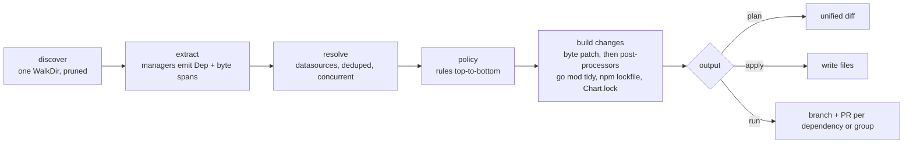

# deps design

`deps` is a dependency updater written in Go and intended to replace Renovate. This document holds the complete design. It covers GitHub/Gitea/Forgejo Actions `uses:` references, Go modules (requirements and `go`/`toolchain` directives), container images, npm `package.json` dependencies, custom annotation/regex dependencies, OSV security updates, and a PR bot for GitHub, Gitea and Forgejo with groups and schedules.

## 1. Goals

- **One static Go binary.** GitHub, Gitea and Forgejo are first-class platforms and are detected automatically.
- **A small, strict config (`.deps.yaml`).** Unknown keys are errors. Rules are evaluated top-to-bottom; each later matching rule overrides only the fields it sets.
- **Files are never reformatted.** Managers extract byte spans and deps replaces only those bytes. The only exceptions are generated files: `go mod tidy` output (go.mod, go.sum) and the `package-lock.json` npm writes.
- **Same behavior locally and in CI.** `deps plan`, `deps apply` and `deps run` behave identically on a laptop and as an Action.
- **Fast and memory-bounded.** Memory grows with the number of dependencies, not the size of the repo (see section 3).

## 2. Pipeline



### Managers

Every discovered file goes to every manager whose `Match` is true. Each dep carries `Manager`, `DepType`, `Datasource` and `Versioning`.

| Manager | Files | DepTypes | Datasource / versioning |
|---|---|---|---|
| `github-actions` | `.github`/`.gitea`/`.forgejo` `workflows`/`actions` and `workflow-templates` YAML, `action.y(a)ml` | `action`, `setup` | `git-tags` / `tag`; setup inputs per action (below) |
| `gomod` | `go.mod` | `direct`, `indirect`, `go`, `toolchain` | `go` / `go`; directives `go-toolchain` / `tag` |
| `docker` | `Dockerfile`, `Containerfile` (also `Dockerfile.x`, `x.Dockerfile`), `(docker-)compose*.y(a)ml`, workflows, `action.y(a)ml`, other `*.y(a)ml` (Kubernetes, Helm values) | `dockerfile`, `compose`, `workflow`, `action`, `kubernetes`, `helm` | `docker` / `docker` |
| `npm` | `package.json` | `dependencies`, `devDependencies`, `optionalDependencies`, `peerDependencies`, `packageManager`, `engines`, `volta` | `npm` / `semver`; node in `engines`/`volta` `node-version` |
| `helm` | `Chart.yaml`, `helmfile.y(a)ml`, `helmfile.d/*.y(a)ml` (each optionally `.gotmpl`), other `*.y(a)ml` (chart resources) | `chart`, `helmfile`, `k0s`, `flux`, `argocd` | `helm` / `semver` |
| `custom` | `custom[].files` globs | `annotation`, `regex` | per entry or per match |

**github-actions.** `uses:` values outside `with:`/`env:`. Skips: `local action` (`./`, `$/`), `docker reference (docker manager)`, `unrecognized uses`, `non-version ref`, `pinned without version comment`, `cannot locate value`.

**Actions setup inputs.** For `uses:` of a well-known setup action the version input in `with:` is a dep (DepType `setup`, manager github-actions): actions/setup-node `node-version` (node-version datasource, name node), actions/setup-go `go-version` (go-toolchain, go), azure/setup-helm `version` (github-releases helm/helm), azure/setup-kubectl `version` (kubernetes/kubernetes), hashicorp/setup-terraform `terraform_version` (hashicorp/terraform), golangci/golangci-lint-action `version` (golangci/golangci-lint). setup-python/setup-java are not extracted (no datasource). Only literal values: full `[v]X.Y.Z` uses semver versioning (the `v` style is kept: `version: 3.16.0` becomes `3.17.0`), partial `26`/`1.27`/`v2.1` uses tag versioning (precision kept: 26 → 27). Skips: `expression` (`${{ }}`), `non-version value` (lts/*, stable, latest), `unsupported range` (1.27.x, >=24, block scalars), `cannot locate value`. The span is the value bytes (quoted or plain, flow mappings too). If the line above the input is a `# deps:`/`# renovate:` marker, the input is left to the custom manager (no double extraction).

**gomod.** Every `require` plus the `go` and `toolchain` directives (the `toolchain` span covers only the version after `go`). Skips: `replaced`, `pseudo-version`, `vendored module (not supported)`, `prerelease toolchain`. By default `indirect` requirements and the `go` directive are ignored; a rule with `ignore: false` opts in. `toolchain` is updated by default. `go mod tidy` runs after any gomod change.

**docker.**
- Dockerfile: every `FROM` (case-insensitive, `--flag`s skipped, line continuations and the `# escape=` directive honored). `scratch` and earlier stage names (`AS <name>`) are not dependencies.
- Compose: `services.*.image`.
- Workflows: `jobs.*.container` (string or `.image`), `jobs.*.services.*.image`, `uses: docker://…` steps. Actions: `runs.image: docker://…` (when `runs.using: docker`) and `uses: docker://…` in `runs.steps`.
- References are parsed with distribution/reference; `Name` is the familiar name (`postgres`), the datasource uses the canonical one. Skips: `variable reference` (`$`), `cannot locate value`, `invalid reference`, `no tag`, `digest without tag`.
- Digests: `image:tag@sha256:…` is refreshed in place (tag and digest). With `pin: digest`, `@sha256:<index digest>` is appended after the tag. Digests come from a HEAD of the tag's manifest, so multi-platform images get the index digest. Credentials come from the Docker config and credential helpers.
- Non-version tags (`latest`, `bookworm`, `ubuntu-26.04`, `stable`) are extracted too; the engine only maintains their digest (section 4, Resolve order). This also covers Helm `tag: latest@sha256:…`.

**Dockerfile stage references and ARGs.** Besides `FROM`, the docker manager extracts `COPY --from=<image>` and `RUN --mount=…,from=<image>`; stage names, numeric stage indexes and `scratch` are not images. A reference that is exactly `$X`/`${X}` resolves to `ARG X=<image>` declared before the first `FROM` or in the current stage; the dep sits at the ARG default (once per ARG), so the update rewrites the ARG line. Defaults that are themselves variable or quoted with escapes are skipped as `variable reference`.

**Kubernetes and Helm YAML.** Every other `*.ya?ml` file is a candidate but is only parsed when its bytes contain `image:` or `repository:`; documents are decoded one by one and a parse error (typically Helm templates) yields no deps and no error.
- `kubernetes`: scalar `image` in `containers`/`initContainers`/`ephemeralContainers` items anywhere.
- `helm`: `*image` mappings with `repository` + `tag` (optional `registry` prefix; digest from `tag: x@sha256:…` or a sibling `digest:`); the tag scalar is rewritten in place.
- Values containing `{{` are skipped as `template value`.

**npm.** `package.json` is streamed with `encoding/json` tokens; `InputOffset` after each string value gives its byte span, which must equal the quoted value in the file (otherwise, e.g. with `\u` escapes, `cannot locate value`). Sections: `dependencies`, `devDependencies`, `optionalDependencies`, `peerDependencies` (the section name is the `DepType`) and `packageManager` (`npm@x`, `pnpm@x`, `yarn@x`; `Name` is the tool). `overrides`, `resolutions` and `bundleDependencies` are not extracted; `node_modules` is pruned by discovery.
- **Range grammar:** an optional operator `^`, `~`, `>=` or `=`, then a full `MAJOR.MINOR.PATCH[-prerelease]`. `Version` is the bare version and `RefSpan` covers only the version bytes, so the operator is kept: the range is *bumped* (`^1.2.3` → `^1.4.0`), not widened or replaced.
- **Skips:** `npm alias` (`npm:`), `local dependency` (`file:`, `link:`, `workspace:`, `./`, `../`, `/`, `~/`), `git dependency` (`github:`, `gitlab:`, `bitbucket:`, `gist:`, `git+`, `git://`, `git@`, `owner/repo[#ref]`), `url dependency` (`http(s)://` tarballs), `tag` (dist-tags such as `latest`, `next`), `unsupported range` (`||`, spaces, `x`/`*` wildcards, partial versions, `<`, hyphen ranges, `v1.2.3`, empty), `cannot locate value`; for `packageManager` also `packageManager with hash` (`+sha512…` suffix) and `unsupported packageManager`.
- **engines and volta:** `engines.{node,npm,pnpm,yarn}` (DepType `engines`, ignored by default; enable with a rule `depTypes: [engines], ignore: false`) and `volta.{node,npm,pnpm,yarn}` (DepType `volta`, updated). node uses the node-version datasource, the others npm. The range grammar is that of dependencies; additionally an optional ^/~/>=/= plus a MAJOR[.MINOR] partial (`^26`, `10.2`) uses tag versioning on the numeric part (^26 → ^27). Other keys and non-string values are ignored.
- **peerDependencies** are ignored by default, like indirect Go requirements; a rule with `depTypes: [peerDependencies]` and `ignore: false` opts in.
- **Lockfile:** after a package.json change, `apply`/`run` regenerate the workspace's `package-lock.json`, `pnpm-lock.yaml` or `yarn.lock` (see *Post-processors* below). Dependencies naming a member of the manifest's own workspace are never updated (any range form).

**helm.** Deps have `Name` = chart, `Source` = repository URL (`https://…` index repository or `oci://host/path`), `RefSpan` = the version scalar.
- `Chart.yaml` (DepType `chart`): `dependencies[]` `name`/`version`/`repository`. Skips: `local chart` (empty or `file://` repository), `repository alias` (`@name`, `alias:name`: resolved from the user's Helm repository config, which deps does not read), `unknown chart repository <repo>`.
- helmfile (DepType `helmfile`): `releases[].chart` is `<repo>/<name>`, resolved through `repositories[]` of any document of the file (`oci: true` prefixes `oci://`), or `oci://host/path/name`. Skips: `local chart` (`./x`, `../x`, `/x`, no `/`), `unknown chart repository <repo>`, `invalid chart reference`. In `.gotmpl` files every line containing `{{` is blanked (bytes replaced by spaces, offsets unchanged) before parsing, so templated values are not deps.
- Only exact versions (`[v]MAJOR.MINOR.PATCH[-pre][+build]`) are updated; Helm treats anything else as a constraint (`1.2` means `1.2.x`), skipped as `version range`. Also `no version`, `template value`, `cannot locate value`.
- `Chart.lock` is kept in sync by the helm post-processor (below).

**custom, annotation mode** (no `match`). A comment `deps: <datasource> <name> [versioning=<scheme>]` after `#`, `//`, `--`, `;` or `<!--` annotates the next line; its first version token (`v?N.N[.N…][-suffix]`, not glued to other word characters) is the version. Otherwise `no version on next line`. Helm charts are named `<repository>/<chart>` (`deps: helm https://charts.jetstack.io/cert-manager`) or given as two tokens, `deps: helm <repository> <chart>`; anything but an `https://`, `http://` or `oci://` repository with a chart is `invalid helm name "<name>"`.

**Renovate markers.** Annotation mode also accepts `renovate: datasource=<ds> depName=<name> [packageName=<p>] [versioning=<v>] [registryUrl=<url>]` (fields in any order; `packageName` wins over `depName`; `registryUrl` is the chart repository of `helm` deps and ignored otherwise, as are unknown keys); it annotates the next line like `deps:`. Skips: `renovate marker without datasource`, `renovate marker without depName`. For the docker datasource the next line's first tagged image reference is used instead: the tag after the last `:` is the version and an adjacent `@sha256:` digest is captured, so tag and digest are rewritten together. Renovate datasource names are aliased: `golang-version` → `go-toolchain`, `github-tags` → `git-tags` (`owner/repo` on github.com), `github-release-attachments` → `github-releases`, `node` → `node-version`. `custom.<name>` names a datasource of `customDatasources`; undefined ones, like other unknown names, are skipped as `unknown datasource "<ds>"`.

```dockerfile
# deps: github-releases golangci/golangci-lint
ARG GOLANGCI_VERSION=v2.5.0
# deps: go golang.org/x/tools versioning=go
RUN go install golang.org/x/tools/cmd/goimports@v0.38.0
```

**custom, regex mode.** `match` is an RE2 run over the whole file; every match is one dep. Named groups: `version` (required; alias `currentValue`), `name` (aliases `depName`, `packageName`; `packageName` wins over `depName`), `datasource`, `versioning`, `digest` (alias `currentDigest`); groups override or supply the entry's `name`/`datasource`. Empty groups skip the match (`empty version`, `empty name`, `empty datasource`). A `digest` group is replaced together with the version.

```yaml
custom:
  - files: ["**/*.mk"]
    match: '(?P<name>[a-z0-9-]+/[a-z0-9-]+)@(?P<version>v\d+\.\d+\.\d+)'
    datasource: github-releases
```

**Release checksums.** A regex entry can pin a checksum next to the version (`ARG GH_VERSION=…` / `ARG GH_SHA256=…`): a `(?P<checksum>…)` group in `match` plus a `checksum:` block, required together. Exactly one source:
- `asset` (github-releases only): the release asset's API `digest` from the already-fetched release list (no extra request);
- `url`: a checksum document downloaded once per URL (streamed, 1 MiB cap); with `file`, the entry is looked up in a sha256sum-style list (`<hex>  <name>` / `<hex> *<name>`), else the first hex token is taken.

The only template variable is `{{version}}` (the new version as written into the file), validated at load. sha256 (64 hex) and sha512 (128 hex) are accepted; the new checksum must have the current length and keeps its letter case. The checksum is fetched only after an update is chosen; a failure is that dependency's error (no update), so version and checksum always change together.

```yaml
custom:
  - files: [Dockerfile]
    match: 'ARG GH_VERSION=(?P<version>\S+)\nARG GH_SHA256=(?P<checksum>[0-9a-f]{64})'
    datasource: github-releases
    name: cli/cli
    checksum:
      url: 'https://github.com/cli/cli/releases/download/v{{version}}/gh_{{version}}_checksums.txt'
      file: 'gh_{{version}}_linux_amd64.tar.gz'
```

### Datasources

| Datasource | Name form | Source |
|---|---|---|
| `git-tags` | repository URL (`https://host/path` or `host/path`) | git smart-HTTP `ls-refs`, tags with peeled commits |
| `go` | module path | GOPROXY `@v/list`, or `go list -m -versions` for GONOPROXY/direct |
| `go-toolchain` | `go` / `toolchain` | `https://go.dev/dl/?mode=json&include=all` |
| `docker` | image reference | registry `tags/list` and manifest HEAD (oras-go) |
| `github-releases` | `owner/repo` (github.com) or `https://host/owner/repo` (GHES) | non-draft non-prerelease tag names, up to 5 pages of 100: GraphQL `releases` with a token for the host, else `GET /repos/{repo}/releases` (section 3) |

| `npm` | package name (`@scope/name` requested as `@scope%2fname`) | `GET <registry>/<name>` with `Accept: application/vnd.npm.install-v1+json` (abbreviated metadata), streamed: only the `versions` keys and each version's `deprecated`; deprecated versions are dropped |
| `node-version` | `node` (any name) | `GET https://nodejs.org/dist/index.json` once per run (base URL overridable with `DEPS_NODE_DIST_URL` for mirrors), streamed element by element: `version` and `date` (release time) |
| `helm` | chart name; `Source` is the repository (`https://…` or `oci://host/path`) | classic: `GET <repo>/index.yaml` once per repository, stream-scanned (section 3); OCI: `tags/list` of `<host>/<path>/<chart>` through the docker datasource, tag `_` read as `+` |
| `custom.<name>` | free-form (all deps share the list) | `customDatasources.<name>`: one `GET <url>` per run (unauthenticated, at most 10 MiB), decoded as json, yaml or plain text, selected and optionally regex-filtered (below) |

Custom entries may use `git-tags`, `github-releases`, `go`, `go-toolchain`, `docker`, `npm`, `node-version` and `helm`, the Renovate aliases `golang-version`, `github-tags`, `github-release-attachments` and `node`, and `custom.<name>` of a defined custom datasource.

**helm.** Classic index versions without `urls` are dropped (Helm ignores them); release times are the index's `created`. A classic request carries the forge token as Basic `x-access-token` only on the forge's own host (a Gitea/Forgejo package registry), else it is anonymous. OCI charts share the docker datasource's credentials, token cache and Docker Hub handling (`registry-1.docker.io`/`index.docker.io` are looked up as `docker.io`); their release time is the manifest annotation `org.opencontainers.image.created`, which `helm push` sets (the docker datasource reads manifest annotations instead of fetching a config blob for any non-image artifact). A chart missing from its index is `chart <name> not found in <repo>`. No digests.

**node-version.** Releases are returned as published (`v26.13.0`, prereleases included; the schemes drop them unless the current version is one), followed by a derived `X.Y` and `X` without `v` per stable release line, so partial values (`node-version: 26`, engines `^26`) have candidates of their precision under `tag` versioning. The derived entries come last so that semver, which reads `27` as 27.0.0, prefers the published `v27.0.0` on a tie. Semver keeps the file's `v` style (`NODE_VERSION = "26.5.0"` → `26.13.0`). A derived entry's release time is that of the line's first release. No digests. Renovate's `node` versioning (LTS-aware stability) is not reproduced; use `allow` to restrict majors.

**Custom datasources.** The document is fetched once per run and shared by every dep of that datasource. json is decoded with numbers kept as written; yaml is decoded to nodes so scalars keep their text (`1.20` is not the number 1.2). The `versions` selector (a jq subset, below) yields the values; nulls are dropped, non-scalars are errors. With `versionRegex` a value must match and its `version` group (else the whole match) is the version. Duplicates are removed, document order is kept; an empty result is `no versions`. No release times, no digests. Errors read `custom.<name>: GET <url>: HTTP 404`, `custom.<name>: <url>: selector ".a[]": cannot iterate over null`.

Selector grammar: stages joined by `|`; a stage is `keys` (sorted keys of an object) or a path of steps `.` (identity), `.field` (identifier `[A-Za-z_][A-Za-z0-9_-]*`) and `[]` / `.[]` (array elements or object values), which may start with `[]`. Like jq, a missing field or a field of null is null, and iterating null or indexing/iterating the wrong type is an error. Examples: `.releases[].version` (the default, Renovate's custom datasource shape), `.releases | keys` (controller-tools' envtest-releases.yaml), `[].tag_name` (a GitHub releases list). JSONata `transformTemplates` are not supported; `versionRegex` covers the common `$replace(…, /^v/, "")` case.

**npm registry and auth.** Per package.json directory, the nearest `.npmrc` walking up to the scanned root is read (once per directory per run): `@scope:registry=` for scoped names, then `registry=`. Without one, `NPM_CONFIG_REGISTRY` (or `npm_config_registry`), else `https://registry.npmjs.org/`. A `//host/path/:_authToken=` entry whose key is the longest prefix of the registry URL (without scheme) sends `Authorization: Bearer <token>`. `${VAR}` and `${VAR?}` in keys and values expand from the environment (empty when unset); values may be quoted. Lookups are deduped per (registry, name). A 404 is `package <name> not found`. npm has no digests.

### Post-processors

`engine.Build` patches every file, then asks the post-processor registered for the file's manager for the file's **scope**: the directory owning its derived files (`plan` passes only the in-process helm post-processor). Manifests of one manager sharing a scope are post-processed together, once per scope, under a global bound of 4 concurrent runs. The engine reads the scope dir's existing siblings; a result under a manifest's path (relative to the scope) replaces that manifest; every sibling whose content differs becomes a change (mode kept, `0644` for new files). A manifest without a scope is only patched. A failing scope drops all its manifests and siblings (`<file>[, <file>…]: <err>`).

- **gomod** (`gotool.Tidier`, scope = module dir, siblings `go.sum`): `go mod tidy -modfile=<tmp>/go.mod` on copies.
- **npm** (`nodetool.Locker`, siblings `package-lock.json`, `pnpm-lock.yaml`, `yarn.lock` + read-only `.npmrc`, `pnpm-workspace.yaml`, `.yarnrc.yml`).
  - Scope (lock root): nearest dir at/above the package.json (within `--dir`) holding one of the lockfiles, accepted if it is the manifest's own dir or its package.json `workspaces` (array or `{packages}`) / `pnpm-workspace.yaml` `packages` doublestar globs match the manifest dir (`!glob` excludes); otherwise no lockfile (none is created).
  - Temp copy: root + all member package.json (patched where changed) at relative paths, the lockfile, config files, and local files referenced by `.yarnrc.yml` `yarnPath`/`plugins` (member discovery walks each glob's literal base, skipping node_modules/.git).
  - Commands: npm `install --package-lock-only --ignore-scripts --no-audit --no-fund`; pnpm `install --lockfile-only --ignore-scripts --no-frozen-lockfile`; yarn berry (`.yarnrc.yml` or `__metadata` in the lock) `install --mode=update-lockfile` with `YARN_ENABLE_SCRIPTS=0 YARN_ENABLE_IMMUTABLE_INSTALLS=0`; yarn classic `install --ignore-scripts --ignore-engines --non-interactive --no-progress`. Env `npm_config_update_notifier=false`, `COREPACK_ENABLE_DOWNLOAD_PROMPT=0`.
  - Tool resolution: binary on PATH; else `npx --yes <tool>@<version>` when root `packageManager` names it (berry: `npx --yes --package=@yarnpkg/cli-dist@<version> -- yarn`); else `npx --yes <tool>`; else `<tool> not found (needed to update <lock>)`.
  - Several lockfiles in one root: the `packageManager` tool's lockfile wins, else package-lock, pnpm, yarn. Only the lockfile is read back and returned when changed; failure `<tool> install in <dir>: <last 20 output lines>`. npm-shrinkwrap.json is not handled.
- **helm** (`helm.Locker`, scope = the dir of a `Chart.yaml`, sibling `Chart.lock`; helmfiles and resources have no scope). In process, no network, so `plan` shows the lock diff too. Without a `Chart.lock` nothing happens.
  - Every dependency whose patched Chart.yaml version is exact and differs from the locked one (matched by position and name) gets the new version in the lock, in the lock's `v` style.
  - `digest` is Helm's `HashReq`: `sha256:` + hex sha256 of `json.Marshal([2][]*chart.Dependency{chartYamlDeps, lockDeps})`, with `chart.Dependency` mirrored field for field. `@name`/`alias:name` repositories are replaced by the URL locked at the same position, as `helm dependency build` resolves them before hashing. Verified against Helm-written locks and accepted by `helm dependency build`.
  - The old digest is recomputed from the unpatched Chart.yaml first; a mismatch fails the chart (`Chart.lock is out of sync with Chart.yaml …; run helm dependency update`) rather than writing a lock Helm would reject.
  - Only the version and digest bytes change; `generated` is kept, so the same update always yields the same commit.

## 3. Performance and memory design

The following is implemented:

- **Discovery.** A single `filepath.WalkDir`. It prunes `.git`, `node_modules`, `vendor`, `testdata` and directories matching `ignorePaths` via `fs.SkipDir`. When `ignorePaths` is absent the default is `**/{node_modules,bower_components,vendor,examples,__tests__,test,tests,__fixtures__}/**` (Renovate's `:ignoreModulesAndTests`). Paths are matched before any file is opened, and only matched files are read.
- **Extraction.** Runs on `runtime.GOMAXPROCS(0)` workers. Each worker keeps only `[]Dep` (spans and strings); parse trees and file bytes are dropped immediately. Files are re-read when changes are built, so memory is O(deps), not O(repo). References across files (a k0s chart's repository alias, a Flux HelmRelease's HelmRepository) are resolved in one sequential `Link` pass per manager after extraction; until then the manager keeps only the repository names and URLs it saw.
- **HTTP.** One shared `http.Client` (HTTP/2, keep-alive) handles every network call.
- **Retries and rate limits.** The shared transport retries idempotent requests: GET/HEAD/OPTIONS, and read-only POSTs marked with `httpx.Idempotent` (git ls-refs, OSV querybatch, GitHub GraphQL queries). It retries connection errors and 429/500/502/503/504, at most 3 times, with full-jitter exponential backoff (500ms base, 10s cap), honouring `Retry-After`. Platform writes are never retried. A 429, or a 403 with `X-RateLimit-Remaining: 0` or `Retry-After`, is a rate limit: if it resets within 60s deps waits (info log); otherwise the request fails fast with `rate limited by <host> until <time>` (`httpx.ErrRateLimited`) instead of stalling the run. The registry client gets the plain transport, not oras-go's retrying client, so attempts are not multiplied. Each attempt is logged at debug, with `X-RateLimit-Remaining` when present.
- **Lookup dedupe.** Lookups are deduped within a run per key (one `sync.Once` per cache entry). A global semaphore caps concurrent requests at 32 (`--concurrency`); every host deps talks to speaks HTTP/2, so requests multiplex over a few connections. On open-component-model, 32 instead of 16 cut wall time by about a third; 64 gained nothing further.
- **Candidate selection.** Each scheme parses a dependency's candidates once (`Scheme.Rank`); Actions/tag versions use a hand-written scanner instead of a regexp, and Masterminds conversion happens only when an `allow` constraint needs it. Go module versions are parsed once into a 32-byte struct (end offsets of major/minor/patch/prerelease into the original string) by a parser that mirrors `golang.org/x/mod/semver`; compatibility, ordering and kind compare substrings without re-parsing, and a test checks validity, `Compare`, kind and compatibility against `x/mod` over a generated corpus (shorthand, prereleases, `+incompatible`, pseudo-versions, leading zeros). The Masterminds conversion of a full `vX.Y.Z` uses the regexp-free `StrictNewVersion`. On `BenchmarkResolve` this cut 32.6 → 23.9 ms/op, 34.4 → 29.6 MiB/op and 199.8k → 176.9k allocs/op. Release-time guards (minimum release age, majors older than current) walk the ranking instead of re-selecting. After the first too-new rejection the next 8 candidates' release times are fetched concurrently.
- **GitHub releases.** One release list per repository and run (`internal/githubapi`) serves the `github-releases` datasource (versions, release times, checksum assets) and the release times of `git-tags` on github.com. With a token for the host it is listed over GraphQL (`POST https://api.github.com/graphql`, GHES `<host>/api/graphql`; `releases(first:100, orderBy: CREATED_AT DESC)` with only `tagName isDraft isPrerelease publishedAt`, cursor-paged); without one over REST (GraphQL requires auth), whose pages always carry every body and asset. Pages are fetched only until the dependency's current release is listed, since everything newer precedes it (at most 5 pages); `git-tags` release times use the first page and look up tags missing from an incomplete list individually (`release(tagName:)`, REST `/releases/tags/<tag>`). Over GraphQL, checksum asset digests are fetched on demand (`release(tagName:){releaseAssets(first:1,name:)}`), once per (repository, tag, asset). GraphQL queries are marked idempotent so they are retried like GETs; `NOT_FOUND` errors behave like a REST 404 and `RATE_LIMITED` like an exhausted rate limit. On open-component-model (`docs/examples-ocm.deps.yaml`, identical plan output) the 17 GitHub API requests went from 31.2 MB to 0.13 MB of response bodies, their summed time to first byte from 16.4 s to 8.1 s and the slowest release page from 2.8 s to 0.95 s; max RSS dropped from about 62 MB to 52 MB.
- **Profiling.** Hidden flags `--cpuprofile` and `--memprofile` write pprof profiles; `BenchmarkResolve` (`internal/engine`) resolves a synthetic OCM-sized repository against in-memory datasources (900 deps, 600/80 versions, 28-day age) to track engine CPU and allocations.
- **Actions tags.** Fetched with a native git smart-HTTP protocol v2 `ls-refs` call using `ref-prefix refs/tags/` and `peel`. No `git` process is spawned per action, only tag refs travel over the wire, and the pkt-line response is parsed as a stream.
- **Go versions.** Fetched from the GOPROXY `@v/list` endpoint over HTTP. `go list` is used only for GOPRIVATE/direct modules. Release times (`@v/<v>.info`, immutable) are read from the local module download cache (`$(go env GOMODCACHE)/cache/download/<module>/@v/<v>.info`) when the go command already fetched that version, also for private modules; only misses go to the proxy. On open-component-model with a warm cache this serves 84 of 258 lookups. Version lists are never taken from the cache, since it only knows locally fetched versions. Go toolchain releases come from one `go.dev/dl/?mode=json&include=all` fetch per run.
- **Registries.** Docker tags come from `tags/list` (all pages; Docker Hub with page size 10000; pages up to 64 MiB, since gcr.io returns every tag in one ~10 MB page), digests from a manifest HEAD. Credentials come from the Docker config and its credential helpers. One oras-go auth client with a shared token cache per run, so each token exchange happens once per registry and scope. Registries on localhost, loopback and private addresses are reached over plain HTTP.
- **npm metadata.** Abbreviated documents are stream-decoded; only one version object is buffered at a time.
- **Chart indexes.** A classic repository's `index.yaml` (27.5 MB for charts.bitnami.com) is fetched once per run and scanned line by line from the response stream: chart keys sit at one indentation under `entries:`, so the lines of every chart nobody asked for are skipped without parsing or buffering, and only a wanted chart's block is decoded (into version, appVersion, created, digest, urls). The wanted set comes from `datasource.Planner`: before the first lookup the engine hands each planning datasource all of its deps, so one scan serves every chart of a repository; a chart asked for later costs one more scan. A JSON index is decoded whole. Measured: plan of 5 charts over the bitnami, prometheus-community and grafana indexes (38 MB) peaks at 62 MB RSS (an empty run: 12 MB); decoding only the bitnami index whole with yaml.v3 takes 292 MB.
- **Security.** OSV is queried in batches of up to 1000 packages; each advisory document is fetched once.
- **Child processes.** Spawned only where unavoidable: post-processors (`go mod tidy`, npm/pnpm/yarn lockfile installs; at most 4 concurrently in total) and `git` for commit and push.
- **Commits.** Built with git plumbing on a temporary index. `run` does no checkout, creates no worktree, and never mutates the working tree. With `--signing-key`, `commit-tree -S` signs them: an OpenSSH key is written once to a `0600` temporary file (`-c gpg.format=ssh -c user.signingkey=<file>`), an armored OpenPGP key is imported once into a temporary `GNUPGHOME` and selected by fingerprint. Both are validated up front (a passphrase-protected key fails before any lookup) and removed when `run` returns.
- **No persistent cache.** Runs are infrequent (scheduled), so in-run dedupe already removes the repeated lookups.

## 4. Core types

```go
// internal/dep
type UpdateType string // "major" | "minor" | "patch" | "digest" | "pin"
const (Major UpdateType = "major"; Minor = "minor"; Patch = "patch"; Digest = "digest"; Pin = "pin")

type Span struct{ Start, End int } // byte offsets, End exclusive

type Dep struct {
    Manager     string // "github-actions" | "gomod" | "docker" | "npm" | "helm" | "custom"
    Datasource  string // "git-tags" | "go" | "go-toolchain" | "docker" | "github-releases" | "npm" | "node-version" | "helm" | "custom.<name>"
    Versioning  string // "tag" | "go" | "docker" | "semver" | "loose" | "regex:<RE2>"; a rule's versioning replaces the manager's
    DepType     string // gomod: direct|indirect|go|toolchain; actions: action|setup; docker: dockerfile|compose|workflow|action|kubernetes|helm; npm: dependencies|devDependencies|optionalDependencies|peerDependencies|packageManager|engines|volta; helm: chart|helmfile|k0s|flux|argocd; custom: annotation|regex
    File        string // slash path relative to --dir
    Line        int    // 1-based
    Name        string // actions: owner/repo[/sub]; gomod: module path; helm: chart
    Source      string // actions: https://<host>/<owner>/<repo>; gomod: ""; helm: repository URL (https:// or oci://)
    Version     string // current version (ref tag, comment version, or module version)
    Digest      string // actions: full SHA when pinned, else ""
    RefSpan     Span   // actions: ref after '@'; gomod: version token
    VersionSpan Span   // actions: version token in trailing comment (pinned only)
    DigestSpan  Span   // docker/custom: digest token stored apart from RefSpan
    InsertAt    int    // manager-defined insert offset (actions: after the uses value incl. closing quote)
    Skip        string // non-empty = not updatable, with the reason

    Checksum       string          // custom: current sha256/sha512 hex pinned next to the version
    ChecksumSpan   Span            // custom: checksum token
    ChecksumSource *ChecksumSource // custom: where the checksum of a new version comes from; nil = none
}

// Asset and URL/File are templates over {{version}}; exactly one of Asset and URL is set.
type ChecksumSource struct {
    Asset string // github-releases: release asset whose API digest is used
    URL   string // checksums document to download
    File  string // entry name in a sha256sum-style URL document; "" = first hex token
}

type Advisory struct{ ID, Summary, URL string }

type Update struct {
    Dep         Dep
    Type        UpdateType
    NewVersion  string
    NewDigest   string        // "" unless the result is digest-pinned
    Group       string        // policy group, "" = own PR
    Schedule    *schedule.Set // workflow crons that put it in schedule; nil = every run
    Advisories  []Advisory    // non-empty = security update
    NewChecksum string        // "" unless Dep.ChecksumSource is set and the version changes
    CommitType  string        // policy commit type (fix, chore, ...)
    CommitScope string        // policy commit scope; "" = none
    Bucket      string        // PR bucket among the dep's updates: "" (only or non-major), "major", "v<N>", "minor", "patch"
    Automerge   bool          // policy automerge of the update's type
    AutomergeStrategy string  // policy automergeStrategy: auto, merge, squash, rebase
}
```

```go
// internal/manager
type Env struct {
    DefaultHost string                // actions default host
    Vendored    func(dir string) bool // slash dir relative to root; engine supplies a stat check when nil
}
type Manager interface {
    Name() string
    Match(path string) bool
    Extract(file string, src []byte, env Env) ([]dep.Dep, error)
    Edits(u dep.Update) ([]patch.Edit, error) // byte edits for one update; the engine merges them per file
}
// Linker is optional: managers whose deps refer to definitions in other files (helm) record
// them during Extract; the engine calls Link once after every file was extracted, with the
// deps of each file, to resolve references in place, drop non-deps and reset.
type Linker interface{ Link(files [][]dep.Dep) }
// actions.New(), gomod.New(), docker.New(), npm.New(), helm.New() return the built-in managers; custom.New(cfg) one per cfg.Custom entry (accepting custom.<name> of cfg.CustomDatasources).
```

```go
// internal/datasource (leaf package; aliased as engine.Release, engine.Datasource, engine.Vuln, engine.SecuritySource, engine.ChecksumSource)
type Release struct{ Version, Digest string }
type Datasource interface {
    Releases(ctx context.Context, d dep.Dep, dir string) ([]Release, error)
    Digest(ctx context.Context, d dep.Dep, version string) (string, error) // when Release.Digest == ""
}
type Vuln struct{ Advisory dep.Advisory; Fixed []string }
type SecuritySource interface {
    Advisories(ctx context.Context, deps []dep.Dep) ([][]Vuln, error)
}
type ChecksumSource interface {
    Checksum(ctx context.Context, d dep.Dep, version string) (string, error) // lowercase hex
}
type Timer interface { // optional: release times for ages and the older-than-current check
    ReleaseTime(ctx context.Context, d dep.Dep, version string) (time.Time, error)
}
type SourceRepo interface { // optional: source repository for release notes
    SourceRepo(ctx context.Context, d dep.Dep, version string) (string, error)
}
type Planner interface { // optional: all updatable deps of the datasource, once, before the first lookup
    Plan(deps []dep.Dep)
}
// gittags.Lister ("git-tags"), goproxy.Source ("go"), gotoolchain ("go-toolchain"),
// dockerds ("docker"), githubreleases ("github-releases"), npmds ("npm"), nodeversion ("node-version"),
// helmds ("helm", a Planner)
// and customds ("custom.<name>", one per customDatasources entry) implement Datasource; osv implements SecuritySource;
// checksum.Source implements ChecksumSource.
```

```go
// internal/versioning
type Scheme interface {
    Valid(v string) bool
    Compare(a, b string) int
    Kind(cur, next string) dep.UpdateType
    Semver(v string) *semver.Version
    Best(cur string, cands []string, accept func(v string, kind dep.UpdateType) (bool, string), reject func(v, reason string)) (string, bool)
    Rank(cur string, cands []string, accept func(v string, kind dep.UpdateType) (bool, string), reject func(v, reason string)) Ranking
    Compatible(cur, next string) bool
}
type Ranking interface{ Len() int; At(i int) Candidate } // best first; candidates are built on access
type Candidate struct{ Version string; Kind dep.UpdateType; Major string } // Major: decimal major of a major candidate
func Get(name string) (Scheme, bool)    // "tag", "go", "docker", "semver", "loose", "regex:<RE2>"
func Parse(name string) (Scheme, error) // Get with the reason; regex schemes are compiled once per name and cached
```

```go
// internal/engine
type PostProcessor interface {
    Scope(root, manifest string) (dir string, ok bool) // slash dir relative to root owning the derived files; !ok = patch only
    Siblings() []string                                // file names in the scope dir read or regenerated
    // manifests: patched content by path relative to dir; files: existing siblings by name.
    // A result under a manifest's path replaces it, one under a sibling's name the sibling.
    Process(ctx context.Context, dir string, manifests, files map[string][]byte) (map[string][]byte, error)
}
type Options struct {
    Managers    []manager.Manager
    Datasources map[string]Datasource // by Dep.Datasource
    Security    SecuritySource        // nil = off
    Checksums   ChecksumSource        // nil = deps with a checksum source cannot be updated
    Filter      func(dep.Dep) bool    // nil = all
    Trace       func(Trace)           // nil = off
    Now         time.Time             // reference time of minimumReleaseAge; zero = time.Now()
}
type Trace struct {
    Dep        dep.Dep
    Rules      []int          // matching rules of the pre-policy
    Policy     config.Policy  // pre-policy
    Candidates int
    Rejected   map[string][]string // reason -> versions
    Updates    []TraceUpdate       // one per PR bucket, lowest version first; nil = none
    Err        error
}
type TraceUpdate struct{ Update dep.Update; Policy *config.Policy } // Policy: of Update.Type (updateTypes rules included)
type Result     struct{ Updates []dep.Update; Skipped []dep.Dep; Errors []error; Deps []dep.Dep } // Deps: every extracted dep, Skipped included (dashboard)
type FileChange struct{ Path string; Mode fs.FileMode; Old, New []byte }
type Group      struct{ Manager, Name, Branch, Title string; Updates []dep.Update; Automerge bool; AutomergeStrategy string } // Automerge: all updates automerge; strategy of the first

func Managers(cfg *config.Config) ([]manager.Manager, error)
func Resolve(ctx context.Context, root string, cfg *config.Config, env manager.Env, o Options) (*Result, error)
func Build(ctx context.Context, root string, managers []manager.Manager, updates []dep.Update, post map[string]PostProcessor) ([]FileChange, []error) // post by manager name; nil = none
func GroupUpdates(updates []dep.Update, branchPrefix string) []Group // "" = config.DefaultBranchPrefix
func Local(updates []dep.Update) (local []dep.Update, separate []bool) // the one update per dep that plan/apply write
```

**Resolve order per dep:** pre-policy (its `versioning` replaces the dep's scheme before the current value is validated) → datasource releases → `Scheme.Rank` under the per-kind policy → one candidate per PR bucket, with the release-time guards below → digest pin/refresh when no bucket has an update (digest-capable managers github-actions and docker, whatever their versioning, and custom deps that carry a digest) → security. With advisories, the minimum fix F is the highest, over all vulns, of each vuln's lowest compatible fixed version. The lowest update at or above F carries the advisories. If there is none, the smallest compatible release ≥ F is chosen regardless of `allow`/`updates`, `minimumReleaseAge` and of rules with `updateTypes` (a pre-policy `ignore` still wins); it replaces the update of its bucket (which is below F) and any digest or pin update. The advisories the chosen version fixes are attached to that one update; such security updates get no group and no schedule. Every file goes to every manager that matches it.
- **Per-kind policy.** `config.Policy(d)` is the pre-policy (rules without `updateTypes`); it decides `ignore` for the dep, `pin`, `versioning`, and whether the dep is looked up at all. `config.PolicyFor(d, kind)` evaluates all rules in file order, those with `updateTypes` only when they list `kind`. The engine caches the five per-kind policies of a dep (evaluated lazily, and only when the config has `updateTypes` rules). Each candidate is accepted under the policy of its own kind: an ignoring per-kind policy rejects it as `ignored by rule #i for <kind>` (or the default-ignore reason), otherwise `updates`/`allow` decide as before; the bucket's next candidate is considered instead, so ignoring indirect majors keeps their minor and patch updates. Digest refresh and pin need `digest`/`pin` enabled and not ignored in their per-kind policy.
- **PR buckets** (Renovate's `separateMajorMinor`, `separateMultipleMajor`, `separateMinorPatch`; its `getBucket`). The ranking is split into buckets and each bucket yields at most one update, its best candidate that passes the policy and the release-time guards (the guards and their bounds run per bucket). The bucket of a candidate comes from the policy of its kind, i.e. the pre-policy unless an `updateTypes` rule listing that kind sets the flags (Renovate evaluates these options before the update type is known, so it ignores them on `matchUpdateTypes` rules; OCM therefore sets them on manager rules, which behaves the same here):
  - `separateMajorMinor: false`: one bucket `""`, the newest update of any kind.
  - otherwise majors go to `major` (the newest major), or with `separateMultipleMajor` to `v<N>` per newer major `N` (the newest release of each); minors and patches share `""` (the newest), or with `separateMinorPatch` get `minor` (the newest minor) and `patch` (the newest patch of the current minor).
  - Digest refreshes and pins are the bucket `""` (they only exist when no version update does). A dep's updates are ordered by version, lowest first, and all share the dep's other spans, so each bucket is built on its own branch (`Update.Bucket` becomes a branch suffix, section 5). `plan`/`apply` write one update per dep (`engine.Local`): the newest non-major one, else the lowest major; the others are reported with a `, separate PR` hint.
- A dep the pre-policy ignores is still resolved when some per-kind policy un-ignores it (`updateTypes: [patch], ignore: false`), only for those kinds; it gets no security lookup.
- **Non-version values.** A current value the dep's versioning scheme cannot parse is skipped as `non-version value "<v>"` before any lookup, not reported as an error. The exception is a docker-datasource dep whose digest can be maintained (docker manager, or a custom dep with a digest), e.g. `latest@sha256:…`: it gets digest-only resolution without listing releases or asking OSV. Pinned → the digest of the same tag is refreshed (`digest`, no update when unchanged); unpinned with `pin: digest` → `pin`; unpinned with `pin: keep` → skipped as `non-version tag`.
- **Release-time guards** (only when the datasource implements `datasource.Timer`; each candidate's time is asked at most once per dep). A bucket's best candidate is rejected and the bucket's next one tried (bounded per bucket: 3 `older than current`, 50 rejections in total, then no update for that bucket):
  - A major candidate whose release time predates the current version's is rejected as `older than current`. This drops legacy pre-module tags such as `k8s.io/client-go v1.5.2` (2016) when the current version is `v0.37.1`.
  - With a `minimumReleaseAge` in the policy of the candidate's kind, a candidate released less than that long before `Options.Now` is rejected as `too new (released <date>, minimum <age>)`; the bucket's next lower candidate is tried. Without `separateMajorMinor` all kinds share one bucket, so a too-new major falls back to an old enough minor.
  - Unknown times (zero, or a lookup error, logged at debug level) never reject. Digest refreshes and pins (no new version) and security updates are exempt from the age.
- The chosen update (also digest, pin and security updates) takes `CommitType`/`CommitScope` and `Automerge`/`AutomergeStrategy` and, unless it is a security update, `Group`/`Schedule` from the policy of its type (`config.Policy` also has `Monorepo`, the built-in group that applied, and `Kind`, the type a `PolicyFor` result is for).

```go
// internal/platform
type Kind string // "github" | "gitea" | "forgejo"
type Info struct{ Kind Kind; ServerURL, APIURL, Host, Repo string } // Repo = "owner/name"
type PR struct {
    Number int; Title, Body, Head, HeadSHA, State, URL string; Merged bool; Mergeable *bool
    CreatedAt time.Time // zero when omitted
    NodeID    string    // GitHub GraphQL id; "" on Gitea/Forgejo
    AutoMerge bool      // GitHub auto_merge non-null; always false on Gitea/Forgejo (not reported)
}
type Issue struct{ Number int; Title, Body, URL string }
var ErrAutoMergePending, ErrAutoMergeUnavailable, ErrIssuesDisabled error
type Client interface {
    DefaultBranch(ctx context.Context) (string, error)
    ListPRs(ctx context.Context, state string, maxPages int) ([]PR, error) // "open" | "closed"
    GetPR(ctx context.Context, number int) (PR, error)
    CreatePR(ctx context.Context, head, base, title, body string) (PR, error)
    UpdatePR(ctx context.Context, number int, title, body string) error
    ClosePR(ctx context.Context, number int) error
    EnableAutoMerge(ctx context.Context, pr PR, strategy string) error // ErrAutoMergePending, ErrAutoMergeUnavailable
    ChecksPassed(ctx context.Context, sha string) (bool, error)        // >= 1 status or check run, all green
    MergePR(ctx context.Context, pr PR, strategy string) error         // pinned to pr.HeadSHA
    ListIssues(ctx context.Context, maxPages int) ([]Issue, error)     // open, PRs excluded; ErrIssuesDisabled
    CreateIssue(ctx context.Context, title, body string, labels []string) (Issue, error)
    UpdateIssue(ctx context.Context, number int, body string) error
}
type Overrides struct{ Kind, APIURL, Repo string } // from flags; "" = auto
func FromEnv(getenv func(string) string) (Info, bool)
func Detect(ctx context.Context, getenv func(string) string, remoteURL string, o Overrides, c *http.Client) (Info, error)
func NewClient(info Info, token string, c *http.Client) Client
func DefaultActionsHost(info Info, getenv func(string) string) (host, source string)
```

```go
// internal/bot
type Git interface {
    RevParse(ctx context.Context, rev string) (string, error)
    RemoteURL(ctx context.Context) (string, error)
    LsRemote(ctx context.Context, pattern string) (map[string]string, error)
    Commit(ctx context.Context, parent string, changes []engine.FileChange, msg, name, email string) (string, error)
    Push(ctx context.Context, commit, branch, expected string) error
    DeleteBranch(ctx context.Context, branch string) error
    BranchTip(ctx context.Context, branch string) (author string, parents []string, err error)
}
type Options struct {
    Base, AuthorName, AuthorEmail string
    BranchPrefix                  string // ending in '/'; "" = config.DefaultBranchPrefix
    DryRun                        bool
    RebaseWhen                    string // config.RebaseWhens; "" = conflicted
    UpdateNotScheduled            bool   // update and rebase open PRs outside their schedule (config updateNotScheduled)
    MaxNewPRs                     int    // PRs created per run (--max-new-prs); 0 = unlimited
    ConcurrentLimit, HourlyLimit  int    // prConcurrentLimit, prHourlyLimit; 0 = unlimited
    IgnoredAuthors                []string // gitIgnoredAuthors: branch-tip emails that count as the bot's own
    Managers                      []manager.Manager
    Now                           time.Time // prHourlyLimit reference; zero = time.Now()
    Trigger                       schedule.Trigger // what started the run (schedule.Detect)
    Notes                         Notes     // nil = no ages/notes
    Dashboard                     *DashboardOptions // nil = no dashboard; an existing one is left alone
}
type DashboardOptions struct{ Title string; Labels []string }
type Notes interface { // implemented by releasenotes.Notes
    Section(ctx context.Context, ups []dep.Update) string
    Age(ctx context.Context, u dep.Update) string
}
type Action struct {
    Branch, Title, Status, URL string; Number int
    Automerge string // automerge outcome appended to the status ("created, automerge"); "" = not automerged
    Dashboard bool   // the dashboard issue, not a PR
}
func Run(ctx context.Context, o Options, root string, res *engine.Result, post map[string]engine.PostProcessor, pc platform.Client, g Git) ([]Action, []error)
```

### Versioning

- **Actions tags.** A tag must match `^(v?)(\d+)(?:\.(\d+))?(?:\.(\d+))?$`; suffixed and prerelease tags are never considered. Candidates must have the same prefix and the same number of parts as the current tag. This precision is what makes `@v4` move to `@v5` and `# v7.0.1` move to `# v7.0.2`.
- **Go modules.** `golang.org/x/mod/semver` syntax and ordering, each version parsed once (section 3). Excluded candidates:
  - pseudo-versions;
  - prereleases, unless the current version is a prerelease;
  - `+incompatible` versions, unless the current version has it;
  - other majors, except the step from v0 to v1.
- **Docker tags (`docker`).** `^(v?)(\d+(?:\.\d+)*)(.*)$` → prefix, numeric parts, suffix. Candidates must have the same prefix, the same number of parts and an identical suffix; `latest` and other non-numeric tags are invalid.
- **Semver (`semver`).** Masterminds loose semver. Prereleases only if the current version is one; any precision. The result keeps the current version's `v` prefix style. Default for `custom[]`; used by npm, whose versions have no `v` and whose prerelease candidates (`2.0.0-rc.1`) are only considered from a prerelease.
- **Loose (`loose`, Renovate's loose).** 1–6 numeric dot parts, an optional `v` (candidates must share the current one), an optional suffix after `-` or `_` (`2.0-rc1`, `5_beta`) that counts as a prerelease, so suffixed candidates are only considered from a suffixed version. Parts compare numerically with a missing part read as 0 (`1877` < `1877.25`; Renovate ranks a shorter version higher instead), then a release above its prereleases, prereleases by dot-separated identifiers (numeric ones numerically), and finally fewer parts below more (`1.2` < `1.2.0`). Kind by position: part 0 major, part 1 minor, later parts and suffix changes patch. Any precision is a candidate, so combine it with an `allow` regex to keep one (`/^\d+\.\d+$/`). `Semver` builds `MAJOR.MINOR.PATCH[-suffix]` from the first three parts.
- **Regex (`regex:<RE2>`, Renovate's regex).** The RE2 matches the version (anchor it with `^…$`) and names its parts: `major` (required), `minor`, `patch`, `build`, `revision` (numeric; absent groups read as 0), `prerelease` and `compatibility`; other named groups are errors, so a typo cannot silently read as 0. Go's regexp (since Go 1.22) accepts Renovate's `(?<name>…)` as well as `(?P<name>…)`, so expressions from `renovate.json5` are used unchanged (no translation step). Candidates must have the current `compatibility` (else `compatibility`), prereleases only from a prerelease. Ordering: major, minor, patch, build, revision numerically, then a release above its prereleases, prereleases by identifiers. Kind: major or minor by group, otherwise patch (build, revision and prerelease changes). `Semver` is `MAJOR.MINOR.PATCH[-prerelease]` for `allow` constraints. Schemes are compiled when the config is loaded and cached by name. OCM's cosign fork: `regex:^v(?<major>\d+)\.(?<minor>\d+)\.(?<patch>\d+)[-+]ocm\.(?<build>\d+)$` orders `v3.1.4+ocm.6` < `v3.1.5+ocm.1` (patch) and matches both the `+ocm.N` release and the `-ocm.N` image tag.
- **`go`/`toolchain` directives** use `tag` versioning against the `go-toolchain` releases: every stable `X.Y.Z` plus a derived `X.Y` per minor, so `go 1.26` moves to `go 1.27` and `go 1.26.1` to `go 1.27.1`. Prerelease toolchains (`go1.27rc1`) are skipped.
- **Rule versioning.** `rules[].versioning` replaces the manager's scheme for matching deps before resolution (pre-policy only; rejected together with `updateTypes`). It applies to every place the dep's scheme is used: validation of the current value (a value the new scheme cannot parse is skipped as `non-version value`), ranking, kinds, `allow` conversion and security fixes.
- Every scheme reports each dropped candidate with a reason (`invalid`, `prerelease`, `precision`, `prefix`, `suffix`, `major`, `compatibility`, `not newer`, `policy: <why>`) for `Trace`; policy reasons are `update type <k> not allowed` and `outside allow <constraint or /regex/>`.

## 5. Platforms

### Detection order

1. **Environment** (no network):
   1. `FORGEJO_ACTIONS=true` → forgejo. Reads `FORGEJO_SERVER_URL`, `FORGEJO_API_URL` and `FORGEJO_REPOSITORY`, each falling back to the `GITHUB_*` name.
   2. `GITEA_ACTIONS=true` → gitea, from the `GITHUB_*` variables.
   3. `GITHUB_ACTIONS=true` → github, from the `GITHUB_*` variables (covers GHES).
2. **The `origin` remote URL.** Accepted forms: `https://host/owner/repo(.git)`, `git@host:owner/repo(.git)` and `ssh://git@host[:port]/owner/repo(.git)`.
   - Host `github.com` → github, API `https://api.github.com`.
   - Any other host is probed unauthenticated, with a 10s timeout each, in this order:
     1. `/api/forgejo/v1/version` returns 200 → forgejo.
     2. `/api/v1/version` returns 200 with JSON `version` → gitea. Both use API `https://host/api/v1`.
     3. `/api/v3/meta` returns 200 → GHES, API `https://host/api/v3`.
     4. Nothing matches → error `cannot detect platform for <host>; pass --platform and --api-url`.

     Instances that require sign-in for the whole API answer probes 1 and 2 with 401/403 and a JSON `message` body; that also counts as a match. Missing paths return 404, so other servers are not misdetected.
3. **Flags.** `--platform`, `--api-url` and `--repo` override the detected values. If only the kind is overridden, the API URL is derived with the per-kind rule above.

**Default host for `owner/repo@ref`**, first match wins:
1. `actions.defaultHost` in the config (source `config`).
2. `DEPS_DEFAULT_ACTIONS_URL` (source `env`).
3. Platform default (source `platform default`): forgejo → `data.forgejo.org`; github, gitea or unknown → `github.com`.

`DEPS_DEFAULT_ACTIONS_URL` is not set by the composite action (it uses no `gitea.` expressions, so it runs unchanged on GitHub). Gitea's `gitea_default_actions_url` is not exposed to expressions by the Gitea 28 runner anyway, so the platform default applies. Instances with a non-default `DEFAULT_ACTIONS_URL` set `actions.defaultHost` in `.deps.yaml`.

### Endpoints

**GitHub.** Headers: `Authorization: Bearer <t>`, `Accept: application/vnd.github+json`, `X-GitHub-Api-Version: 2022-11-28`.

| Method | Endpoint |
|---|---|
| DefaultBranch | `GET {api}/repos/{repo}` → `.default_branch` (the repository JSON is fetched once per run and also gives `allow_auto_merge`, `allow_merge_commit`, `allow_squash_merge`, `allow_rebase_merge`, `has_issues`) |
| ListPRs | `GET {api}/repos/{repo}/pulls?state=<s>&sort=updated&direction=desc&per_page=100&page=N` |
| GetPR | `GET .../pulls/{n}` (nullable `mergeable`, `node_id`, `head.sha`, nullable `auto_merge`) |
| CreatePR | `POST .../pulls {title,head,base,body}` |
| UpdatePR | `PATCH .../pulls/{n} {title,body}` |
| ClosePR | `PATCH .../pulls/{n} {state:"closed"}` |
| EnableAutoMerge | `POST {graphql}` mutation `enablePullRequestAutoMerge(input:{pullRequestId:<node_id>, mergeMethod:MERGE\|SQUASH\|REBASE})`; not sent when `allow_auto_merge` is `false` |
| ChecksPassed | `GET .../commits/{sha}/status` (`state`, `total_count`) and `GET .../commits/{sha}/check-runs?per_page=100&page=N` (`status`, `conclusion`) |
| MergePR | `PUT .../pulls/{n}/merge {merge_method, sha}` |
| ListIssues | `GET {api}/repos/{repo}/issues?state=open&per_page=100&page=N`, entries with `pull_request` dropped; 410 → issues disabled |
| CreateIssue | `POST .../issues {title,body,labels:[names]}` |
| UpdateIssue | `PATCH .../issues/{n} {body}` |

On GitHub, `Merged` is `merged_at != null` and `AutoMerge` is `auto_merge != null`. `{graphql}` is `https://api.github.com/graphql`, or `https://<host>/api/graphql` on GHES.

**Gitea / Forgejo.** Header: `Authorization: token <t>`.

| Method | Endpoint |
|---|---|
| DefaultBranch | `GET {api}/repos/{repo}` (also `default_merge_style`, `has_issues`, `external_tracker`) |
| ListPRs | `GET {api}/repos/{repo}/pulls?state=<s>&sort=recentupdate&limit=50&page=N` |
| GetPR / CreatePR / UpdatePR / ClosePR | same paths and bodies as GitHub |
| EnableAutoMerge | `POST .../pulls/{n}/merge {do, merge_when_checks_succeed: true, delete_branch_after_merge: true, head_commit_id}`; the style field is `do` on Gitea 28 and `Do` on Forgejo (both `swagger.v1.json`). 409 `already scheduled` is success; 405 `Please try again later` is pending. |
| ChecksPassed | `GET .../commits/{sha}/status` (Actions report commit statuses) |
| MergePR | `POST .../pulls/{n}/merge {do, delete_branch_after_merge: true, head_commit_id}` |
| ListIssues | `GET {api}/repos/{repo}/issues?state=open&type=issues&limit=50&page=N`; a 404 with `has_issues: false` or an `external_tracker` → issues disabled |
| CreateIssue | `POST .../issues {title,body,labels:[ids]}`; ids from `GET .../labels` and `GET {api}/orgs/{owner}/labels` (case-insensitive names) |
| UpdateIssue | `PATCH .../issues/{n} {body}` |

On Gitea and Forgejo, `Merged` is the `merged` field and `Mergeable` is the `mergeable` field. Their PR JSON does not report a scheduled auto-merge, so `AutoMerge` is always false and the request is repeated (idempotently) on later runs.

Both clients share these rules:
- `Head` = `head.ref`; `URL` = `html_url`.
- Paging stops at a short page or at `maxPages`.
- Errors have the form `<METHOD> <path>: <status>: <first 200 bytes of body>`.

**Git (all platforms).**
- Tags are fetched from `<source>/info/refs?service=git-upload-pack`, then `POST <source>/git-upload-pack` (`ls-refs`). Servers that only speak protocol v0 are handled by parsing the advertisement and using the `^{}` peeled lines.
- Auth uses HTTP Basic with user `x-access-token`.

**GitHub releases (datasources and notes).** With a token for the host: `POST {api}/graphql` (github.com `https://api.github.com/graphql`, GHES `https://<host>/api/graphql`) with `Authorization: Bearer <t>`. Without one: REST `GET {api}/repos/{repo}/releases?per_page=100&page=N` and `/releases/tags/{tag}`. GraphQL answers failed queries with 200 and an `errors` array: `NOT_FOUND` is treated as a 404, `RATE_LIMITED` fails with the rate-limit reset time.

### Token sources

1. **Platform API:** `--token`, then the first non-empty of `DEPS_TOKEN`, `GITHUB_TOKEN`, `GITEA_TOKEN`, `FORGEJO_TOKEN`, then the password from `git credential fill` for the platform host.
   - If no token is found, `run` fails with `no token for <host>`.
   - With `--dry-run`, the API is used anonymously instead.
2. **Tag lookups:** the platform token is used for the platform host. `DEPS_GITHUB_COM_TOKEN` is used for github.com when the platform is not github.com.
   - On a 401 without static credentials, deps runs `git credential fill` once per host (`GIT_TERMINAL_PROMPT=0`, 10s timeout), caches the result (success or failure), and retries once.

### PR lifecycle (`deps run`)

1. **Base branch:** `--base`, or the repo's default branch.
2. **Freshness check:** local `HEAD` must equal the remote tip of `origin/<base>`. Otherwise deps fails with `checkout HEAD <h7> is not the tip of origin/<base> (<r7>); check out the latest <base>`.
3. **State:**
   - remote `refs/heads/<branchPrefix>*` (`branchPrefix`, default `deps/`);
   - open PRs (up to 20 pages) and closed PRs (up to 4 pages);
   - both PR lists are filtered to head branches under `branchPrefix`; the bot never touches other branches or PRs;
   - with `dependencyDashboard`, the dashboard issue and its ticked checkboxes (see [Dependency dashboard](#dependency-dashboard)). A failed issue list is an error and the dashboard is not written this run; a repository without issues skips the dashboard (`skipped: issues disabled`, a warning).
4. **Grouping:**
   - Updates whose policy sets `group` form one group per group name: branch `<prefix>group/<slug(group)>`, title `<type>(<scope>): update <group> (<n> dependencies)`, `update <group> to <v>` when all members move to one version, or the single-dependency title below when only one dependency is in it.
   - Every other update forms one group per (manager, name): branch `<prefix><manager>/<slug(name)>`.
   - **PR buckets** split both kinds of groups: updates of one dep in different buckets (section 4) never share a group, and a non-empty bucket is appended to the branch as `-<bucket>`: `-major`, `-v<N>` (`separateMultipleMajor`; deps uses the major number where Renovate writes `<N>.x`), `-minor`, `-patch`. The non-major bucket (and the only bucket with `separateMajorMinor: false`) has no suffix, so its branches keep their names. A policy group gets the suffix of its members' bucket: `<prefix>group/<slug>-patch`. Titles carry their version as before (`update actions/checkout to v7.0.1`).
   - **Built-in monorepo groups:** a curated list of about 60 single-repository monorepos (kubernetes staging modules, opentelemetry-go, aws-sdk-go-v2, babel, typescript-eslint, angular, ...) is applied as implicit rules before the user rules, setting only `group: <name> monorepo`. Any user rule overrides it; `monorepos: false` disables the list; `deps explain` shows them as `builtin`.
   - Security updates (with advisories) are never put into a policy group. Title: `fix(<scope>): update <name> to <ver> [security]`, or `fix(<scope>): update <name> [security]` when versions differ.
   - **Semantic prefix** (Renovate's `:semanticPrefixFixDepsChoreOthers`): production deps (gomod `direct`, npm `dependencies`) use `fix(deps):`, everything else `chore(deps):`, security updates always `fix`. Rules override with `commitType` and `commitScope` (`""` drops the scope: `chore: ...`). A group uses `fix` if any member is `fix`, else the first member's type, and always the first member's scope.
   - Other titles, first match wins (`<p>` = the semantic prefix):
     - every update is a pin with the same digest: `<p> pin <name> to <sha7>`;
     - every update is a digest refresh with the same digest: `<p> update <name> digest to <sha7>`;
     - every update shares one new version: `<p> update <name> to <ver>`;
     - otherwise: `<p> update <name>`.
   - `slug` lowercases, maps bytes outside `[a-z0-9._-]` to `-`, collapses runs of `-` and trims `-`.
   - Changes are built for at most 4 groups concurrently (groups that will be pushed: in schedule, or with an open PR under `updateNotScheduled`), then the groups are handled one after another. Every group is built from its own updates only, so a dep's buckets never conflict.
5. **Fingerprint:** the first 16 hex characters of sha256 over the sorted `path\x00newcontent` pairs.
   - The PR body is a `| File | From | To | Type |` table (with an *Age* column when release notes are enabled), a `### Security` section listing the advisories (if any), the release notes section, then `<!-- deps:fingerprint=<fp> -->`.
   - The commit message is the title, a blank line, then one line per update: `- <file>:<line> <from> -> <to>`.
6. **Per-group decision**, first match wins:
   Dashboard requests for a branch apply first: `create` and `recreate` bypass the schedule (the group is built) and the new-PR limit, `recreate` also bypasses rule 1, and `rebase` bypasses the schedule, the limit and rule 5 and turns an unchanged open PR into a rebuild (`rebased`).
   1. No open PR exists, and a closed PR has the same branch, was not merged and has the same title → `skipped: closed PR for this version`.
   2. A non-security update of the group is outside its schedule: the run was triggered by a cron (`GITHUB_EVENT_NAME=schedule`) whose expression, read from the `schedule` field of the event payload (`GITHUB_EVENT_PATH`; filled by GitHub and by Gitea 28.3, `services/actions/schedule_tasks.go`) or from `--trigger-schedule`/`DEPS_TRIGGER_SCHEDULE`, is not in the update's `schedule` (compared after collapsing whitespace; never evaluated as a time window). Other triggers (`workflow_dispatch`, `push`, local runs) and schedule events without a readable cron (warned) are in schedule for every group. With `updateNotScheduled: true` (the default, as in Renovate) a group with an open PR continues below, so content changes, conflicts and `rebaseWhen` keep the PR current, and only creating a new PR waits for a matching trigger → `skipped: outside schedule`. With `updateNotScheduled: false` every out-of-schedule group is `skipped: outside schedule`. Nothing is built or pushed for skipped groups.
   3. The open PR's fingerprint matches (its content is unchanged):
      - `rebaseWhen: never` → `up-to-date`, even when the PR conflicts.
      - The PR is not unmergeable and `rebaseWhen` is `conflicted` (the default), or the branch does not exist → `up-to-date`. On GitHub, a nil `mergeable` triggers a `GetPR` call; nil still counts as mergeable.
      - The PR is not unmergeable and `rebaseWhen: behind-base-branch`: the branch tip is fetched (`BranchTip`). If it is the bot's and its only parent is the base head → `up-to-date`; otherwise it is rebuilt on the base head (step 7, status `rebased`). deps branches are one commit on top of base, so the parent alone tells whether base moved.
      - An unmergeable PR falls through and is rebuilt (`updated`).
   4. No open PR exists and the new-PR limit is exhausted → `skipped: new PR limit reached`. The limit of a run is the minimum over the non-zero limits: `--max-new-prs` (default 10) minus PRs created this run; `prConcurrentLimit` minus the open managed PRs; `prHourlyLimit` minus the managed PRs (open and closed) whose `created_at` is within the last hour. `0` means unlimited for each; `prConcurrentLimit` and `prHourlyLimit` default to 0 (Renovate defaults to 10 and 2).
   5. The branch exists and the author email of its last commit is neither the bot's (`AuthorEmail`) nor in `gitIgnoredAuthors` (case-insensitive) → `skipped: branch modified by someone else`. Such branches are never rebased.
   6. `--dry-run` → `would-create`, `would-update` or `would-rebase`, with no git or API writes.
   7. Otherwise: commit on a temporary index, then `push --force-with-lease` against the expected sha (empty means the branch must not exist yet). Then update the PR (`updated`) or create one (`created`). A rebase only pushes: content, title and body are unchanged, so the PR is not edited and no release notes are fetched (`rebased`, counted as updated in the run summary line).

   **Branch tip fetch:** `BranchTip` runs `git fetch --no-tags origin refs/heads/<b>` (with `--depth=1` in shallow clones, so full clones stay full) and parses the raw `git cat-file commit FETCH_HEAD` header for the author email and parents; the raw object still lists the parent when a shallow graft hides it. It is fetched at most once per group and only when the branch exists and the author or parent is needed.

   A build, git or API error in one group is recorded, and the next group is processed.
8. **Automerge:** for a group whose updates all automerge, after `created`, `updated`, `rebased` or `up-to-date` (see [Automerge](#automerge)). An automerge error is recorded; the PR's action is kept.
9. **Cleanup:** runs only when the whole run (engine and bot) produced zero errors and is not a dry run. Every open PR under `branchPrefix` whose branch matches no current group is closed and its branch deleted (`closed`). Groups that are outside their schedule still count as current, so their PRs are never closed as obsolete. This guard ensures that a failed upstream lookup never closes a valid PR.
10. **Dashboard:** with `dependencyDashboard`, the body is rendered from the actions, the engine and bot errors and `Result.Deps`, then the issue is created (with `dependencyDashboardLabels`), edited when the body changed, or left alone (`up-to-date`). A dry run reports `would-create`/`would-update`.

### Automerge

A group automerges when every update in it has `Automerge` from the policy of its type; its strategy is the first update's `AutomergeStrategy`. Mixed groups are not automerged. The request goes to the PR deps just created, updated or rebased (with the pushed head), or to the up-to-date open PR:

- **Already enabled** (GitHub `auto_merge` non-null) → `automerge enabled`, no request.
- **Dry run** → `would-automerge`, no request.
- **Gitea / Forgejo:** `POST /pulls/{n}/merge` with `merge_when_checks_succeed: true` schedules the merge; the forge merges once the required status checks succeed (right away when they already did) and deletes the branch. 201/200 and 409 `already scheduled` → `automerge`. 405 `Please try again later` (the mergeability check of a fresh push is still running, or the PR conflicts) → `automerge pending`, retried next run without an error. `head_commit_id` pins the head deps pushed or saw.
- **GitHub:** `enablePullRequestAutoMerge` → `automerge`. GitHub refuses it when auto-merge is disallowed in the repository (also known up front from `allow_auto_merge: false`) or when the PR has nothing left to wait for (`Pull request is in clean status`, also `unstable`/`has_hooks`). Then deps falls back to merging directly, but only when a fresh `GetPR` reports `mergeable: true` and `ChecksPassed(head.sha)` is true: at least one commit status or check run exists, the combined status is `success` (when there are statuses) and every check run is `completed` with `success`, `neutral` or `skipped`. Then `PUT /pulls/{n}/merge` with `sha` = the checked head → `merged`. Otherwise → `automerge waiting for checks`, and the next run checks again. A repository without any checks therefore never merges through the fallback.
- `auto` maps to the repository default: Gitea/Forgejo `default_merge_style` (else `merge`); GitHub the first allowed of merge commit, squash, rebase (else `MERGE`).
- Security updates follow the same policy.

### Dependency dashboard

- **Finding it.** The first open issue (lowest number) among up to 10 pages of open issues whose title equals `dependencyDashboardTitle` and whose body contains `<!-- deps:dashboard -->`. GitHub lists PRs as issues; they are dropped. deps never closes it; with `dependencyDashboard: false` it is neither read nor written.
- **Checkboxes.** `- [x] <!-- deps:<action>=<branch> -->` lines (`x` or `X`) are requests for the next run: `create` (awaiting schedule, rate-limited), `recreate` (closed without merging), `rebase` (open PRs, and branches modified by someone else, whose commits are then discarded). Every body deps writes has all boxes unticked.
- **Body.** Sections in this order, each left out when empty: `Awaiting schedule` (each item names the crons it waits for: the intersection of its updates' schedules, ``(waits for `0 0 * * 0`)``), `Rate-limited`, `Ignored or blocked`, `Open` (PR links), `Errors` (at most 20, flattened to one line of at most 300 characters), `Detected dependencies` (`<details>` per manager and per file, one `` `name version` `` line per extracted dep, sorted by manager, file, line and name). Items follow the group order, so the body is deterministic and an unchanged run does not edit the issue (line endings and surrounding whitespace are ignored in the comparison). The body is capped at 60 000 bytes (GitHub allows 65 536 characters); lists that do not fit end with a `not listed` note, and open `<details>` are always closed.

### Release age and notes

- **When.** Only for PRs that are created or updated; never for up-to-date, skipped or dry-run groups. Independently, `minimumReleaseAge` asks the same `Timer` during resolve, once per chosen candidate (section 4); the datasources dedupe these lookups, so a PR body reuses them.
- **Age.** From the optional `datasource.Timer`: `@v/<v>.info` (or `go list -m -json` for private modules), the npm packument's `time` (stream-decoded keeping only `time` and `repository`), GitHub release publication times (the shared release list, section 3), git tags on github.com or Gitea/Forgejo via their releases API, the image config's `created` (else, and for non-image artifacts such as OCI charts, the manifest's `org.opencontainers.image.created`), and a chart index's `created`. Go toolchains have no date.
- **Notes.** One page of the source repository's GitHub or Gitea/Forgejo releases per run; on GitHub one GraphQL query (`releases(first:100)` with `tagName url description isDraft isPrerelease`) when a token for the host is known, else the REST page. The repository is the action's, the module's forge repository (plus a small vanity table: golang.org/x, k8s.io, sigs.k8s.io, google.golang.org/{grpc,protobuf}, go.yaml.in/yaml), npm's `repository`, or the OCI `org.opencontainers.image.source` label. Versions in (current, new] are listed newest first, each body capped at 2 KiB and the section at 40 KiB, plus a compare link when both tags exist.
- **Sanitising.** Quoted bodies are neutralised: no `@mention` pings, upstream `#123` links, `redirect.github.com`.
- **Cost.** Lookups are lazy, deduped and bounded by the shared semaphore; failures only drop the notes. The fingerprint covers file contents only, so changing notes never churns PRs.

### Security updates (OSV)

- **Source.** `api.osv.dev`: one `/v1/querybatch` round per 1000 distinct packages, then one `/v1/vulns/{id}` fetch per distinct advisory (deduped per run). Runs once per run, concurrently with the release lookups. Disabled with `security: false`.
- **Ecosystems.**
  - `Go`: gomod deps of type `direct` or `indirect`, queried with module path and version; OSV matches server-side. Fixed versions get the module `v` prefix.
  - `npm`: npm deps, queried with package name and bare version; OSV matches server-side. Fixed versions are bare semver. GHSA IDs are preferred over aliases.
  - `GitHub Actions`: github-actions deps hosted on github.com, package `owner/repo` (subpath dropped). OSV does not evaluate ranges for this ecosystem, so the package is queried without a version and the ranges are evaluated locally. A floating tag with fewer than three parts (`v4`, `v4.1`) is affected only when every release of its line is. Fixed versions are rendered in the dep's style (prefix, part count).
- **Dedupe.** Withdrawn advisories are skipped. Aliases (`GO-2024-2687` / `GHSA-4v7x-pqxf-cx7m`) are reported once, preferring the ecosystem's native ID.
- **Decision.** The minimum fix F is the max over vulns of each vuln's lowest fix compatible with the current version (vulns without one are ignored). If there is no normal update, or it is below F, the smallest compatible release ≥ F is chosen, bypassing `allow`, `updates` and `schedule`; `ignore` still wins. No such release: the normal update (or none) stays, without error.
- **Failure.** A failed lookup adds `security advisories: <err>` to the errors and resolution continues without advisories (so obsolete PRs are not closed that run).

## 6. Running in CI

### Composite action (`action.yml`)

The action downloads a released static binary instead of building from source, so runners need no Go to run it:

1. **Resolve** (its own step, output `version`): map `uname -s`/`uname -m` to `linux/amd64` or `linux/arm64`; anything else fails with `deps: unsupported runner <os>/<arch>; only linux/amd64 and linux/arm64 are released`. Version: the `version` input, else `github.action_ref` when it is a release tag (`vX.Y.Z…`), else the latest release of `repository` (Gitea/Forgejo: `<host>/api/v1/repos/<repo>/releases/latest`; `https://github.com/...`: `api.github.com/repos/<repo>/releases/latest`). The binary dir is `$RUNNER_TOOL_CACHE/deps/<version>/<arch>` (falls back to `$RUNNER_TEMP` if unset or not writable).
2. **Preinstalled** (unless `use-preinstalled: false`): if `deps` on PATH prints the resolved version for `deps version`, run it and skip steps 3–5; output `cache-hit=preinstalled`. It is trusted without a checksum check (verifying it would need the checksums.txt download this step exists to avoid); the image that ships it is the trust anchor.
3. **Tool cache:** if the dir holds `deps` and `deps.sha256` and `sha256sum -c deps.sha256` passes, use it. Self-hosted runners keep the tool cache between jobs.
4. **Actions cache:** on a tool-cache miss, `actions/cache/restore` with key `deps-<version>-linux-<arch>` into the dir. Explicit restore/save steps instead of `actions/cache` with a post step, so nothing depends on post steps of actions nested in a composite action.
5. **Install:** a restored binary is used only if it passes the same checksum check; otherwise (or on a miss) download `deps_linux_<arch>` and `checksums.txt` from `<repository>/releases/download/<version>/` (`gh release download` on github.com runners), verify with `sha256sum -c`, and move the binary plus its recorded checksum line (`deps.sha256`) into the dir atomically. Print `deps version`. Output `cache-hit`.
6. **Save:** after a download, `actions/cache/save` stores the dir under the key.
7. Run `"<dir>/deps" <args>` (or the preinstalled binary) with `DEPS_TOKEN` from the `token` input.

| Input | Default |
|---|---|
| `token` | `${{ github.token }}` (the job token on GitHub, Gitea and Forgejo) |
| `args` | `run` |
| `version` | action ref if it is a release tag, else latest release |
| `repository` | the GitHub mirror on github.com runners, the Gitea repository elsewhere (any Gitea/Forgejo or GitHub repository URL) |
| `cache` | `true`; `false` skips both cache layers and downloads every run |

The action uses only `github.*` expressions, so it runs unchanged on GitHub Actions and Gitea/Forgejo with default settings. Its generated reference is [reference/action.md](reference/action.md).

Releases: a `v*` tag runs the `release` job of `.gitea/workflows/ci.yml` after `test` (`task ci` runs once). `task release:build` builds `deps_linux_amd64` and `deps_linux_arm64` with `CGO_ENABLED=0`, `-trimpath`, `-ldflags "-s -w -buildid= -X main.version=<tag>"`, plus `checksums.txt`; the job checks the binaries are static. `task release:packages` packages them as reproducible `.deb`, Arch Linux `.pkg.tar.zst` and Alpine `.apk` files (both architectures each), which the job uploads to the owner's Gitea Debian (`stable`/`main`), Arch (`jakobmoellerdev`) and Alpine (`stable`/`main`) registries. `gt release create` publishes the binaries, packages and checksums. Details: [ci.md](ci.md#releases-maintainers).

### Gitea / Forgejo workflow

```yaml
# .gitea/workflows/deps.yml (or .forgejo/workflows/deps.yml)
on:
  schedule: [{cron: "0 5 * * *"}]
  workflow_dispatch:
permissions: {contents: write, pull-requests: write}
jobs:
  deps:
    runs-on: ubuntu-latest
    steps:
      - uses: actions/checkout@v7.0.1
      - uses: https://git.jakob-moeller.cloud/jakobmoellerdev/deps@v0.1.0   # or ./ inside this repo
```

If the job token cannot push or open PRs, or cannot read private action repos, store a PAT as a secret. Pass it to both `actions/checkout` (`token:`) and the action (`token:`).

Lockfile regeneration needs the package manager: the binary on `PATH`, else `npx --yes <tool>[@<packageManager version>]`, so `npm`/`npx` on the runner (e.g. `actions/setup-node`) suffices. Without them, those manifests fail with `<tool> not found (needed to update <lock>)` and are not updated. Workflows, tokens and runner tools in detail: [ci.md](ci.md).

### GitHub workflow

GitHub workflows cannot `uses:` an action hosted on Gitea. Either mirror the repository to GitHub and use `uses: <owner>/deps@v0.1.0` (the defaults keep downloading from the Gitea releases), or download the binary directly (no Go needed):

```yaml
on:
  schedule: [{cron: "0 5 * * *"}]
  workflow_dispatch:
permissions: {contents: write, pull-requests: write}
jobs:
  deps:
    runs-on: ubuntu-latest
    steps:
      - uses: actions/checkout@v7.0.1
        with:
          token: ${{ secrets.DEPS_TOKEN }}
      - run: |
          base=https://git.jakob-moeller.cloud/jakobmoellerdev/deps/releases/download/v0.1.0
          cd "$RUNNER_TEMP" && curl -fsSLO "$base/deps_linux_amd64" -O "$base/checksums.txt"
          grep ' deps_linux_amd64$' checksums.txt | sha256sum -c - && install -m 0755 deps_linux_amd64 deps
      - run: '"$RUNNER_TEMP/deps" run'
        env:
          DEPS_TOKEN: ${{ secrets.DEPS_TOKEN }}
```

**Caveat:** PRs created with `GITHUB_TOKEN` do not trigger workflows (`pull_request`, `push`), so CI never runs on them. Use a PAT or a GitHub App token. Pass it via the `token` input (or `DEPS_TOKEN`), and also to `actions/checkout` `token:` so the pushed branches trigger CI.

### Output and logging

Results and diagnostics are separate streams of stderr content:

- **Results** are always printed: `update`, `error` and `pr` lines and the final count line; `skip` lines with `-v`. `plan` writes the diff to stdout. `explain` writes its report to stdout.
- **Diagnostics** go through `log/slog` to stderr, filtered by `--log-level` (`debug|info|warn|error`, env `DEPS_LOG_LEVEL`, default `warn`) and formatted by `--log-format` (`text|json`, env `DEPS_LOG_FORMAT`, default `text`). An invalid value exits 2.
  - `info`: the run trigger (`trigger event=<GITHUB_EVENT_NAME> cron=<cron>`, `run` only), detected platform and how (`ci environment`, `remote host`, `api probe`, `--platform`), the actions default host and its source, per-phase counts and durations (discover, extract, resolve), and the bot's view of the repo (base, head, deps branches, open/closed PRs).
  - `debug`: every HTTP request (method, credential-free URL, status, protocol, time to headers), every `git`, `go` and `npm` process (args, duration, error), credential-helper outcome per host (never the secret), GOPROXY resolution per module, per-file extraction, per-dependency verdict, patch and post-processor steps, `.npmrc` loads, npm metadata fetches (registry, versions, deprecated), and the bot's per-PR decision inputs (fingerprints, mergeability, branch author).
  - `warn`: obsolete PRs left open because the run had errors; a schedule event whose cron cannot be read (every schedule then matches).

When debug is disabled, the HTTP transport skips timing entirely after one `Enabled` check; other debug calls are cheap level-filtered no-ops.

## 7. CLI reference

The complete, generated reference (every command, flag, default, environment variable, status and exit code) is [reference/cli.md](reference/cli.md); the help texts it is generated from are what `deps <command> --help` prints. In short:

| Command | Behavior |
|---|---|
| `deps plan` | Unified diff on stdout, report on stderr. Post-processors do not run: go.sum and package-lock.json changes are not computed (`note    go.sum changes are computed by apply/run`, `note    package-lock.json changes are computed by apply/run`). A dep with updates in several PR buckets contributes one of them to the diff (`engine.Local`: the newest non-major update, else the lowest major); every update gets an `update` line, the others with `(<type>, separate PR)`. The summary line counts all of them. |
| `deps apply` | Writes the changes, including `go mod tidy` output and regenerated package-lock.json files; the same one update per dep as `plan`. |
| `deps run` | Branch and PR per group (section 5). Flags: `--platform`, `--api-url`, `--repo`, `--token`, `--base`, `--author-name`, `--author-email`, `--max-new-prs` (default 10, `0` = unlimited), `--dry-run`. The commit author resolves per field: explicitly set flag > `$DEPS_GIT_AUTHOR` > `gitAuthor` > `deps[bot] <deps-bot@noreply.invalid>`. |
| `deps explain <name-glob>...` | Resolves only deps whose name matches any doublestar glob (as rule `names`). Prints per occurrence `<name>  <file>:<line>  (<manager>, <depType>, <datasource>, <versioning>)` (the versioning after a rule's override), then `current`, `rules` (`#<i> <fields>` or `none`; for updates, the `updateTypes` rules that applied to their types follow as `#<i> <fields> (applies to <type>)`), `policy` (`pin= allow= updates= group= schedule= minAge=`, plus `versioning=` when a rule set it; the pre-policy, then `<type>: <policy>` per type whose `updateTypes` rules applied), `candidates`, `rejected` (versions by reason, up to 3 each, e.g. `ignored by rule #4 for major`, `outside allow /^\d+\.\d+$/`, `too new (released 2026-11-01, minimum 28 days)`), one `result` line per PR bucket (`update <from> -> <to> (<type>)`, with `, bucket <b>` for a non-empty bucket), or `up to date`, `skipped: <reason>` or `error: <err>`, and one `security` line per advisory after its update. A glob matching nothing is an error. |
| `deps schema` | Prints the JSON Schema (draft 2020-12) of `.deps.yaml`, reflected from `internal/config` with invopop/jsonschema. Unknown keys are rejected, as in `Load`. |
| `deps version` | Prints the version set via `-ldflags "-X main.version=…"`. |

`plan`/`apply` update lines carry advisories as a suffix: `update  <file>:<line>  <name>  <from> -> <to>  (<type>)  security: <id>,<id>`; updates left to their own PR read `(<type>, separate PR)`.

Editor support: the repository root has the generated `deps.schema.json` (`task docs` regenerates it from `deps schema`); start `.deps.yaml` with `# yaml-language-server: $schema=./deps.schema.json` pointing at a copy.

## 8. Roadmap

Open items from [renovate-parity.md](renovate-parity.md) and the performance plan:

- PR body badges: Mend adoption/passing/confidence (L5; external badge URLs or drop) and the OpenSSF scorecard (L6);
- GitHub hosting (O1), partially done: static linux/amd64 and linux/arm64 binaries are released on `v*` tags (notes by git-cliff) and the action downloads them; remaining: a GitHub mirror so GitHub workflows can `uses:` the action;
- the final OCM translation (O4): `examples-ocm.deps.yaml` plus the remaining groups listed in [migrating-from-renovate.md](migrating-from-renovate.md#worked-example-open-component-model);
- `actions.lock` via `github.com/github/actions-lockfile/go`;
- a benchmark gate: `BenchmarkResolve` in CI with a regression threshold (the benchmark exists; CI does not run it yet);
- Go proxy request volume (next performance phase): on open-component-model about 370 `@v/list` and 250 `@v/<v>.info` requests are the critical path (release times are already served from GOMODCACHE where cached). There is no batch endpoint for lists, so the remaining option is an opt-in cross-run Go proxy cache.

## 9. Configuration

The user-facing reference (every key, its default and validation, rule semantics, versioning schemes, custom managers and datasources) is [reference/configuration.md](reference/configuration.md), generated from the JSON Schema that `deps schema` prints; managers and datasources are in [reference/managers.md](reference/managers.md). The design decisions behind it:

- **Strict decoding.** `yaml.Decoder.KnownFields(true)`: a typo is an error with its line, never a silently ignored key. All validation errors are joined (`<path>: <field>: <msg>`), so one run reports every problem. Config errors exit 2.
- **Ordered rules with field-wise override.** Rules are evaluated top to bottom; each matching rule overwrites only the fields it sets (`updates` is replaced, not merged). This is Renovate's packageRules model without presets, so the effective policy of a dep is always the file read top to bottom (`deps explain` prints it).
- **Pre-policy vs per-type policy.** Decisions needed before an update exists (`ignore` of the dep, `pin`, `versioning`, whether to look it up) come from rules without `updateTypes`; everything else is evaluated per candidate type (section 4), which is why `pin` and `versioning` are rejected on `updateTypes` rules.
- **Renovate-compatible defaults where they matter.** Default `ignorePaths`, default-ignored dep types (indirect, `go`, peerDependencies, engines), semantic commit prefixes and built-in monorepo groups replace the presets OCM relies on; the PR limits default to unlimited (`prConcurrentLimit`/`prHourlyLimit` 0), capped per run by `--max-new-prs`.
- **Validated at load.** Constraints, `allow` regexes, schedules, ages and regex versioning schemes are compiled in `Validate`; custom `match` expressions and datasource selectors are checked there too, so a bad config never starts a lookup.
- **Automerge through the platform only.** `automergeType` accepts only `pr`; `branch` (Renovate's merge without a PR) is rejected, because deps never pushes to the base branch.

## 10. Why Go

- **Ecosystem.**
  - `golang.org/x/mod` gives exact Go module semantics: modfile parsing, semver, pseudo-versions and path escaping.
  - oras-go and distribution/reference cover Docker registries and image references.
  - The Gitea SDK lineage exists, and `actions-lockfile` (roadmap) is a Go module.
  - Forges are mostly written in Go, so their behavior is easy to reference.
- **I/O-bound work.** The job is mostly HTTP and git. Goroutines, one shared HTTP/2 client and a semaphore cover it without a runtime, an interpreter or node_modules. The result is one static binary that starts instantly and has a small memory footprint.
