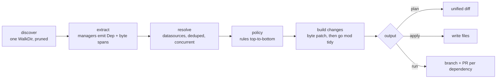

# deps design

`deps` is a dependency updater written in Go and intended to replace Renovate. This document holds the complete design. Milestone 1 (M1) covers GitHub/Gitea/Forgejo Actions `uses:` references, Go modules, and a PR bot for GitHub, Gitea and Forgejo.

## 1. Goals

- **One static Go binary.** GitHub, Gitea and Forgejo are first-class platforms and are detected automatically.
- **A small, strict config (`.deps.yaml`).** Unknown keys are errors. Rules are evaluated top-to-bottom; each later matching rule overrides only the fields it sets.
- **Files are never reformatted.** Managers extract byte spans and deps replaces only those bytes. The single exception is the output of `go mod tidy`.
- **Same behavior locally and in CI.** `deps plan`, `deps apply` and `deps run` behave identically on a laptop and as an Action.
- **Fast and memory-bounded.** Memory grows with the number of dependencies, not the size of the repo (see section 3).

## 2. Pipeline



## 3. Performance and memory design

M1 implements exactly the following:

- **Discovery.** A single `filepath.WalkDir`. It prunes `.git`, `node_modules`, `vendor`, `testdata` and `ignorePaths` directories via `fs.SkipDir`. Paths are matched before any file is opened, and only matched files are read.
- **Extraction.** Runs on `runtime.GOMAXPROCS(0)` workers. Each worker keeps only `[]Dep` (spans and strings); parse trees and file bytes are dropped immediately. Files are re-read when changes are built, so memory is O(deps), not O(repo).
- **HTTP.** One shared `http.Client` (HTTP/2, keep-alive) handles every network call.
- **Lookup dedupe.** Lookups are deduped within a run per key (one `sync.Once` per cache entry). A global semaphore caps concurrent requests at 16.
- **Actions tags.** Fetched with a native git smart-HTTP protocol v2 `ls-refs` call using `ref-prefix refs/tags/` and `peel`. No `git` process is spawned per action, only tag refs travel over the wire, and the pkt-line response is parsed as a stream.
- **Go versions.** Fetched from the GOPROXY `@v/list` endpoint over HTTP. `go list` is used only for GOPRIVATE/direct modules.
- **Child processes.** Spawned only where unavoidable: `go mod tidy` (at most 4 concurrently) and `git` for commit and push.
- **Commits.** Built with git plumbing on a temporary index. `run` does no checkout, creates no worktree, and never mutates the working tree.
- **No persistent cache.** Runs are infrequent (scheduled), so in-run dedupe already removes the repeated lookups.

## 4. Core types

```go
// internal/dep
type UpdateType string // "major" | "minor" | "patch" | "digest" | "pin"
const (Major UpdateType = "major"; Minor = "minor"; Patch = "patch"; Digest = "digest"; Pin = "pin")

type Span struct{ Start, End int } // byte offsets, End exclusive

type Dep struct {
    Manager       string // "github-actions" | "gomod"
    File          string // slash path relative to --dir
    Line          int    // 1-based
    Name          string // actions: owner/repo[/sub]; gomod: module path
    Source        string // actions: https://<host>/<owner>/<repo>; gomod: ""
    Version       string // current version (ref tag, comment version, or module version)
    Digest        string // actions: full SHA when pinned, else ""
    RefSpan       Span   // actions: ref after '@'; gomod: version token
    VersionSpan   Span   // actions: version token in trailing comment (pinned only)
    CommentInsert int    // actions: offset after the uses value incl. closing quote
    Skip          string // non-empty = not updatable, with the reason
}

type Update struct {
    Dep        Dep
    Type       UpdateType
    NewVersion string
    NewDigest  string // "" unless the result is digest-pinned
}
```

```go
// internal/engine
type TagSource interface{ Tags(ctx context.Context, repoURL string) ([]gittags.Tag, error) }
type GoSource  interface{ Versions(ctx context.Context, modPath, dir string) ([]string, error) }
type Tidier    interface{ Tidy(ctx context.Context, dir string, mod, sum []byte) ([]byte, []byte, error) }
type Sources   struct{ Tags TagSource; Go GoSource }

type Result     struct{ Updates []dep.Update; Skipped []dep.Dep; Errors []error }
type FileChange struct{ Path string; Mode fs.FileMode; Old, New []byte }
type Group      struct{ Manager, Name, Branch, Title string; Updates []dep.Update }

func Resolve(ctx context.Context, root string, cfg *config.Config, defaultHost string, src Sources) (*Result, error)
func Build(ctx context.Context, root string, updates []dep.Update, tidy Tidier) ([]FileChange, []error)
func GroupUpdates(updates []dep.Update) []Group
```

```go
// internal/datasource/gittags
type Tag struct{ Name, Commit string } // Commit is the peeled commit for annotated tags
```

```go
// internal/platform
type Kind string // "github" | "gitea" | "forgejo"
type Info struct{ Kind Kind; ServerURL, APIURL, Host, Repo string } // Repo = "owner/name"
type PR struct{ Number int; Title, Body, Head, State, URL string; Merged bool; Mergeable *bool }
type Client interface {
    DefaultBranch(ctx context.Context) (string, error)
    ListPRs(ctx context.Context, state string, maxPages int) ([]PR, error) // "open" | "closed"
    GetPR(ctx context.Context, number int) (PR, error)
    CreatePR(ctx context.Context, head, base, title, body string) (PR, error)
    UpdatePR(ctx context.Context, number int, title, body string) error
    ClosePR(ctx context.Context, number int) error
}
type Overrides struct{ Kind, APIURL, Repo string } // from flags; "" = auto
func FromEnv(getenv func(string) string) (Info, bool)
func Detect(ctx context.Context, getenv func(string) string, remoteURL string, o Overrides, c *http.Client) (Info, error)
func NewClient(info Info, token string, c *http.Client) Client
func DefaultActionsHost(info Info, getenv func(string) string) (host, source string)
```

```go
// internal/bot
type Git interface {
    RevParse(ctx context.Context, rev string) (string, error)
    RemoteURL(ctx context.Context) (string, error)
    LsRemote(ctx context.Context, pattern string) (map[string]string, error)
    Commit(ctx context.Context, parent string, changes []engine.FileChange, msg, name, email string) (string, error)
    Push(ctx context.Context, commit, branch, expected string) error
    DeleteBranch(ctx context.Context, branch string) error
    BranchAuthorEmail(ctx context.Context, branch string) (string, error)
}
type Options struct{ Base, AuthorName, AuthorEmail string; DryRun bool; MaxNewPRs int }
type Action  struct{ Branch, Title, Status, URL string; Number int }
func Run(ctx context.Context, o Options, root string, res *engine.Result, tidy engine.Tidier, pc platform.Client, g Git) ([]Action, []error)
```

### Versioning

- **Actions tags.** A tag must match `^(v?)(\d+)(?:\.(\d+))?(?:\.(\d+))?$`; suffixed and prerelease tags are never considered. Candidates must have the same prefix and the same number of parts as the current tag. This precision is what makes `@v4` move to `@v5` and `# v7.0.1` move to `# v7.0.2`.
- **Go modules.** Uses `golang.org/x/mod/semver`. Excluded candidates:
  - pseudo-versions;
  - prereleases, unless the current version is a prerelease;
  - `+incompatible` versions, unless the current version has it;
  - other majors, except the step from v0 to v1.

## 5. Platforms

### Detection order

1. **Environment** (no network):
   1. `FORGEJO_ACTIONS=true` → forgejo. Reads `FORGEJO_SERVER_URL`, `FORGEJO_API_URL` and `FORGEJO_REPOSITORY`, each falling back to the `GITHUB_*` name.
   2. `GITEA_ACTIONS=true` → gitea, from the `GITHUB_*` variables.
   3. `GITHUB_ACTIONS=true` → github, from the `GITHUB_*` variables (covers GHES).
2. **The `origin` remote URL.** Accepted forms: `https://host/owner/repo(.git)`, `git@host:owner/repo(.git)` and `ssh://git@host[:port]/owner/repo(.git)`.
   - Host `github.com` → github, API `https://api.github.com`.
   - Any other host is probed unauthenticated, with a 10s timeout each, in this order:
     1. `/api/forgejo/v1/version` returns 200 → forgejo.
     2. `/api/v1/version` returns 200 with JSON `version` → gitea. Both use API `https://host/api/v1`.
     3. `/api/v3/meta` returns 200 → GHES, API `https://host/api/v3`.
     4. Nothing matches → error `cannot detect platform for <host>; pass --platform and --api-url`.

     Instances that require sign-in for the whole API answer probes 1 and 2 with 401/403 and a JSON `message` body; that also counts as a match. Missing paths return 404, so other servers are not misdetected.
3. **Flags.** `--platform`, `--api-url` and `--repo` override the detected values. If only the kind is overridden, the API URL is derived with the per-kind rule above.

**Default host for `owner/repo@ref`**, first match wins:
1. `actions.defaultHost` in the config (source `config`).
2. `DEPS_DEFAULT_ACTIONS_URL` (source `env`).
3. Platform default (source `platform default`): forgejo → `data.forgejo.org`; github, gitea or unknown → `github.com`.

### Endpoints

**GitHub.** Headers: `Authorization: Bearer <t>`, `Accept: application/vnd.github+json`, `X-GitHub-Api-Version: 2022-11-28`.

| Method | Endpoint |
|---|---|
| DefaultBranch | `GET {api}/repos/{repo}` → `.default_branch` |
| ListPRs | `GET {api}/repos/{repo}/pulls?state=<s>&sort=updated&direction=desc&per_page=100&page=N` |
| GetPR | `GET .../pulls/{n}` (nullable `mergeable`) |
| CreatePR | `POST .../pulls {title,head,base,body}` |
| UpdatePR | `PATCH .../pulls/{n} {title,body}` |
| ClosePR | `PATCH .../pulls/{n} {state:"closed"}` |

On GitHub, `Merged` is `merged_at != null`.

**Gitea / Forgejo.** Header: `Authorization: token <t>`.

| Method | Endpoint |
|---|---|
| DefaultBranch | `GET {api}/repos/{repo}` |
| ListPRs | `GET {api}/repos/{repo}/pulls?state=<s>&sort=recentupdate&limit=50&page=N` |
| GetPR / CreatePR / UpdatePR / ClosePR | same paths and bodies as GitHub |

On Gitea and Forgejo, `Merged` is the `merged` field and `Mergeable` is the `mergeable` field.

Both clients share these rules:
- `Head` = `head.ref`; `URL` = `html_url`.
- Paging stops at a short page or at `maxPages`.
- Errors have the form `<METHOD> <path>: <status>: <first 200 bytes of body>`.

**Git (all platforms).**
- Tags are fetched from `<source>/info/refs?service=git-upload-pack`, then `POST <source>/git-upload-pack` (`ls-refs`). Servers that only speak protocol v0 are handled by parsing the advertisement and using the `^{}` peeled lines.
- Auth uses HTTP Basic with user `x-access-token`.

### Token sources

1. **Platform API:** `--token`, then the first non-empty of `DEPS_TOKEN`, `GITHUB_TOKEN`, `GITEA_TOKEN`, `FORGEJO_TOKEN`, then the password from `git credential fill` for the platform host.
   - If no token is found, `run` fails with `no token for <host>`.
   - With `--dry-run`, the API is used anonymously instead.
2. **Tag lookups:** the platform token is used for the platform host. `DEPS_GITHUB_COM_TOKEN` is used for github.com when the platform is not github.com.
   - On a 401 without static credentials, deps runs `git credential fill` once per host (`GIT_TERMINAL_PROMPT=0`, 10s timeout), caches the result (success or failure), and retries once.

### PR lifecycle (`deps run`)

1. **Base branch:** `--base`, or the repo's default branch.
2. **Freshness check:** local `HEAD` must equal the remote tip of `origin/<base>`. Otherwise deps fails with `checkout HEAD <h7> is not the tip of origin/<base> (<r7>); check out the latest <base>`.
3. **State:**
   - remote `refs/heads/deps/*`;
   - open PRs (up to 20 pages) and closed PRs (up to 4 pages);
   - both PR lists are filtered to head branches starting with `deps/`.
4. **Grouping:** one group per (manager, name).
   - Branch: `deps/<manager>/<slug(name)>`.
   - Title, first match wins:
     - every update is a pin with the same digest: `chore(deps): pin <name> to <sha7>`;
     - every update is a digest refresh with the same digest: `chore(deps): update <name> digest to <sha7>`;
     - every update shares one new version: `chore(deps): update <name> to <ver>`;
     - otherwise: `chore(deps): update <name>`.
   - Changes are built for at most 4 groups concurrently, then the groups are handled one after another.
5. **Fingerprint:** the first 16 hex characters of sha256 over the sorted `path\x00newcontent` pairs.
   - The PR body is a `| File | From | To | Type |` table followed by `<!-- deps:fingerprint=<fp> -->`.
   - The commit message is the title, a blank line, then one line per update: `- <file>:<line> <from> -> <to>`.
6. **Per-group decision**, first match wins:
   1. No open PR exists, and a closed PR has the same branch, was not merged and has the same title → `skipped: closed PR for this version`.
   2. The open PR's fingerprint matches and it is not unmergeable → `up-to-date`. On GitHub, a nil `mergeable` triggers a `GetPR` call; nil still counts as mergeable.
   3. No open PR exists and the created count is at least `--max-new-prs` → `skipped: new PR limit reached`.
   4. The branch exists and the author email of its last commit is not the bot's → `skipped: branch modified by someone else`.
   5. `--dry-run` → `would-create` or `would-update`, with no git or API writes.
   6. Otherwise: commit on a temporary index, then `push --force-with-lease` against the expected sha (empty means the branch must not exist yet). Then update the PR (`updated`) or create one (`created`).

   A build, git or API error in one group is recorded, and the next group is processed.
7. **Cleanup:** runs only when the whole run (engine and bot) produced zero errors and is not a dry run. Every open `deps/` PR whose branch matches no current group is closed and its branch deleted (`closed`). This guard ensures that a failed upstream lookup never closes a valid PR.

## 6. Running in CI

### Composite action (`action.yml`)

The action builds the binary from the action's own checkout, so no release artifacts are needed.

```yaml
name: deps
description: Update dependencies and open one pull request per dependency
inputs:
  token: {description: "Token with contents:write and pull-requests:write", default: "${{ github.token }}"}
  args: {description: "Arguments for deps", default: "run"}
runs:
  using: composite
  steps:
    - shell: bash
      working-directory: ${{ github.action_path }}
      run: go build -trimpath -o "$RUNNER_TEMP/deps" ./cmd/deps
    - shell: bash
      env:
        DEPS_TOKEN: ${{ inputs.token }}
        DEPS_DEFAULT_ACTIONS_URL: ${{ github.gitea_default_actions_url }}
      run: '"$RUNNER_TEMP/deps" ${{ inputs.args }}'
```

### Gitea / Forgejo workflow

```yaml
# .gitea/workflows/deps.yml (or .forgejo/workflows/deps.yml)
on:
  schedule: [{cron: "0 5 * * *"}]
  workflow_dispatch:
permissions: {contents: write, pull-requests: write}
jobs:
  deps:
    runs-on: ubuntu-latest
    steps:
      - uses: actions/checkout@v6
      - uses: jakobmoellerdev/deps@main   # or ./ inside this repo
```

If the job token cannot push or open PRs, or cannot read private action repos, store a PAT as a secret. Pass it to both `actions/checkout` (`token:`) and the action (`token:`).

### GitHub workflow

GitHub workflows cannot `uses:` an action hosted on Gitea, so the binary is run with `go run`:

```yaml
on:
  schedule: [{cron: "0 5 * * *"}]
  workflow_dispatch:
permissions: {contents: write, pull-requests: write}
jobs:
  deps:
    runs-on: ubuntu-latest
    steps:
      - uses: actions/checkout@v6
        with:
          token: ${{ secrets.DEPS_TOKEN }}
      - uses: actions/setup-go@v6
        with: {go-version: stable}
      - run: go run git.jakob-moeller.cloud/jakobmoellerdev/deps/cmd/deps@main run
        env:
          DEPS_TOKEN: ${{ secrets.DEPS_TOKEN }}
```

**Caveat:** PRs created with `GITHUB_TOKEN` do not trigger workflows (`pull_request`, `push`), so CI never runs on them. Use a PAT or a GitHub App token. Pass it via the `token` input (or `DEPS_TOKEN`), and also to `actions/checkout` `token:` so the pushed branches trigger CI.

## 7. Roadmap

- **M2 `docker`:**
  - Dockerfile `FROM`, compose `image:`, workflow `container:`/`services:`/`docker://`, and `runs.image`.
  - Uses go-containerregistry and distribution/reference.
  - Tag versioning matches on prefix, part count and suffix.
  - Pins `@sha256:` digests.
- **M3 `custom`:**
  - `# deps: <datasource> <name>` annotations, which update the first version token on the next line.
  - RE2 regex managers with named groups `name`, `version` and `digest`.
- **M4:**
  - per-rule `group`, `schedule` (cron) and `automerge`;
  - OSV security updates that bypass `allow` and the schedule;
  - `actions.lock` via `github.com/github/actions-lockfile/go`;
  - `go`/`toolchain` directive updates;
  - indirect Go dependencies;
  - `deps explain <name>` and `deps schema` (invopop/jsonschema);
  - a dependency dashboard issue.

## 8. Config reference

Config file: `.deps.yaml`, falling back to `.deps.yml`, or the path given with `--config` (which must exist). If no file is found, the defaults `{version: 1, pin: keep}` apply, and an empty file also yields the defaults.

### M1 schema

```yaml
version: 1                  # optional; must be 1 if set
pin: keep                   # keep | digest (default keep); github-actions only
actions:
  defaultHost: ""           # host for `owner/repo@ref`; "" = auto (section 5)
ignorePaths: []             # doublestar globs on slash paths relative to --dir
rules:
  - manager: github-actions # optional: github-actions | gomod
    names: ["actions/*"]    # optional path.Match globs on the dependency name
    ignore: true            # optional
    pin: digest             # optional: keep | digest
    allow: "< 7"            # optional Masterminds semver constraint
    updates: [major, minor, patch, digest, pin]   # optional allowed update types
```

**Semantics:**
- The file is decoded strictly: unknown keys are errors and report their line. All validation errors are reported together, each as `<path>: <field>: <msg>`.
- **Rule evaluation:** the policy starts as `{pin: <top-level pin>, updates: all five}`. Each rule matches when its `manager` is empty or equal, and its `names` are empty or any glob matches. Rules are applied in file order. Every field a matching rule sets overwrites the policy; `updates` is replaced, not merged.
- **Acceptance:** an update is accepted when its type is in `updates` and the new version satisfies `allow` (if set).
- **`pin: digest`:** pins tag refs to the tag's commit SHA and appends `# <tag>`. Already-pinned refs stay pinned and are refreshed. The `pin` setting is ignored for gomod.

### Planned keys (not accepted in M1)

| Key | Milestone |
|---|---|
| `rules[].group` | M4 |
| `rules[].automerge` | M4 |
| `rules[].paths` | M4 |
| `schedule` | M4 |
| `custom[]` | M3 |

## 9. Why Go

- **Ecosystem.**
  - `golang.org/x/mod` gives exact Go module semantics: modfile parsing, semver, pseudo-versions and path escaping.
  - go-containerregistry and distribution/reference cover Docker (M2).
  - The Gitea SDK lineage exists, and `actions-lockfile` (M4) is a Go module.
  - Forges are mostly written in Go, so their behavior is easy to reference.
- **I/O-bound work.** The job is mostly HTTP and git. Goroutines, one shared HTTP/2 client and a semaphore cover it without a runtime, an interpreter or node_modules. The result is one static binary that starts instantly and has a small memory footprint.
